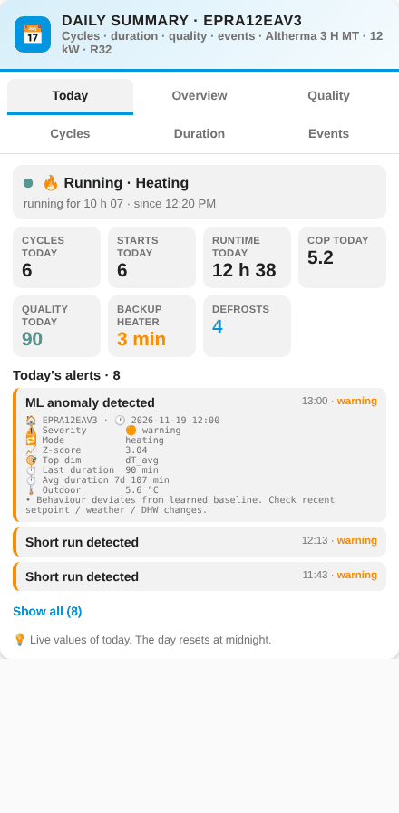
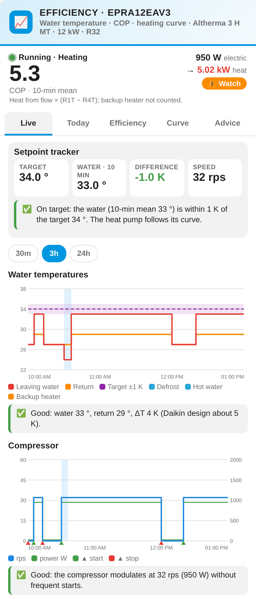
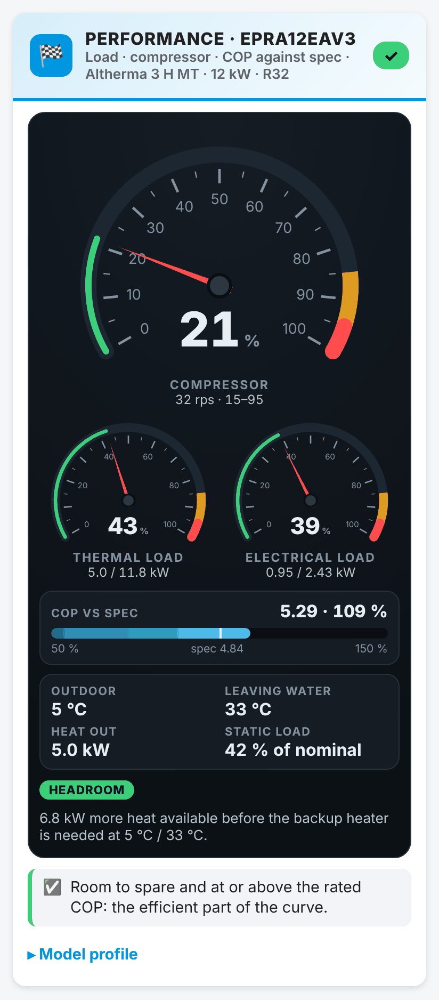
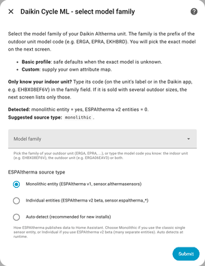
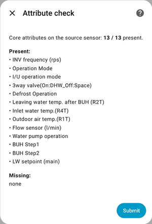
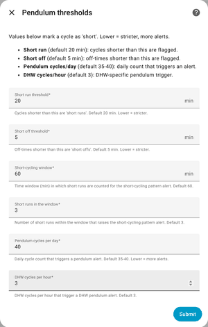

# Daikin Cycle ML

  

Home Assistant integration that turns your ESPAltherma sensor into a **complete heat pump intelligence platform** — cycle detection, per-mode COP, seasonal SPF, weather-normalized degradation, runtime + energy accounting, installer-grade curve advice, and 19 ML-powered alerts.

> **Data source:** [ESPAltherma](https://github.com/raomin/ESPAltherma) by [@raomin](https://github.com/raomin) - reads your Daikin Altherma X10A port via ESP32 and exposes the attributes this integration consumes.

**Local-only. No cloud. No accounts.** Everything runs inside your Home Assistant box.

**Setup guide:**

---

## Contents

- [Native cards](#native-cards)
- [What it does](#what-it-does)
- [Installation](#installation)
- [Setup](#setup)
- [Supported heat pumps](#supported-heat-pumps)
- [Documentation](#documentation)
- [Quality](#quality)
- [Support](#support)
- [Contributing](#contributing)
- [License](#license)

---

## Native cards

Three cards served by the integration itself: nothing to install, nothing
to paste, updated with every release. **Add card → search *Daikin***.
English, Dutch and French, light and dark theme, one heat pump per card
when you have several.

| Daily summary | Efficiency | Performance |
|---|---|---|
|  |  |  |
| Today's run, cycles, quality, COP, backup heater, defrosts and alerts; 7 / 15 / 30-day tabs; tap a day for details | Live COP and water temperatures, COP per hour and against the datasheet, SPF, heating curve and advice: every graph says good / watch / act | Your heat pump against its datasheet limits (compressor, heat output), with your own model profile |

Tap a card for its manual. At the bottom of each card: **Download** / **Copy** the diagnostics for a bug report.

**YAML cards** (button-card based) are still available for custom
dashboards: Daily Summary Tabbed, COP & Energy, Pattern Analysis, LWT
Fine-Tuning, Heating Curve and more. See the
[card overview](https://github.com/elRadix/daikin_cycle_ml/blob/main/dashboard/README.md);
re-paste them after an update.

---

## What it does

- **Cycle detection and quality.** Every compressor run from start to
  stop, per mode (heating, hot water, cooling), scored 0-100 on run length,
  ΔT, pause, backup heater and defrost. Short runs, short pauses and
  pendulum patterns raise alerts with what to change.
  [Entities](https://github.com/elRadix/daikin_cycle_ml/blob/main/docs/ENTITIES.md)
- **Real COP.** Per mode for day, week and month; SPF for the season and
  year; rolling 365-day SCOP; weather-normalised degradation. Works with a
  power meter, ESPAltherma 2.0's own estimate, or an estimate from the
  inverter current.
- **Against the datasheet.** 59 bundled Daikin datasheets: your COP is
  compared with the datasheet at the same outdoor and water temperature.
  Add your own values per model.
  [Model compatibility](https://github.com/elRadix/daikin_cycle_ml/blob/main/docs/MODEL_COMPATIBILITY.md)
- **Heating-curve advice.** Lower or raise the leaving water temperature,
  by 1-3 °C, learned from your own COP per outdoor band and guarded by
  your room temperature.
- **19 alerts.** Pendulum, short runs, backup heater and defrost use,
  COP drops, ML anomalies, data problems. Per-alert switches, quiet hours,
  any notify entity, English / Dutch / French.
  [Alerts](https://github.com/elRadix/daikin_cycle_ml/blob/main/docs/ALERTS.md)
- **Learns your installation.** A behaviour baseline per mode and outdoor
  band, adaptive thresholds and weekly clustering, all local.
  [Machine learning](https://github.com/elRadix/daikin_cycle_ml/blob/main/docs/ML.md)
- **Runtime and energy.** Compressor and backup-heater runtime, defrosts,
  electrical and thermal kWh per mode for the Energy dashboard; kept across
  restarts.

It only reads: no setpoint writes, no cloud, no telemetry.

---

## Installation

**HACS (recommended):** HACS → Integrations → search **Daikin Cycle ML** →
Download → restart Home Assistant. Not found? Add
`https://github.com/elRadix/daikin_cycle_ml` as a custom repository
(category *Integration*) first.

**Manual:** copy `custom_components/daikin_cycle_ml/` to
`/config/custom_components/` and restart Home Assistant.

**Upgrading:** see the [CHANGELOG](https://github.com/elRadix/daikin_cycle_ml/blob/main/CHANGELOG.md)
and the [upgrade guide](https://github.com/elRadix/daikin_cycle_ml/blob/main/docs/UPGRADE.md).

---

## Setup

**Settings → Devices & services → Add integration → Daikin Cycle ML.**
Type any model code you know (indoor unit, outdoor unit, or family and
size); the wizard finds the datasheet, checks your ESPAltherma values and
suggests sensible defaults.

| Model family | Attribute check | Thresholds |
|---|---|---|
|  |  |  |

**[📖 Getting started](https://github.com/elRadix/daikin_cycle_ml/blob/main/docs/GETTING_STARTED.md)**:
the ESPAltherma values to enable, every wizard screen, and what to check in
the first hour, day and week. Also in
[🇳🇱 Nederlands](https://github.com/elRadix/daikin_cycle_ml/blob/main/docs/setup/nl.md) and
[🇫🇷 Français](https://github.com/elRadix/daikin_cycle_ml/blob/main/docs/setup/fr.md).

---

## Supported heat pumps

Any Daikin Altherma that ESPAltherma reads, with **ESPAltherma v1** (one
sensor with attributes) or **v2** (separate entities). Datasheets are
bundled for the Altherma 3 R / H / M families (ERGA, EPRA, ERLA, EPGA,
EBLA, EDLA, EBLQ, EDLQ), Altherma 4 (EPSK), Altherma HT (EKHBRD / ERRQ)
and the Altherma R Hybrid (EVLQ); other models run on the basic profile
or your own values. Hybrid and bivalent systems keep boiler time out of the
heat-pump COP.

Per-model details:
[Model compatibility](https://github.com/elRadix/daikin_cycle_ml/blob/main/docs/MODEL_COMPATIBILITY.md)
· [Getting started §1](https://github.com/elRadix/daikin_cycle_ml/blob/main/docs/GETTING_STARTED.md#1-before-you-start)
· [§7 hybrid and bivalent](https://github.com/elRadix/daikin_cycle_ml/blob/main/docs/GETTING_STARTED.md#7-hybrid-and-bivalent-systems).

---

## Documentation

Start at the [documentation index](https://github.com/elRadix/daikin_cycle_ml/blob/main/docs/README.md).

| Page | For |
|---|---|
| [Getting started](https://github.com/elRadix/daikin_cycle_ml/blob/main/docs/GETTING_STARTED.md) | Requirements, setup wizard with screenshots, first hour / day / week |
| [FAQ](https://github.com/elRadix/daikin_cycle_ml/blob/main/docs/FAQ.md) | Common questions and known limitations |
| [Recipes](https://github.com/elRadix/daikin_cycle_ml/blob/main/docs/RECIPES.md) | Automations: advice to your phone, cycle log, daily summary, energy dashboard |
| [Configuration](https://github.com/elRadix/daikin_cycle_ml/blob/main/docs/CONFIGURATION.md) | Every wizard screen and option, reconfigure, bivalent / hybrid, cookbook |
| [Entities](https://github.com/elRadix/daikin_cycle_ml/blob/main/docs/ENTITIES.md) | Sensors, binary sensors, services, repairs |
| [Alerts](https://github.com/elRadix/daikin_cycle_ml/blob/main/docs/ALERTS.md) | Every alert, delivery, quiet hours, templates |
| [Machine learning](https://github.com/elRadix/daikin_cycle_ml/blob/main/docs/ML.md) | Quality score, baseline, adaptive thresholds, clustering |
| [Troubleshooting](https://github.com/elRadix/daikin_cycle_ml/blob/main/docs/TROUBLESHOOTING.md) | No cycles, wrong COP, empty cards, logs |
| [Diagnostics](https://github.com/elRadix/daikin_cycle_ml/blob/main/docs/DIAGNOSTICS.md) | What the diagnostics file contains and how it is anonymised |
| [Database](https://github.com/elRadix/daikin_cycle_ml/blob/main/docs/DATABASE.md) | Tables, retention, migrations, backup |
| [Development](https://github.com/elRadix/daikin_cycle_ml/blob/main/docs/DEVELOPMENT.md) | Dev setup, tests, CI, release procedure |

---

## Quality

100 % test coverage, mypy strict, Pylint 10/10 and ruff on every pull
request; the tests replay real diagnostics files from users' installations
and render every native card in English, Dutch and French. Integration
Quality Scale: **Platinum** (self-declared, checked by tests). Details in
[Development](https://github.com/elRadix/daikin_cycle_ml/blob/main/docs/DEVELOPMENT.md).

---

## Support

- **Questions and bugs:** [issues](https://github.com/elRadix/daikin_cycle_ml/issues)
  and [discussions](https://github.com/elRadix/daikin_cycle_ml/discussions);
  the Tweakers ESPAltherma topic (Dutch / English).
- **Before opening an issue:** read [Troubleshooting](https://github.com/elRadix/daikin_cycle_ml/blob/main/docs/TROUBLESHOOTING.md)
  and attach the diagnostics: **Download** or **Copy** at the bottom of any
  native card ([what is in it](https://github.com/elRadix/daikin_cycle_ml/blob/main/docs/DIAGNOSTICS.md)).

Daikin Cycle ML is free and open-source, built in my own time. If it helped
you, a coffee is appreciated:

---

## Contributing

Pull requests are welcome. [Development](https://github.com/elRadix/daikin_cycle_ml/blob/main/docs/DEVELOPMENT.md)
covers the dev setup (`scripts/bootstrap.sh`), the local checks
(`scripts/ci-fast.sh`, `scripts/ci-local.sh`) and the rules: 100 %
coverage, docs updated with every user-facing change, and a reference to
the issue in the pull request.

---

## License

MIT, see [LICENSE](https://github.com/elRadix/daikin_cycle_ml/blob/main/LICENSE).

## Acknowledgements

- **ESPAltherma** and [@raomin](https://github.com/raomin): the data source
  that makes this possible.
- **Daikin Altherma users** on Tweakers, GitHub and the Home Assistant
  forum, whose reports and diagnostics shaped every release.
- **Home Assistant**: the platform.
