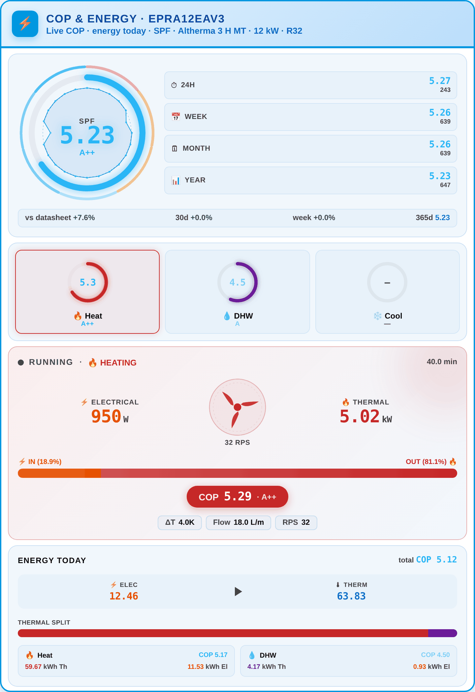

# Dashboard Cards — Daikin Cycle ML

Ready-to-use Lovelace dashboard cards for the **Daikin Cycle ML** integration.

## ⭐ Featured Card

| Card | Description | Preview | Requires |
|---|---|---|---|
| [**Daily Summary Tabbed**](cards/daily-summary-tabbed/README.md) | **5-tab variant** — Overview, Quality, Cycles, Duration, Events. Adaptive charts, popup details, EN/NL entity auto-detect, persistent tab state |  | v1.12.0+ |
| [**LWT Fine-Tuning**](cards/lwt-fine-tuning/README.md) | **4-tab heating-curve advisor** — Advice, Buckets (optimal LWT curve with auto-zoom), Analysis (slope/tracking/step), Live (animated LWT marker). EN/NL auto-detect, popup drilldown, optimal-zone band, state-aware waiting messages |  | v1.22.6+ |

## Other cards

| Card | Description | Preview | Requires |
|---|---|---|---|
| [**Simple Card**](cards/simple-card/README.md) | Live phase, hydraulic diagram, COP, quality, alerts, stooklijn advice |  | v1.4.0+ |
| [**Heating Curve**](cards/heating-curve/README.md) | HP spec-aware visual with COP heatmap, regression & live position |  | v1.4.0+ |
| [**Daily Summary**](cards/daily-summary/README.md) | 8-day cycle history: sparklines, dynamic quality line chart, stacked cycles / duration bars, BUH + defrost events |  | v1.7.1+ |
| [**COP & Energie**](cards/cop-energy/README.md) | Radial SPF hero gauge, per-mode COP dials, animated RPS fan, energy cascade. Light/dark themes, EN/NL auto-detect |  | v1.19.0+ |
| [**Pattern Analysis**](cards/pattern-analysis/README.md) | **3-tab analytic view** — Distribution, Scatter, COP. Interactive popups, dual-axis trends, dark-mode, EN/NL entity auto-detect |  | v1.21.0+ |

---

## Requirements

### Backend (integration)

- **daikin_cycle_ml** `>= v1.4.0`

> **Entity ids below are the English defaults.** On a Dutch or French
> install HA creates translated ids (e.g. `sensor.daikin_cycle_ml_cyclus_status`,
> `sensor.daikin_cycle_ml_etat_du_cycle`). All cards resolve these
> automatically via the entity registry `translation_key`, so they also keep
> working after you rename entity ids (#347, #369).

**Core entities** (used by both cards):

- `sensor.daikin_cycle_ml_heating_curve_advice`
- `sensor.daikin_cycle_ml_cycle_state`
- `sensor.daikin_cycle_ml_last_cycle`
- `sensor.daikin_cycle_ml_cop_mean_day`
- `sensor.daikin_cycle_ml_cop_mean_week`

**Simple Card only** (additional):

- `sensor.daikin_cycle_ml_current_cycle`
- `sensor.daikin_cycle_ml_cycles_today`
- `sensor.daikin_cycle_ml_quality_today`
- `sensor.daikin_cycle_ml_cop_today`
- `sensor.daikin_cycle_ml_source_health`
- `sensor.daikin_cycle_ml_learned_thresholds`
- `sensor.daikin_cycle_ml_thermal_power_live` (optional, kW callout)
- 15 binary_sensors (see Simple Card README for the full list)

**Daily Summary only** (additional):

- `sensor.daikin_cycle_ml_daily_summary_recent` (state = total cycles; attrs `days[]`, `totals_by_mode`, `days_available`, `days_count`, `latest_day`, `oldest_day`)
- `sensor.daikin_cycle_ml_hp_specs` (attrs `model`, `family`, `kw` for the hero)

**Attributes on `sensor.daikin_cycle_ml_cycle_state`:**

- `configured_language` — auto-detected language (`nl` / `en`)
- `configured_model` — HP model key (e.g. `epra12eav3`)
- `configured_source_sensor`, `configured_power_sensor`, `configured_cop_sensor`, `configured_indoor_sensor`

**Attributes on `sensor.daikin_cycle_ml_heating_curve_advice`:**

- `huidige_lwt`, `optimale_lwt`, `besparing_cop_pct`
- `bucket`, `samples`, `buckets` (dict: `{ "<outdoor-bucket>": { cop, n, lwt }, ... }`)
- `reason`, `comfort_impact`, `betrouwbaarheid`

### Frontend (HACS cards)

| Card | Repo | Purpose |
|---|---|---|
| `stack-in-card` | [custom-cards/stack-in-card](https://github.com/custom-cards/stack-in-card) | Wrapper |
| `button-card` | [custom-cards/button-card](https://github.com/custom-cards/button-card) | SVG content |
| `card-mod` | [thomasloven/lovelace-card-mod](https://github.com/thomasloven/lovelace-card-mod) | Border + shadow styling |

Install each via **HACS → Frontend → Explore & Download Repositories**.
Restart Home Assistant after installing a new frontend card.

---

## Installation

1. Install the three HACS frontend cards (see above).
2. Restart Home Assistant.
3. Hard-refresh the browser (`Ctrl+Shift+R`).
4. Open **Lovelace → Edit dashboard → + Add Card → Manual**.
5. Open the card's own README (via the **Available Cards** table) and copy
   the entire YAML from its `*.yaml` file.
6. Paste the YAML into the manual card editor.
7. **Save.**

Cards auto-detect your HP model, integration language, and configuration — no
manual entity-ID edits required if your integration uses the default
`daikin_cycle_ml` prefix.

---

## Features

### 🎨 Visual

- **COP heatmap** — 2D Carnot-based grid behind the plot (red → yellow → green)
- **HP spec-aware axes** — Y-axis auto-scales to your heat pump's LWT range
- **Auto-zoom** — X-axis focuses on bucket spread when data is available
- **Live point** — Blinking last-cycle outdoor × current LWT position
- **Bucket points** — One point per outdoor bucket · Color = COP quality · details in the tooltip
- **Regression curve** — Linear fit through buckets with formula label
- **Zone overlays** — Defrost (hachure), warm tint, heating OFF, BUH assist band
- **Hydraulic loop** *(Simple Card)* — Animated supply/return, live rps fan, ΔT bubble

### ⚙️ Auto-discovery

- Reads `configured_model` to select HP specs from a lookup table (14 models: EPRA / ERLA, 04–16 kW)
- Reads `configured_*` sensors for the config footer
- Graceful fallbacks when attributes are missing

### 🌐 Header, language and theme (all cards)

- Same header on every card: title + heat pump model, family, power, refrigerant
- English, Dutch and French: `lang_override`, else the HA UI language, else the integration language
- Dark mode: `theme_override: auto` follows the HA dark mode (`light` / `dark` force it)
- One `variables:` block in the card header — see [shared card settings](cards/README.md)

### 📐 Info panels

- **Specs box** — model, family, kW, refrigerant, LWT/outdoor ranges, thresholds, regression formula, samples, buckets
- **Config footer** — auto-discovered sensors (source, power, COP, indoor)
- **Regression + samples counter**
- **COP trend** — 24h vs 7d rolling comparison

---

## Data & limitations

### HP specs are indicative

`HP_SPECS` values (kW, nominal COP, LWT ranges, refrigerant) are **indicative**
and derived from public Altherma 3 datasheets. Verify against your own unit
before relying on the thresholds for control decisions.

### `buckets` structure

The Heating Curve card reads `buckets` from
`sensor.daikin_cycle_ml_heating_curve_advice`. Keys follow
`bucket_for_outdoor()` in the integration:

- `-10-` — outdoor < -10 °C
- `-10--8`, `-8--6`, `-2-0`, `0-2`, `2-4`, ..., `18-20` — 2 °C buckets
- `20+` — outdoor >= 20 °C
- `unknown` — dropped

Each bucket value is `{ cop: float, n: int, lwt: float|None }`.

### Live dot uses last completed cycle

`_attrs_current_cycle` does not expose `outdoor_temp` in v1.4.x — the live dot
therefore reads `outdoor_temp` from `sensor.daikin_cycle_ml_last_cycle`.

### During DHW

While DHW (or the backup heater) runs, the heating-curve advice is
suppressed (`suppressed_by`), but the measured buckets and LWT values stay,
so the Heating Curve and LWT cards keep rendering their data.

---

## Customization

### Language, theme and hints

All cards use the same variables in their header (`lang_override`,
`theme_override`, `show_help`) — see [shared card settings](cards/README.md).

### Entity IDs

If your integration entities don't match the default prefix
(`sensor.daikin_cycle_ml_*` / `binary_sensor.daikin_cycle_ml_*`), update the
`var S = { ... }` / `var B = { ... }` objects near the top of each card's JS
block.

---

## Troubleshooting

| Symptom | Fix |
|---|---|
| Card renders as plain YAML text | HACS frontend cards not installed. See **Requirements**. |
| `Custom element doesn't exist: stack-in-card` | Frontend card not loaded — restart HA, hard-refresh browser. |
| Body shows empty / blank | Check the browser console for JS errors. Verify entity IDs match. |
| `ButtonCardJSTemplateError` | A helper function referenced by the card is missing — ensure the YAML matches the current version from this repo. |
| COP shows `—` | No COP sample collected yet — check `sensor.daikin_cycle_ml_cop_today` in **Developer Tools → States**. |
| Language not switching | Verify both override variables are set to the same value. Values are case-sensitive lowercase `'nl'` / `'en'`. |
| Header in NL, body in EN (or vice versa) | Override variables are out of sync. Set both to identical values. |
| Colours look washed out | Some browsers block CSS gradients in `card_mod` under strict mode. Remove the outer `card_mod.style` block if needed. |
| Preview image missing | Take a fresh screenshot of the card (~800×600) and save it as `preview.png` in the card's folder. |

---

## Adding a new card

1. Create a new folder under `cards/<your-card-name>/`.
2. Add `<your-card-name>.yaml` — the full Lovelace YAML.
3. Add `README.md` — purpose, dependencies, install steps, entity list.
4. Add `preview.png` — a screenshot of the rendered card (~800×600).
5. Add a row to the **Available Cards** table at the top of this file.
