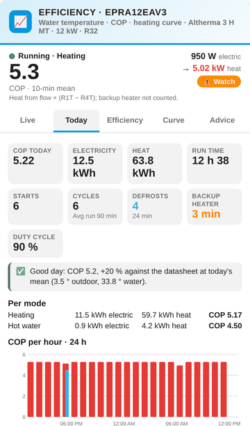
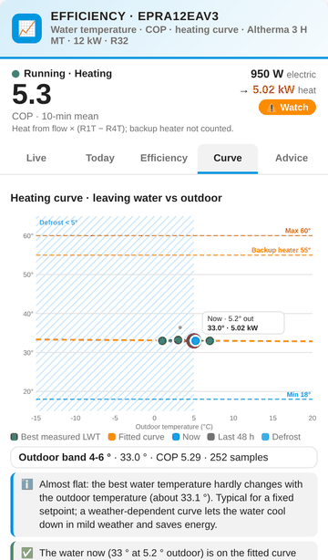
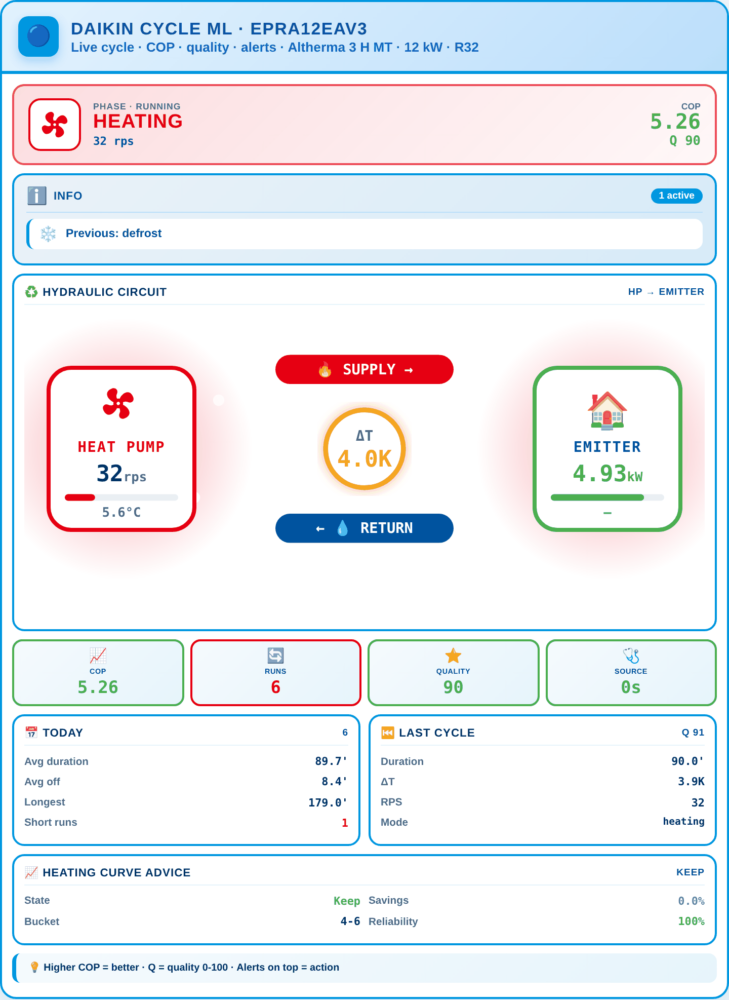
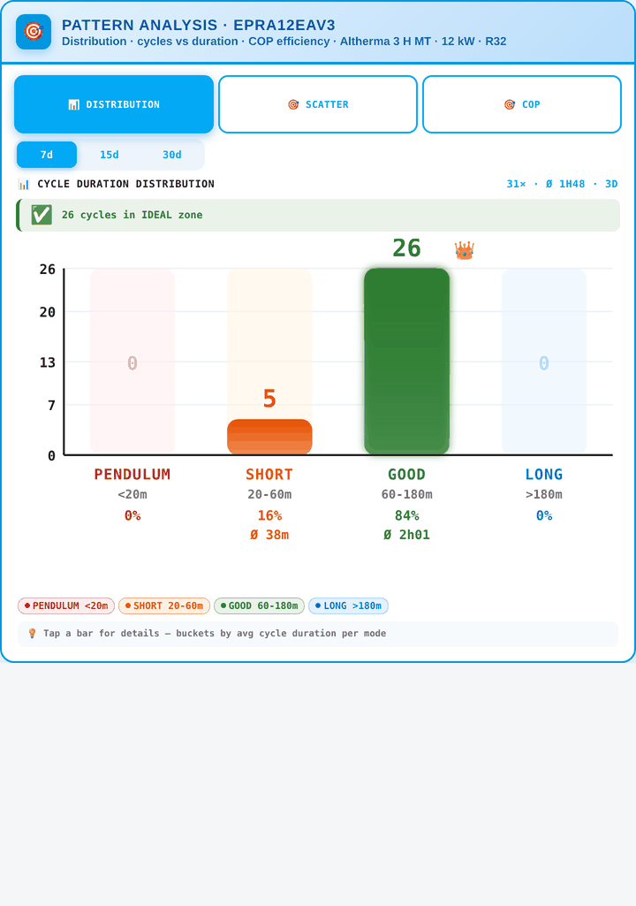
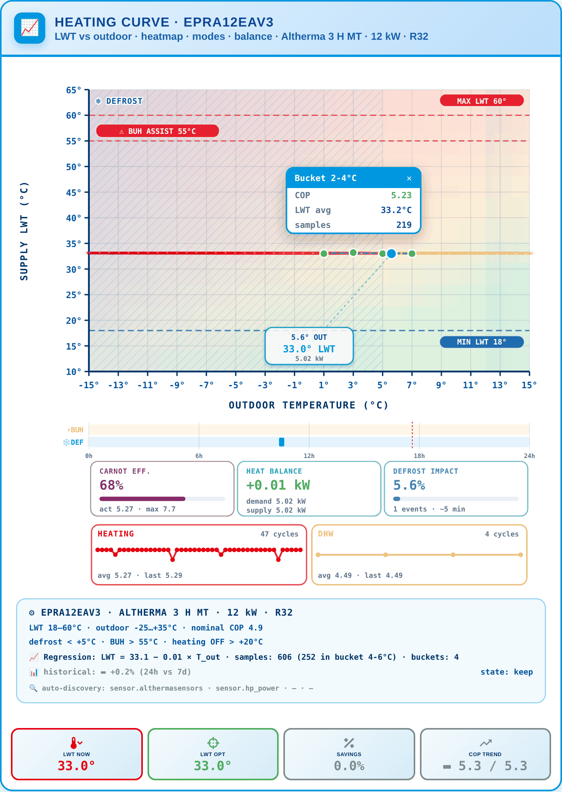
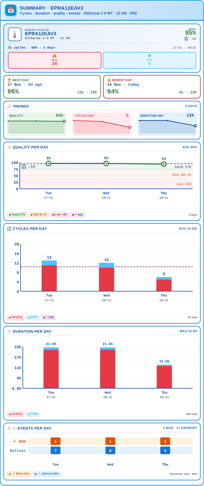

# Dashboard cards — Daikin Cycle ML

Two kinds of cards for the **Daikin Cycle ML** integration:

- **Native cards (recommended).** The integration serves them itself:
  nothing to install, nothing to paste, and they update with every
  release. Add them from the card picker.
- **YAML cards.** Lovelace YAML you paste into a manual card. They need
  three HACS frontend cards and have to be re-pasted after an update.

**[Native cards](#native-cards)** · **[Add a native card](#add-a-native-card)** · **[Which card replaces which](#which-card-replaces-which)** · **[YAML cards](#yaml-cards)** · **[Troubleshooting](#troubleshooting)** · **[Adding a card](#adding-a-card)**

---

## Native cards

Both native cards:

- have a **visual editor** and appear in the **card picker**;
- speak **English, Dutch and French** (Home Assistant language, or forced);
- follow the Home Assistant theme, **dark mode** included;
- find their entities by themselves, in any language and after renames;
- work with **several heat pumps** (`device_id`);
- need **no HACS frontend cards** (no button-card, stack-in-card, card-mod).

### 🏁 Performance — load against your model's limits

`type: custom:daikin-performance-card` · **[📖 Documentation](cards/daikin-performance-card/README.md)**

Capacity used, compressor speed and electrical power against what your
model can deliver at today's outdoor and water temperature, COP against
the Daikin rating point, and the heat still in reserve. Daikin's
datasheet capacities count as a minimum, never as the maximum; fill in or
adjust the limits in the **model profile** on the card; the whole
integration uses them.

### ⭐ Efficiency — a verdict on every graph

`type: custom:daikin-efficiency-card` · **[📖 Documentation](cards/daikin-efficiency-card/README.md)**

| Today | Efficiency | Curve | Advice | Dark |
|---|---|---|---|---|
|  |  |  |  |  |

LWT fine-tuning, COP & energy and the heating curve in one card.

- **Hero** — COP (10-min mean), electrical power → heat, overall status
- **Live** — setpoint tracker; graphs of water temperatures, compressor
  (start / stop markers), flow and ΔT, comfort; 30 min / 3 h / 24 h
- **Today · Efficiency** — COP per hour, per period and mode, against
  the datasheet; SPF against SCOP; COP drop at the same weather
- **Curve** — the measured heating curve with the limits of your model,
  Carnot efficiency, heat balance, defrost, specifications
- **Advice** — the heating-curve advice in plain words, with the comfort
  guard
- **Every graph says good / watch / act**, judged within the datasheet
  limits of your model; a help section explains why

### ⭐ Daily summary — today, quality, cycles, events

`type: custom:daikin-daily-summary-card` · **[📖 Documentation](cards/daikin-daily-summary-card/README.md)**

- **Today** — the run going on now, today's numbers and **today's alerts**
- **Overview · Quality · Cycles · Duration · Events** — 7 / 15 / 30 days,
  charts per mode, best and worst day; tap a day for its details

### Add a native card

1. Update Daikin Cycle ML (HACS) and restart Home Assistant.
2. Refresh the browser once (`Ctrl`+`Shift`+`R`; in the app: pull down).
3. **Edit dashboard → + Add card**, search **Daikin Cycle ML**.
4. Pick **Efficiency** or **Daily summary**, set the options in the
   visual editor (all optional) and **Save**.

Or in YAML (**+ Add card → Manual**):

    type: custom:daikin-efficiency-card

    type: custom:daikin-daily-summary-card

The options of each card are in its documentation.

---

## Which card replaces which

The native cards cover most YAML cards. The YAML cards stay available.

| Native card | Covers (YAML) | Still only in the YAML card |
|---|---|---|
| Efficiency | [LWT fine-tuning](cards/lwt-fine-tuning/README.md), [COP & energy](cards/cop-energy/README.md), [Heating curve](cards/heating-curve/README.md) | Slope / offset analysis (LWT fine-tuning), COP heatmap behind the curve, animated power flow |
| Daily summary | [Daily summary (tabbed)](cards/daily-summary-tabbed/README.md), [Summary](cards/daily-summary/README.md) | — |
| — | — | [Simple card](cards/simple-card/README.md) (hydraulic diagram), [Pattern analysis](cards/pattern-analysis/README.md) |

---

## YAML cards

| Card | Shows | Preview |
|---|---|---|
| [Simple card](cards/simple-card/README.md) | Live phase, hydraulic diagram, COP, quality, alerts, heating-curve advice |  |
| [Pattern analysis](cards/pattern-analysis/README.md) | Cycle duration distribution, cycles vs duration, COP |  |
| [LWT fine-tuning](cards/lwt-fine-tuning/README.md) | Heating-curve advice, buckets, slope / offset analysis, live LWT |  |
| [COP & energy](cards/cop-energy/README.md) | SPF gauge, COP per period and mode, live power flow, energy today |  |
| [Heating curve](cards/heating-curve/README.md) | LWT vs outdoor with COP heatmap, regression, live point |  |
| [Daily summary (tabbed)](cards/daily-summary-tabbed/README.md) | Per-day data in five tabs, 7 / 15 / 30 days, pop-ups |  |
| [Summary](cards/daily-summary/README.md) | One-page multi-day summary |  |

### Install a YAML card

1. **HACS → Frontend**: install
   [stack-in-card](https://github.com/custom-cards/stack-in-card),
   [button-card](https://github.com/custom-cards/button-card) and
   [card-mod](https://github.com/thomasloven/lovelace-card-mod).
2. Restart Home Assistant and refresh the browser (`Ctrl`+`Shift`+`R`).
3. Open the card's README, copy the whole `*.yaml` file.
4. **Edit dashboard → + Add card → Manual**, paste, **Save**.

After every integration update, re-paste the YAML (HACS does not update
pasted cards). Header, variables (`lang_override`, `theme_override`,
`show_help`), language and theme are shared by all YAML cards: see
[shared card settings](cards/README.md).

---

## Data notes

- **Entities in any language.** Home Assistant creates translated entity
  ids (`sensor.daikin_cycle_ml_cyclus_status` in Dutch,
  `..._etat_du_cycle` in French). All cards find them through the entity
  registry (`translation_key`), also after a rename.
- **Your model's limits** (LWT range, nominal COP, SCOP, backup-heater,
  defrost and heating-off temperatures) come from
  `sensor.daikin_cycle_ml_hp_specs`, the datasheet of the configured
  model. Datasheet values are indicative for a real installation.
- **Graph history (Efficiency card)** comes from the recorder history of
  `sensor.daikin_cycle_ml_thermal_power_live` and the defrost, hot-water,
  backup-heater and compressor binary sensors. Keep them in the recorder.
- **Heating-curve buckets** (`sensor.daikin_cycle_ml_heating_curve_advice`,
  attribute `buckets`): one entry per 2 °C outdoor band (`-4--2`, `0-2`,
  …, `-10-` below −10 °C, `20+` from 20 °C), each `{cop, n, lwt}`.
- **During hot water or backup heater** the curve advice pauses
  (`suppressed_by`); the measured buckets and LWT stay, so the curve
  graphs keep their data.

---

## Troubleshooting

| Symptom | Fix |
|---|---|
| Native card missing from the card picker | Update and restart Home Assistant, then refresh the browser once |
| Native card: "entities not found" | Integration set up and updated? With several heat pumps, pick one with `device_id` |
| Efficiency graphs empty | Normal for the first hours after the update; otherwise check that the recorder keeps `thermal_power_live` |
| YAML card shows as plain text / `Custom element doesn't exist` | Install the three HACS frontend cards, restart, refresh the browser |
| YAML card outdated after an update | Re-paste the YAML from this repository |
| COP shows `—` | No COP sample yet: check `sensor.daikin_cycle_ml_cop_today` in Developer Tools → States |

---

## Adding a card

**Native:** the card files go in `custom_components/daikin_cycle_ml/frontend/`
(each under 500 lines) and in `CARD_FILES` of its `__init__.py`. Tests
render it under Node from the states of the real integration and in
Chromium (`tests/test_*_native_card.py`). The documentation folder
`cards/<card>/` holds a README with every screenshot and a CHANGELOG.

**YAML:** a folder `cards/<card>/` with the YAML, a README, a CHANGELOG
and a screenshot; the shared block is synced with
`tools/sync_card_common.py` (see [shared card settings](cards/README.md)).
Add the card to the tables above.
