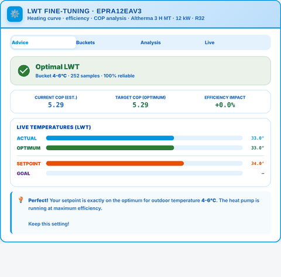
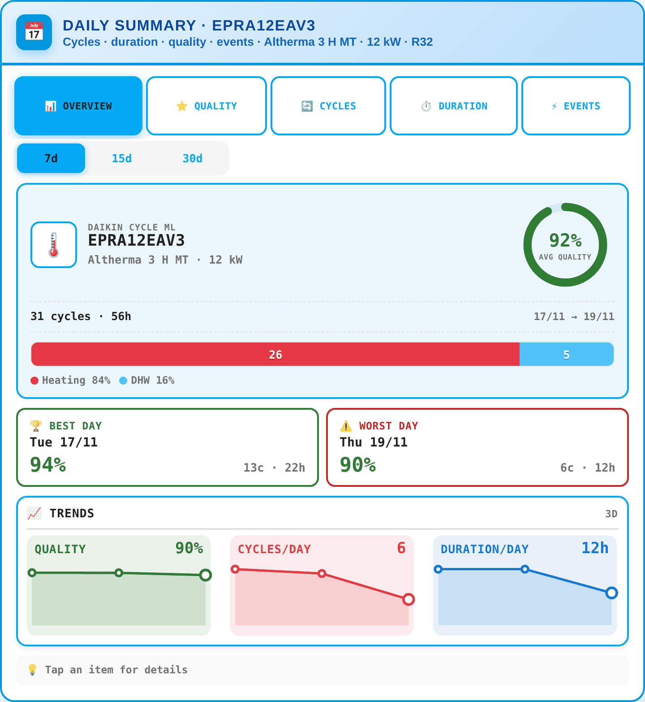

# Dashboard cards

Two kinds of cards show what Daikin Cycle ML measures.

| | Native cards | YAML cards |
|---|---|---|
| Install | Nothing: served by the integration | Three HACS frontend cards, then paste the YAML |
| Updates | With every release | Re-paste the YAML after an update |
| Settings | Visual editor | `variables:` in the YAML |
| Languages | English, Dutch, French | English, Dutch, French |
| Several heat pumps | Choose one in the editor | One heat pump |

**Start with the native cards.** The YAML cards stay available for custom
dashboards and for the few things only they show.

**[Native cards](#native-cards)** · **[YAML cards](#yaml-cards)** · **[Which card replaces which](#which-card-replaces-which)** · **[Troubleshooting](#troubleshooting)** · **[Adding a card](#adding-a-card)**

---

## Native cards

| Daily summary | Efficiency | Performance |
|---|---|---|
| [](cards/daikin-daily-summary-card/README.md) | [](cards/daikin-efficiency-card/README.md) | [](cards/daikin-performance-card/README.md) |
| `custom:daikin-daily-summary-card` | `custom:daikin-efficiency-card` | `custom:daikin-performance-card` |
| Today's run, cycles, quality, COP, backup heater, defrosts and alerts; 7 / 15 / 30-day tabs; tap a day for details | Live COP, water temperatures, compressor, flow and ΔT; COP per hour and against the datasheet; SPF; heating curve and advice; every graph says good / watch / act | Heat output, compressor speed and power against your model's limits at today's conditions; your model profile |
| [Documentation](cards/daikin-daily-summary-card/README.md) · [Changelog](cards/daikin-daily-summary-card/CHANGELOG.md) | [Documentation](cards/daikin-efficiency-card/README.md) · [Changelog](cards/daikin-efficiency-card/CHANGELOG.md) | [Documentation](cards/daikin-performance-card/README.md) · [Changelog](cards/daikin-performance-card/CHANGELOG.md) |

All three:

- appear in the **card picker** and have a **visual editor**;
- follow the Home Assistant language (or a forced one) and theme, dark
  mode included;
- find their entities in any language and after renames;
- show one heat pump: choose it in the editor when you have several;
- end with **Diagnostics for a bug report** (**Download** / **Copy**).

### Add a native card

1. Update Daikin Cycle ML and restart Home Assistant.
2. Refresh the browser once (`Ctrl`+`Shift`+`R`; in the app, pull down).
3. **Edit dashboard → + Add card**, search **Daikin**, pick a card, set
   the options (all optional), **Save**.

In YAML (**+ Add card → Manual**), for example:

```yaml
type: custom:daikin-efficiency-card
```

---

## YAML cards

| Card | Shows | Preview |
|---|---|---|
| [Simple card](cards/simple-card/README.md) | Live phase, hydraulic diagram, COP, quality, alerts, heating-curve advice |  |
| [Pattern analysis](cards/pattern-analysis/README.md) | Run-length distribution, cycles against run length, COP |  |
| [LWT fine-tuning](cards/lwt-fine-tuning/README.md) | Heating-curve advice, outdoor bands, slope / offset analysis, live LWT |  |
| [COP & energy](cards/cop-energy/README.md) | SPF gauge, COP per period and mode, live power flow, energy today |  |
| [Heating curve](cards/heating-curve/README.md) | Water temperature against outdoor with a COP heatmap and the live point |  |
| [Daily summary (tabbed)](cards/daily-summary-tabbed/README.md) | Per-day data in five tabs, 7 / 15 / 30 days |  |
| [Summary](cards/daily-summary/README.md) | One-page multi-day summary |  |

**Install, variables, language and theme** (shared by all seven):
[YAML card guide](cards/README.md).

---

## Which card replaces which

| Native card | Covers | Only in the YAML card |
|---|---|---|
| Efficiency | LWT fine-tuning, COP & energy, Heating curve | Slope / offset analysis, the COP heatmap behind the curve, the animated power flow |
| Daily summary | Daily summary (tabbed), Summary | — |
| Performance | — (new) | — |
| — | — | Simple card (hydraulic diagram), Pattern analysis |

---

## Troubleshooting

| Symptom | Check |
|---|---|
| Native card not in the card picker, or an old version | Update and restart Home Assistant, then refresh the browser once |
| Native card says "entities not found" | Integration loaded? With several heat pumps, choose one in the editor |
| Efficiency graphs empty | Normal for the first hours; keep `thermal_power_live` and the binary sensors in the recorder |
| YAML card shows as text or `Custom element doesn't exist` | Install the three HACS frontend cards, restart, refresh ([YAML card guide](cards/README.md)) |
| YAML card outdated after an update | Re-paste the YAML from its folder |

More: [Troubleshooting §9](../docs/TROUBLESHOOTING.md#9-cards).

---

## Adding a card

**Native:** files in `custom_components/daikin_cycle_ml/frontend/` (each
under 500 lines), listed in `CARD_FILES`; tests render it under Node from
the real integration's states in English, Dutch and French and in Chromium
(`tests/test_*_native_card.py`). Documentation in `cards/<card>/`: a README
with every screenshot and a CHANGELOG.

**YAML:** a folder `cards/<card>/` with the YAML, README, CHANGELOG and
screenshots; the shared block is synced with `tools/sync_card_common.py`.
Add the card to the tables on this page.
