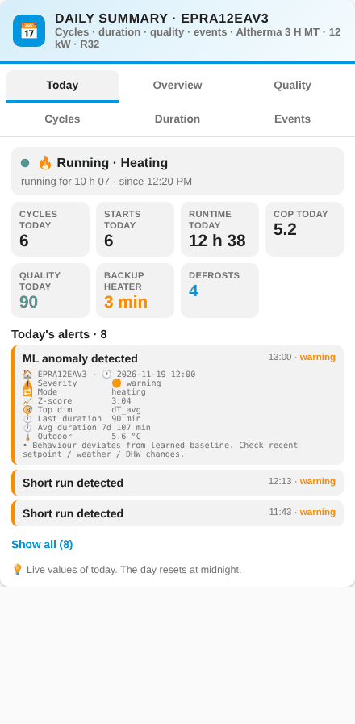
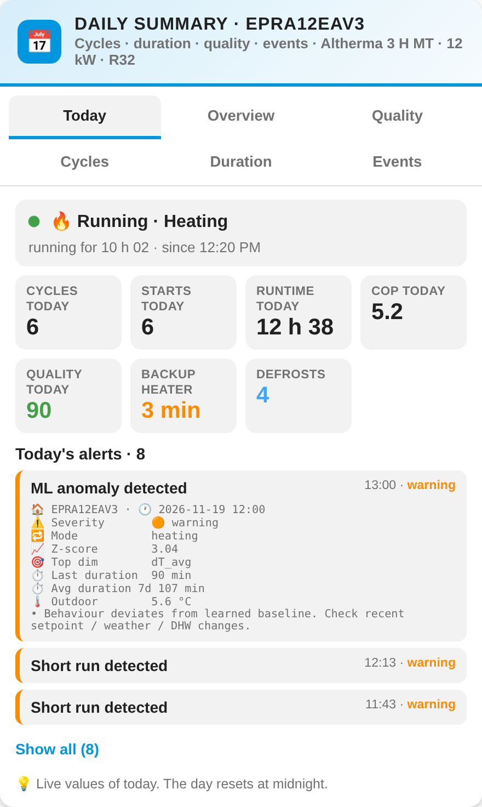
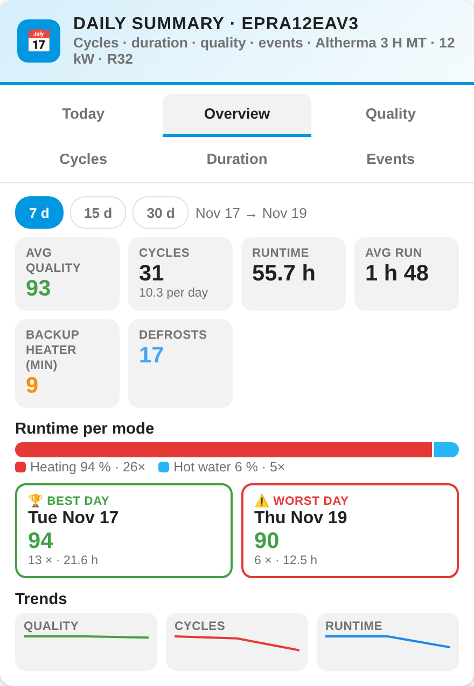
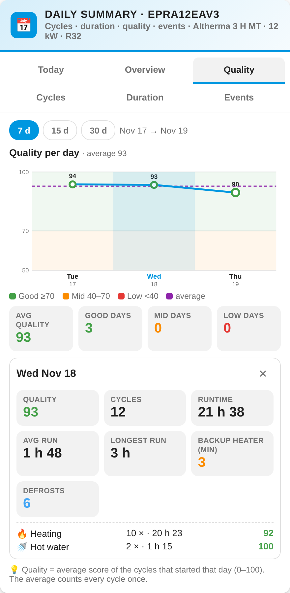
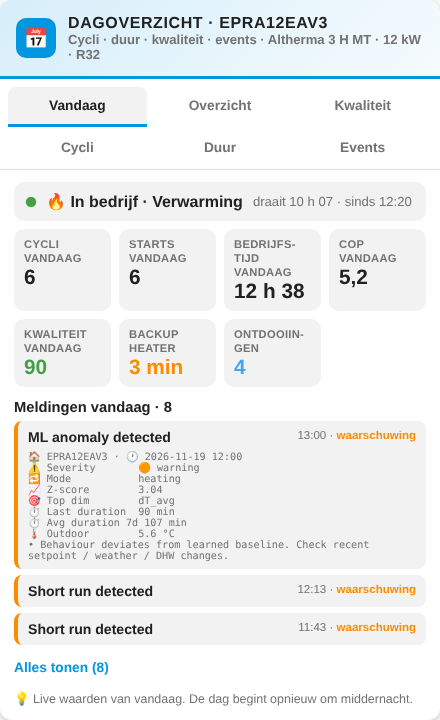
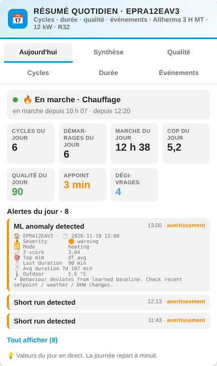
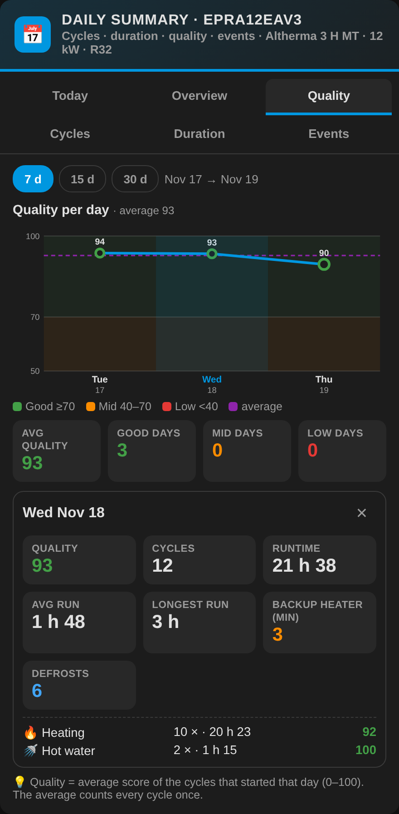

# Daily summary — native card

A native card of **Daikin Cycle ML**:
`type: custom:daikin-daily-summary-card`. Six tabs (Today, Overview,
Quality, Cycles, Duration, Events), today's live run and alerts, day
details on tap, English / Dutch / French, light and dark theme. The
integration serves the card itself: **nothing to install, no YAML to
paste**, and it updates with the integration.

**[Installation](#installation)** · **[Options](#options)** · **[Tabs](#tabs-overview)** · **[Troubleshooting](#troubleshooting)**

[CHANGELOG](CHANGELOG.md) · [All cards](../../README.md)

---

## What it shows

| Tab | Content |
|---|---|
| **Today** | Live run (mode, how long, since when, live score); today's cycles, starts, runtime, COP, quality, backup-heater time and defrosts; **today's alerts** (tap one for its details; 3 shown, *Show all* for the rest) |
| **Overview** | Period quality, cycles (and per day), runtime, average run, backup-heater minutes, defrosts; runtime per mode; best and worst day; trends |
| **Quality** | Quality per day with good / mid / low bands, the period average and an axis that fits the data; good / mid / low days |
| **Cycles** | Cycles per day stacked per mode, with the average; total, per day, busiest day, average run |
| **Duration** | Runtime per day stacked per mode, with the average; total, per day, average run, longest run |
| **Events** | Defrosts and backup-heater minutes per day; totals, defrosts per cycle, days with backup heater |

*vs. the [Daily summary (tabbed)](../daily-summary-tabbed/README.md) YAML
card:* the same per-day data and figures, plus the **Today** tab with the
live run and today's alerts, a **visual editor**, the **card picker**,
**several heat pumps**, and **no HACS frontend cards**. Updates arrive with
the integration: no re-pasting.

---

## Requirements

### Backend

- **daikin_cycle_ml** `>= v1.25.0`.

### Frontend

- None. No button-card, stack-in-card, card-mod or mushroom; no Lovelace
  resource. The integration registers the card on every dashboard.

---

## Installation

1. Update Daikin Cycle ML (HACS) and restart Home Assistant.
2. Refresh the browser once (`Ctrl`+`Shift`+`R`; in the app: pull down).
3. **Edit dashboard → + Add card**, search **Daikin Cycle ML · Daily summary**.
4. Pick the options in the visual editor (all optional) and **Save**.

Or in YAML (**+ Add card → Manual**):

    type: custom:daikin-daily-summary-card

The card finds its entities by itself (any language, renamed entities
too) and shows your heat pump model in the header.

---

## Options

All optional. The visual editor sets them; in YAML:

| Option | Default | Values | Effect |
|---|---|---|---|
| `device_id` | first found | a Daikin Cycle ML device | Which heat pump, when you have more than one |
| `title` | Daily summary | text | Header title (the model is added) |
| `default_tab` | `today` | `today`, `overview`, `quality`, `cycles`, `duration`, `events` | Tab shown first |
| `window` | `7` | `7`, `15`, `30` | Days shown first (tabs Overview to Events) |
| `tabs` | all | list of tabs | Tabs to show, in this order |
| `language` | auto | `en`, `nl`, `fr` | Card language; auto = Home Assistant language, then the integration language, then English |
| `show_help` | `true` | `true`, `false` | Explanation line under each tab |

### Language and theme

The card speaks the Home Assistant language (English, Dutch or French);
`language` forces one. Numbers and dates follow that language (`5,2` in
Dutch and French). Colours come from the Home Assistant theme, so the dark
theme needs no option:

| Dutch | French |
|---|---|
|  |  |

---

## Tabs overview

### Today

What the heat pump does right now and today's totals. The green dot pulses
while the compressor runs. When the first cycle since setup is still
running, a note explains that quality and per-cycle numbers appear when the
compressor stops (normal for a heat pump that runs for days at minimum
speed).

### Overview

The period at a glance: quality is the **average of all cycles** in the
period (#436), the same figure as the other summary cards. Tap the best or
worst day to open it on the Quality tab.

### Quality

One point per day: the average score of the cycles that started that day.
Bands: good ≥ 70, mid 40–70, low < 40; the dashed line is the period
average.

### Cycles

Cycles per day per mode (heating, hot water, cooling). Many short cycles
cost efficiency and wear; the average run is in the tiles.

### Duration

Compressor runtime per day per mode. A run that crosses midnight counts on
both days, each with its own part.

### Events

Defrosts and backup-heater minutes per day, from the integration's per-day
event counters. Few is good.

---

## Day details

Tap a bar, a point or the best / worst day to open that day:

| Field | Meaning |
|---|---|
| Quality | Average score of the day's cycles |
| Cycles, runtime | Cycles started that day, runtime on that day |
| Avg run | Runtime / runs on the day (*includes the run still going* when one is open) |
| Longest run | Longest part of a run on that day |
| Backup heater, defrosts | Minutes and events of the day |
| Per mode | Cycles, runtime and quality of heating, hot water and cooling |

Tap the day again or ✕ to close. Keyboard: Tab to a tab, the best / worst
day or an alert, Enter to open.

---

## Entity compatibility

| Entity (English id) | Used for |
|---|---|
| `sensor.daikin_cycle_ml_daily_summary_recent` | Per-day rows (`days`, `runs`, `events_by_day`): tabs Overview to Events |
| `sensor.daikin_cycle_ml_hp_specs` | Model, family, power, refrigerant in the header |
| `sensor.daikin_cycle_ml_current_cycle` | Live run: mode, duration, start |
| `sensor.daikin_cycle_ml_quality_today` | Quality today, live score |
| `sensor.daikin_cycle_ml_cycles_today`, `…_compressor_starts_today`, `…_runtime_compressor_today`, `…_cop_combined_today`, `…_runtime_buh_today`, `…_defrost_count_today` | Today's tiles |
| `sensor.daikin_cycle_ml_alerts_today` | Today's alerts |
| `sensor.daikin_cycle_ml_cycle_state`, `…_last_cycle` | Integration language; first-cycle note |

The card looks entities up in the entity registry by their translation key,
so Dutch and French ids (`sensor.daikin_cycle_ml_recent_dagoverzicht`,
`sensor.daikin_cycle_ml_resume_des_derniers_jours`) and renamed entities
work. With two heat pumps, `device_id` picks one; without it the card uses
the first it finds.

---

## Customization examples

Quality first, two weeks:

    type: custom:daikin-daily-summary-card
    default_tab: quality
    window: 15

Only today and events, no explanations, in Dutch:

    type: custom:daikin-daily-summary-card
    tabs: [today, events]
    language: nl
    show_help: false

Second heat pump:

    type: custom:daikin-daily-summary-card
    title: Garage
    device_id: 3958a89df58ce6bdbc0af7481004d13b

---

## Diagnostics for a bug report

At the bottom of the card, **Download** saves the diagnostics file and
**Copy** puts it on the clipboard, ready to paste into a
[GitHub issue](https://github.com/elRadix/daikin_cycle_ml/issues/new/choose).
It is Home Assistant's diagnostics file for the heat pump this card shows,
without the list of every other custom integration Home Assistant adds to
its own download. An administrator account is needed.

## Troubleshooting

### Card not in the card picker / "Custom element doesn't exist"

The integration loads the card when it starts. Check that Daikin Cycle ML
is set up and running, then refresh the browser (`Ctrl`+`Shift`+`R`).

### "Daikin Cycle ML entities not found"

The integration is not running, or `device_id` points to another device.
Remove `device_id` to use the first heat pump found.

### "No daily data yet"

Normal on the first day: the per-day tabs fill after midnight. The Today
tab works from the start.

### "The first cycle is still running"

Normal for a heat pump that has run without stopping since setup: quality
and per-cycle numbers come when the compressor stops for the first time.

### Old look after an update

Refresh the browser once. The card URL carries the integration version,
so a normal refresh is enough.

---

## Data & limitations

- Days come from `daily_summary_recent` (up to 30 days shown).
- Quality and cycle counts belong to the day a cycle started; runtime is
  split over the days a run covers.
- Today's alerts show the integration's alert history of today (the same
  list as `sensor.daikin_cycle_ml_alerts_today`).
- The live run duration refreshes every minute.
- Screenshots are rendered from the states of a real integration (tests
  `tests/test_daily_summary_native_card.py`).
