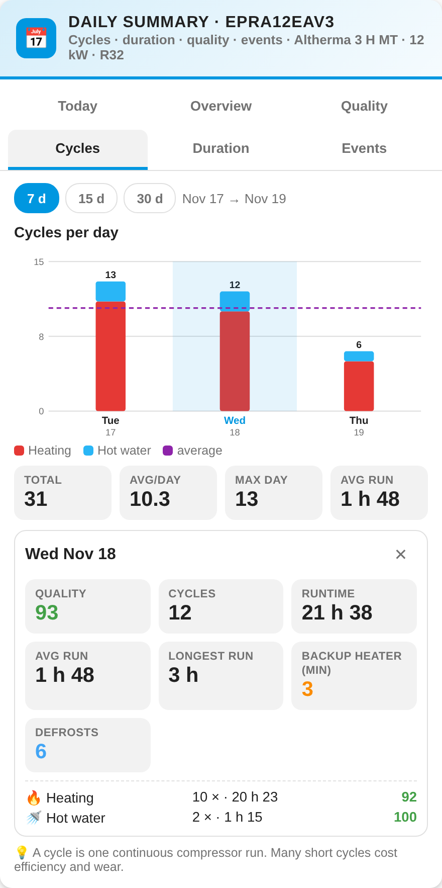
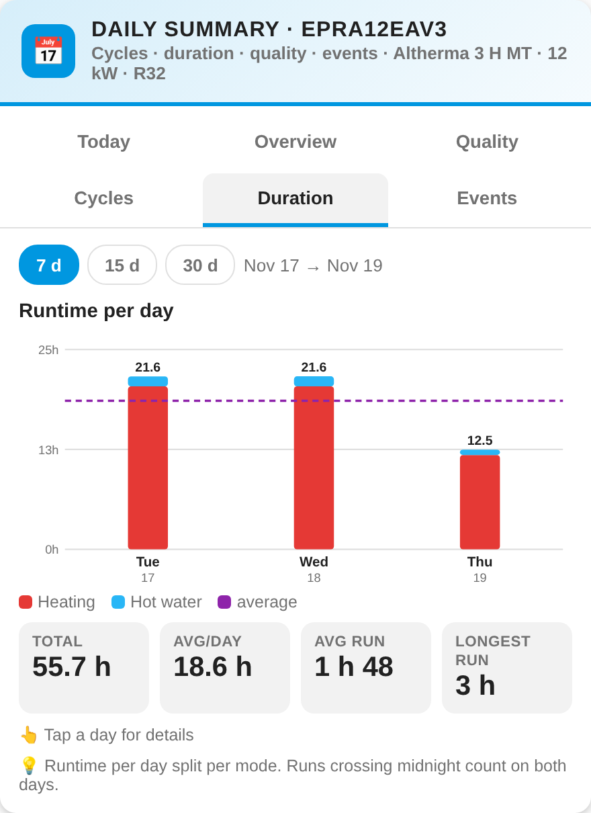
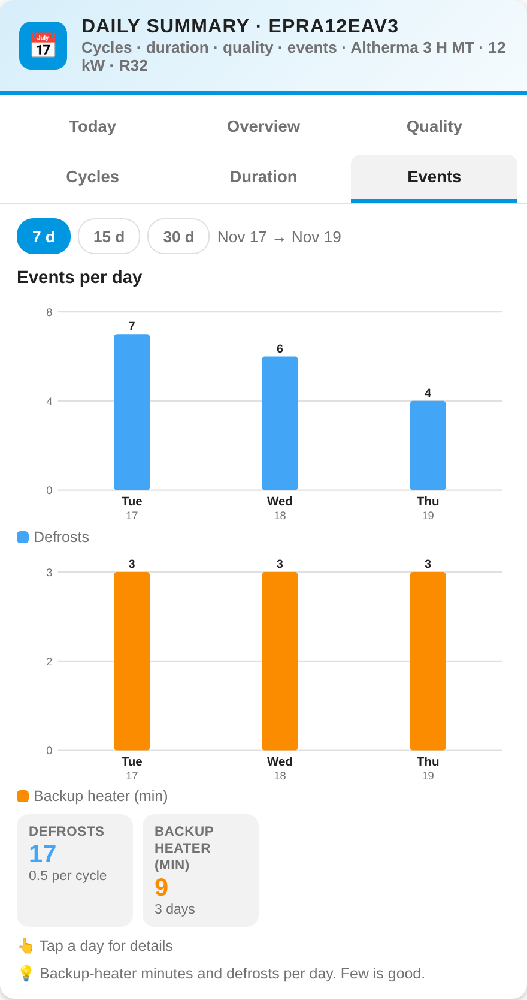
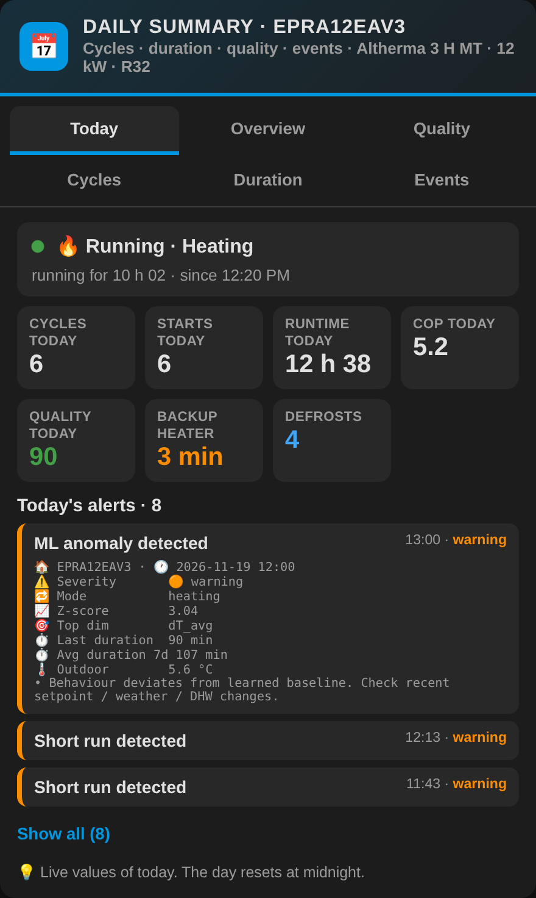

# Daily Summary Card (native)

`type: custom:daikin-daily-summary-card`

The first **native** card of Daikin Cycle ML. The integration serves it
and loads it on every dashboard, so there is **nothing to install**: no
HACS frontend cards (button-card, stack-in-card, card-mod), no Lovelace
resource, no YAML to paste. Updating the integration updates the card.

## Add the card

1. **Edit dashboard → Add card**, search for **Daikin Cycle ML · Daily summary**.
2. Pick the options in the visual editor, or use YAML:

       type: custom:daikin-daily-summary-card

After an update of the integration, refresh the browser once
(`Ctrl`+`Shift`+`R`, or pull down in the app) if the card still looks old.

## Tabs

| Tab | Shows |
|---|---|
| **Today** | Live run (mode, how long, since when, live score), today's cycles, starts, runtime, COP, quality, backup-heater time and defrosts, and **today's alerts**: tap an alert for its details; 3 are shown, *Show all* lists the rest |
| **Overview** | Period quality, cycles (per day), runtime, average run, backup-heater minutes, defrosts; runtime per mode; best and worst day; trends |
| **Quality** | Quality per day with good / mid / low bands and the period average; good / mid / low days |
| **Cycles** | Cycles per day stacked per mode, with the average; total, per day, busiest day, average run |
| **Duration** | Runtime per day stacked per mode; total, per day, average run, longest run |
| **Events** | Defrosts and backup-heater minutes per day; totals, defrosts per cycle |

Overview to Events show **7, 15 or 30 days**. **Tap a day** (a bar, a
point, or the best / worst day) to see its details per mode: quality,
cycles, runtime, average and longest run, backup heater and defrosts.

| | |
|---|---|
|  |  |
|  |  |
|  |  |

Dark theme (follows Home Assistant):

## Options

All optional; the visual editor sets them.

| Option | Default | Values | Effect |
|---|---|---|---|
| `device_id` | first found | a Daikin Cycle ML device | Which heat pump, when you have more than one |
| `title` | Daily summary | text | Header title (the model is added) |
| `default_tab` | `today` | `today`, `overview`, `quality`, `cycles`, `duration`, `events` | Tab shown first |
| `window` | `7` | `7`, `15`, `30` | Days shown first |
| `tabs` | all | list of tabs | Tabs to show, in this order |
| `language` | auto | `en`, `nl`, `fr` | Card language; auto = Home Assistant language, then the integration language |
| `show_help` | `true` | `true`, `false` | Explanation line under each tab |

Example:

    type: custom:daikin-daily-summary-card
    default_tab: quality
    window: 15
    tabs: [today, quality, cycles, events]

## Data

| Entity (English id) | Used for |
|---|---|
| `sensor.daikin_cycle_ml_daily_summary_recent` | Per-day rows (`days`, `runs`, `events_by_day`): all tabs except Today |
| `sensor.daikin_cycle_ml_hp_specs` | Model, family, power, refrigerant in the header |
| `sensor.daikin_cycle_ml_current_cycle` | Live run: mode, duration, start |
| `sensor.daikin_cycle_ml_quality_today` | Quality today, live score |
| `sensor.daikin_cycle_ml_cycles_today`, `…_compressor_starts_today`, `…_runtime_compressor_today`, `…_cop_combined_today`, `…_runtime_buh_today`, `…_defrost_count_today` | Today's tiles |
| `sensor.daikin_cycle_ml_alerts_today` | Today's alerts |
| `sensor.daikin_cycle_ml_cycle_state`, `…_last_cycle` | Integration language; first-cycle note |

The card finds these through the entity registry (`translation_key`), so
Dutch and French entity ids (`sensor.daikin_cycle_ml_recent_dagoverzicht`,
`sensor.daikin_cycle_ml_resume_des_derniers_jours`) work too, and renamed
entities keep working.

Figures match the other cards: the quality of a day and of the period is
the **average of all cycles** (#436), the average run is the runtime
divided by the runs on that day (a run still going and a run crossing
midnight included).

## Troubleshooting

| Symptom | Check |
|---|---|
| Card not in the card picker | Integration set up? Refresh the browser once |
| "Entities not found" | Integration running; with `device_id`, the right heat pump selected |
| "No daily data yet" | Normal on the first day; the per-day tabs fill after midnight |
| "The first cycle is still running" | Normal for a heat pump that has run since setup: quality and per-cycle numbers come when the compressor stops |
| Old look after an update | Refresh the browser (`Ctrl`+`Shift`+`R`) |

## Compared with the YAML cards

The [Daily summary (tabbed)](../daily-summary-tabbed/README.md) YAML card
shows the same per-day data. The native card adds the **Today** tab with
the live run and today's alerts, the visual editor, several heat pumps,
and needs no frontend cards. The YAML cards stay available.
