# Efficiency Card (native)

The second **native** Lovelace card of **Daikin Cycle ML**:
`type: custom:daikin-efficiency-card`. It merges the
[LWT fine-tuning](../lwt-fine-tuning/README.md),
[COP & energy](../cop-energy/README.md) and
[heating curve](../heating-curve/README.md) YAML cards into one card with
a live hero and five tabs. **Every graph and every tab tells you whether
the current state is good, worth watching or needs action**, judged
within the datasheet limits of your model. The integration serves the
card itself: nothing to install, no YAML to paste.

**[Installation](#installation)** · **[Options](#options)** · **[Tabs](#tabs)** · **[How the verdicts work](#how-the-verdicts-work)** · **[Data](#where-the-data-comes-from)** · **[Troubleshooting](#troubleshooting)**

| Live | Today | Efficiency | Curve | Advice | Dark |
|---|---|---|---|---|---|
| [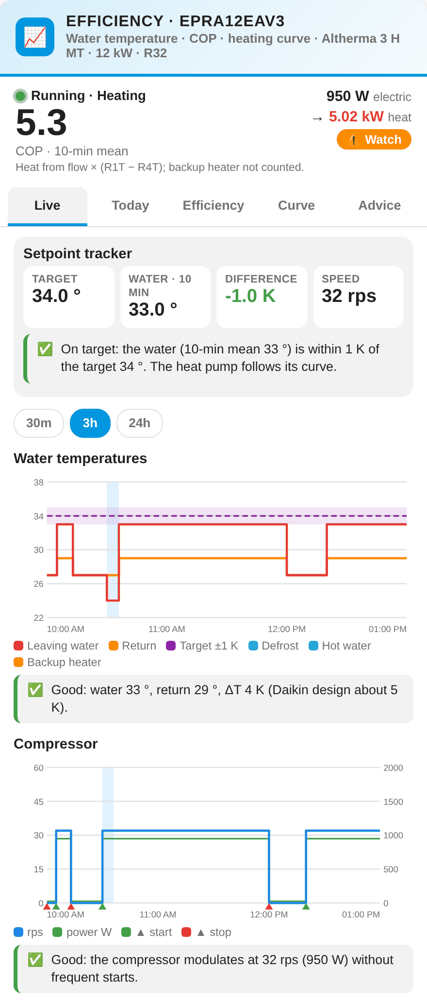](screenshot-live.png) | [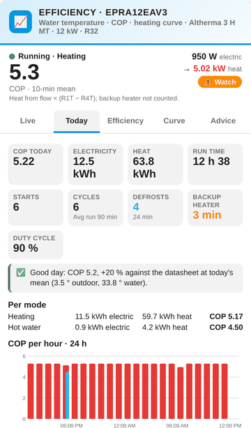](screenshot-today.png) | [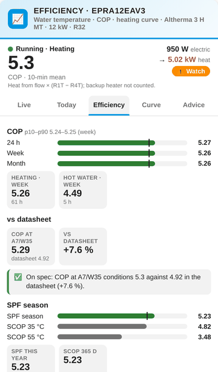](screenshot-eff.png) | [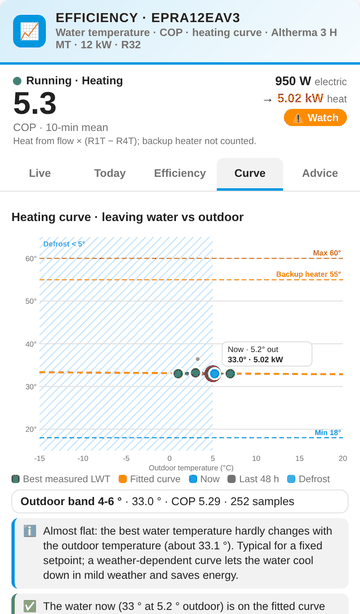](screenshot-curve.png) | [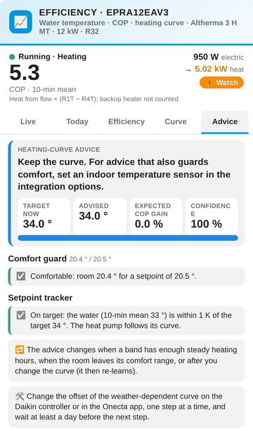](screenshot-advice.png) | [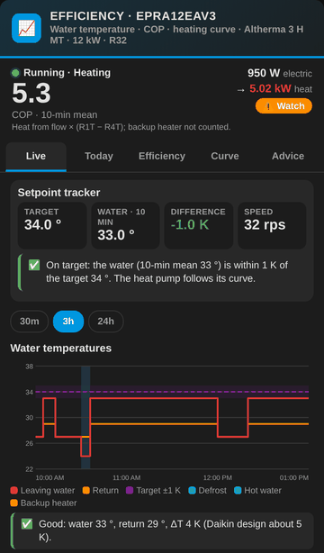](screenshot-dark-live.png) |

Full tabs:

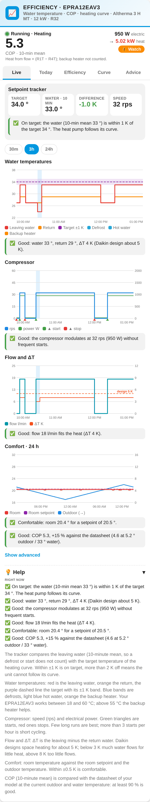
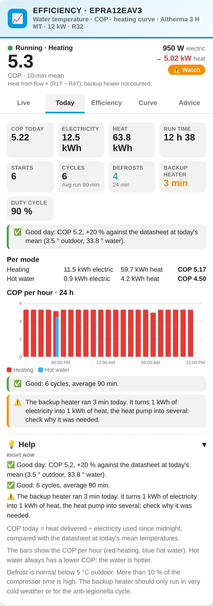
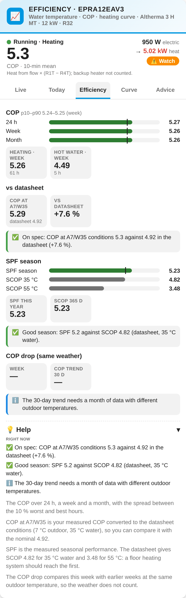
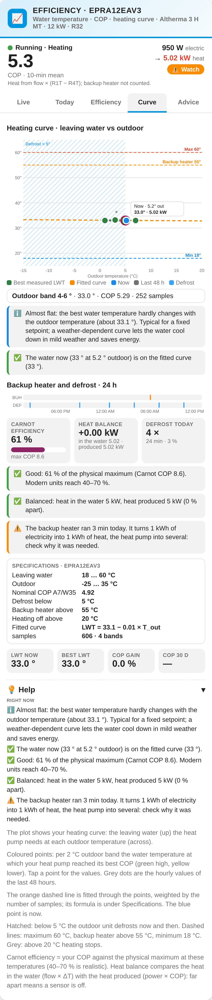
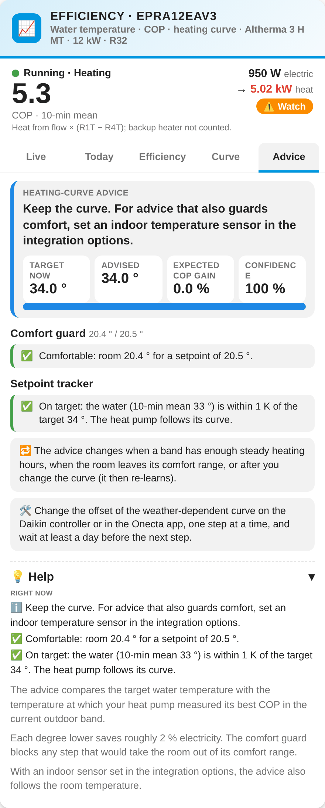

---

## Requirements

- **daikin_cycle_ml** with this card (next release after v1.26.1).
- No HACS frontend cards (no button-card, card-mod, apexcharts).
- The recorder (on by default) for the graph history. Without it the
  graphs start empty and fill while the page is open.

---

## Installation

1. Update Daikin Cycle ML (HACS) and restart Home Assistant.
2. Refresh the browser once (`Ctrl`+`Shift`+`R`; in the app: pull down).
3. **Edit dashboard → + Add card**, search **Daikin Cycle ML · Efficiency**.
4. Pick the options in the visual editor (all optional) and **Save**.

Or in YAML:

    type: custom:daikin-efficiency-card

The graphs show history from the moment the integration is updated: the
live temperatures are new attributes, so the first day fills up as data
arrives.

---

## Options

| Option | Default | Values | Effect |
|---|---|---|---|
| `device_id` | first found | a Daikin Cycle ML device | Which heat pump, when you have more than one |
| `title` | Efficiency | text | Header title (the model is added) |
| `default_tab` | `live` | `live`, `today`, `eff`, `curve`, `advice` | Tab shown first |
| `range` | `3h` | `30m`, `3h`, `24h` | Time range of the Live graphs (switch in the card too) |
| `tabs` | all | list of tabs | Tabs to show, in this order |
| `language` | auto | `en`, `nl`, `fr` | Card language; auto = Home Assistant language, then the integration language |
| `show_help` | `true` | `true`, `false` | Help section at the bottom of each tab |
| `min_flow` | none | l/min | Minimum water flow of your unit, from its installation manual. Shown as a line in the flow graph; a flow below it is flagged |
| `target_dt` | 5 | K | Target ΔT of your installation (leaving minus return water), as your installer set it; 2 to 15. The flow graph's target line and the verdicts use it: below 60 % of it is "much water for little heat", above it + 3 K "too little flow" |

### Language and theme

English, Dutch and French; numbers follow the language (`5,3`). Colours
come from the Home Assistant theme, dark included:

| Dark · Live | Dark · Curve | Dutch | French |
|---|---|---|---|
| 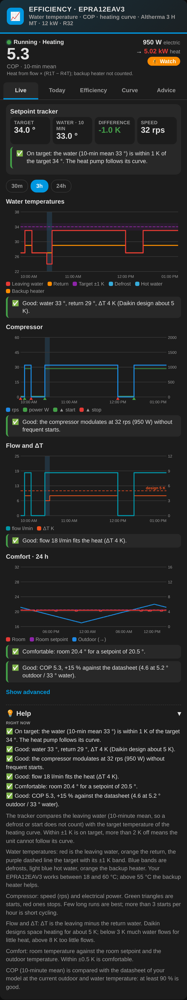 | 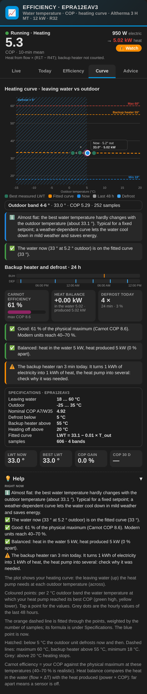 | 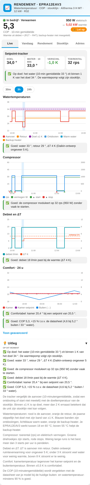 | 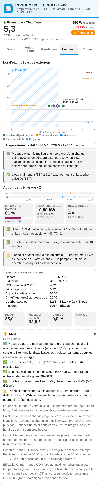 |

---

## Tabs

**Hero** (always on top): running state and mode, COP as a 10-minute
mean, electrical power → heat output, and the overall status (the worst
verdict of the live graphs and today).

| Tab | Content |
|---|---|
| **Live** | Setpoint tracker (target, 10-min water mean, difference, compressor speed); graphs with a 30 min / 3 h / 24 h switch: **water temperatures** (leaving, return, target with ±1 K band; defrost, hot water and backup-heater bands), **compressor** (rps, power, start ▲ / stop ▲ markers), **flow and ΔT** (design 5 K, your minimum flow), **comfort · 24 h** (room, room setpoint, outdoor); advanced: refrigerant liquid (R3T) − leaving water |
| **Today** | COP, electricity, heat, run time, starts, cycles, defrosts, backup heater, duty cycle; per mode; COP per hour (24 h) |
| **Efficiency** | COP over 24 h / week / month against the nominal COP; per mode; COP at A7/W35 against the datasheet; season SPF against the datasheet SCOP at 35 °C and 55 °C; COP drop at the same weather and the 30-day trend |
| **Curve** | The heating curve: best measured water temperature per outdoor band (colour = COP, tap for details), the fitted curve, the last 48 h, now; defrost zone, backup-heater, maximum and minimum lines; 24 h backup-heater and defrost strip; Carnot efficiency, heat balance, defrost today; specifications of your model; tiles |
| **Advice** | The heating-curve advice in plain words, target now → advised, expected COP gain, confidence, comfort guard, tracker, when the advice changes and how to change the curve |

---

## How the verdicts work

Each graph has a line under it: ✅ good, ⚠️ watch, ⛔ act, ℹ️ info (not
judged now, with the reason). The help section repeats the current
verdicts of the tab and explains the graphs with the numbers of **your**
model (datasheet in `sensor.daikin_cycle_ml_hp_specs`).

| Graph | Good | Watch / act |
|---|---|---|
| Tracker | 10-min water mean within ±1 K of the target | 1–2 K off: watch; more than 2 K: act. Not judged during defrost, hot water, the first 10 min of a run, or when heating is off above the "heating off" temperature |
| Water | ΔT 3–8 K (Daikin design about 5 K), water within the unit limits | ΔT below 3 K or above 8 K; water above the backup-heater temperature; above the maximum: act |
| Compressor | Running without frequent starts | 3 starts in the last hour: watch; 4 or more, or the short-cycling sensors: act |
| Flow | Flow fits the heat (ΔT between 60 % of your `target_dt` and target + 3 K; 3–8 K at the default 5 K) | No flow while running, or below your `min_flow`: act |
| Comfort | Room within ±0.5 K of its setpoint | 0.5–1 K below: watch; 1 K or more below: act; more than 1 K above: watch (the curve can go down) |
| COP | At least 90 % of the datasheet at the current outdoor and water temperature | 75–90 %: watch; below 75 %: act; above 140 %: check the meter |
| Refrigerant (advanced) | Liquid up to 6 K above the leaving water | More: watch (low flow or air) |
| Today | COP at least 90 % of the datasheet at today's mean | Defrost above 10 % of the run time: watch, above 20 %: act; any backup-heater minutes: watch; runs averaging under 30 min: watch |
| Efficiency | On spec at A7/W35; SPF at least 90 % of SCOP 35 °C | Below spec by up to 20 %: watch, more: act; SPF between SCOP 55 °C and 35 °C: watch, below: act; COP drop warning / critical |
| Curve | Falling curve that stays below the backup-heater temperature at −10 °C; water now within 1.5 K of the fitted curve | Flat or rising curve; curve above the backup-heater or maximum temperature at −10 °C |
| Carnot | 40–80 % of the physical maximum (typical 40–70 %) (condensing = water + 2 K, evaporating = outdoor − 6 K) | 30–40 %: watch; below 30 %: act; above 80 %: check the meter |
| Heat balance | Heat in the water (flow × ΔT) within 15 % of power × COP | 15–30 %: watch; more: act (a sensor is off) |

These limits are general rules for Daikin air-to-water heat pumps, not
a service diagnosis. When a verdict says *act*, check the measurement
first (power meter, flow sensor), then the installation.

---

## Where the data comes from

The card reads only Daikin Cycle ML entities. The integration reads
ESPAltherma (v1 monolithic or v2 entities, any names).

- **Graphs:** the recorder history of
  `sensor.daikin_cycle_ml_thermal_power_live`. Its attributes carry power,
  COP, flow, ΔT, rps and the live temperatures `lwt_c`, `return_c`,
  `outdoor_c`, `lw_setpoint_c`, `room_c` (your indoor sensor when set in
  the integration options), `room_setpoint_c`, `refrigerant_liquid_c`.
  Bands and markers: `binary_sensor.daikin_cycle_ml_defrost_active`,
  `dhw_active`, `buh_active`, `compressor_running`.
- **Other tabs:** heating-curve advice, hp_specs (datasheet), COP mean,
  SPF, COP vs datasheet, COP degradation and trend, energy today, run
  time, starts, defrosts, backup heater and duty cycle sensors.

---

## Troubleshooting

| Symptom | Check |
|---|---|
| "Entities not found" | Integration set up and updated; refresh the browser |
| Graphs empty, note "history is not available" | The recorder must record `sensor.daikin_cycle_ml_thermal_power_live` (not excluded in `recorder:`) |
| Graphs empty right after the update | Normal: the temperatures are new attributes; the graphs fill over the next hours |
| Comfort graph without room line | Set an indoor sensor in the integration options, or enable the room sensor in ESPAltherma |
| COP far above the datasheet | Check the power meter (a missing phase, kW read as W) |
| Curve tab says "learning" | The curve needs steady heating in at least two outdoor bands 4 K apart |
