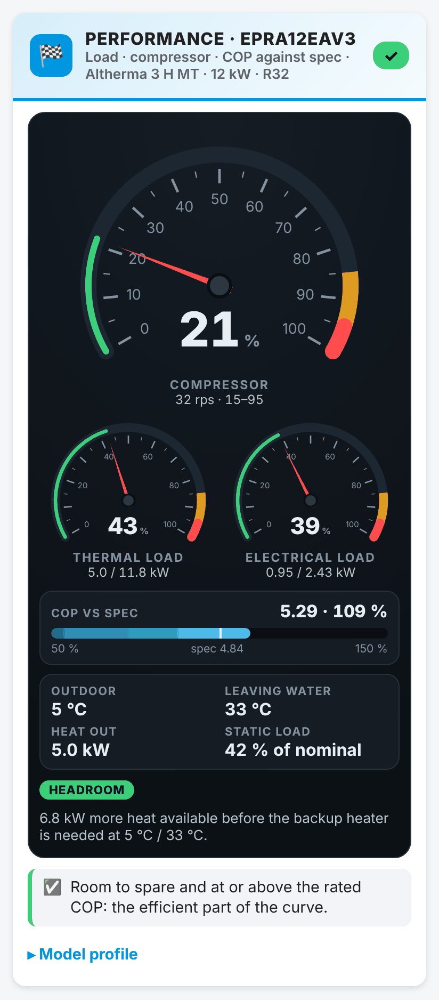
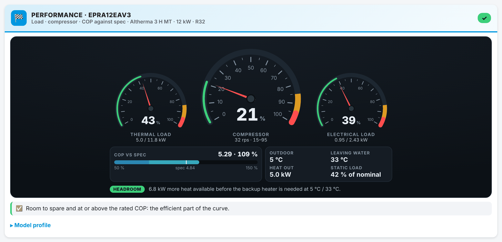
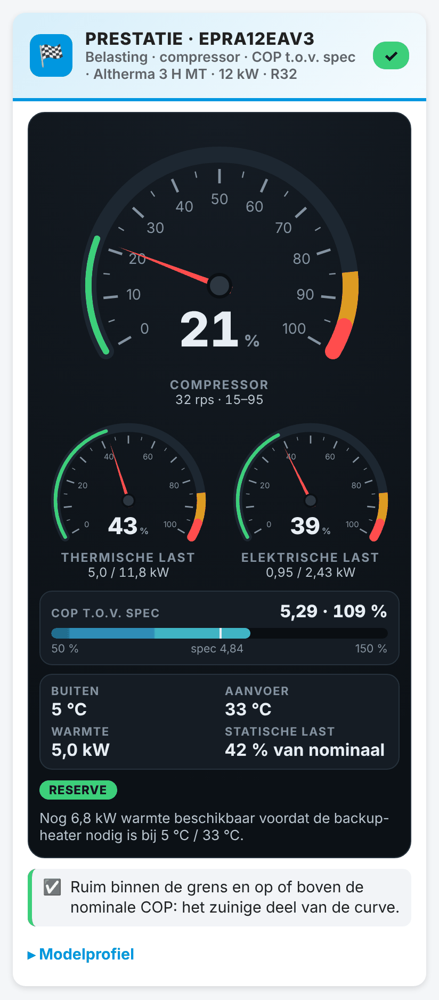

# Performance Card (native)

The third **native** Lovelace card of **Daikin Cycle ML**:
`type: custom:daikin-performance-card`. A car-style cluster that shows how
hard your heat pump works **against the limits of its own model** at
today's outdoor and water temperature: thermal load, compressor speed and
electrical load, the COP against the datasheet, and how much heat is left
before the backup heater has to help. The integration serves the card
itself: nothing to install, no YAML to paste.

**[Installation](#installation)** · **[Options](#options)** · **[What the dials show](#what-the-dials-show)** · **[Model profile](#model-profile)** · **[Troubleshooting](#troubleshooting)**

| Phone | Model profile | Desktop | Nederlands | Dark |
|---|---|---|---|---|
|  |  |  |  |  |

---

## Why

A single "load" of heat output ÷ nominal kW hides what matters. In mild
weather a 12 kW unit making 5 kW is relaxed; at -7 °C with 55 °C water the
same unit can be at 100 % compressor speed while that number still says
65 %. This card measures every load against what *your model* can do at
*this* outdoor and water temperature.

## Installation

1. Update Daikin Cycle ML (HACS) and restart Home Assistant.
2. Refresh the browser once.
3. **Edit dashboard → + Add card**, search **Daikin Cycle ML · Performance**.

Or in YAML:

    type: custom:daikin-performance-card

## Options

| Option | Default | Meaning |
|---|---|---|
| `primary_load` | `compressor` | The big dial: `compressor`, `thermal` or `electrical` |
| `title` | Performance | Card title |
| `language` | Home Assistant | `en`, `nl` or `fr` |
| `device_id` | first heat pump | When you have several |

The limits are not card options: they belong to the integration, so every
card and alert uses the same values (see [Model profile](#model-profile)).

## What the dials show

| Dial | Formula | Limit comes from |
|---|---|---|
| **Thermal load** | heat output ÷ maximum heat at (outdoor, water) | `hmax` points of your model profile, interpolated |
| **Compressor** | (speed − minimum) ÷ (maximum − minimum) | learned from your runs, or your values |
| **Electrical load** | electrical input ÷ (maximum heat ÷ spec COP) | the two above |
| **COP vs spec** | live COP ÷ spec COP at (outdoor, water) | datasheet COP points, Carnot-scaled outside them |

Amber from 85 %, red from 95 %. **Headroom** is the heat left before the
backup heater is needed. A dial without a known limit shows "—" and says
what to add; nothing is made up. When the current condition is more than
3 K away from your points, the dial says which point it used.

Verdicts: running with room to spare, close to the limit, at the limit
(with or without the backup heater helping), defrost, compressor off.

## Model profile

Open **▸ Model profile** on the card (or **Configure → Model profile** in
Home Assistant). It starts from the datasheet of the model chosen in setup:

- **Compressor minimum / maximum**: learned from your own runs after 20
  steady runs; type a value to set your own.
- **Datasheet points**: per outdoor and water temperature the **maximum
  heat** (`hmax`, from Daikin's capacity tables) and the **spec COP**. A
  dashed red box is missing. The datasheet's own heating capacity is the
  capacity at the EN 14511 rating point (often part load), so it is not
  used as a maximum.
- **Add point** for a condition the datasheet does not list.

Every value shows its source: **Datasheet**, **Learned** or **Manual**.
**Remove my value** goes back to the datasheet or the learned value. Your
values are saved in the integration and used everywhere: COP against the
datasheet, the normalised COP, alerts and the other cards.

## Troubleshooting

- **All dials "—"**: no maximum heat and no compressor range yet. Add the
  maximum heat for a few points, or wait for 20 steady runs.
- **"Nearest point …" under the thermal dial**: add a point closer to the
  current outdoor and water temperature.
- **Card not found** in the picker: refresh the browser once after the update.
