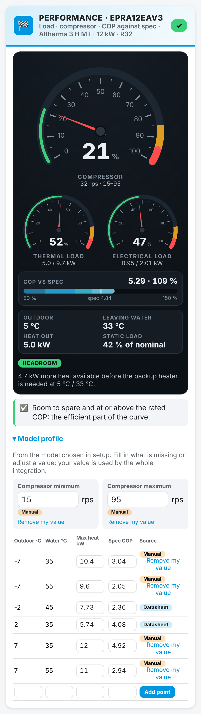
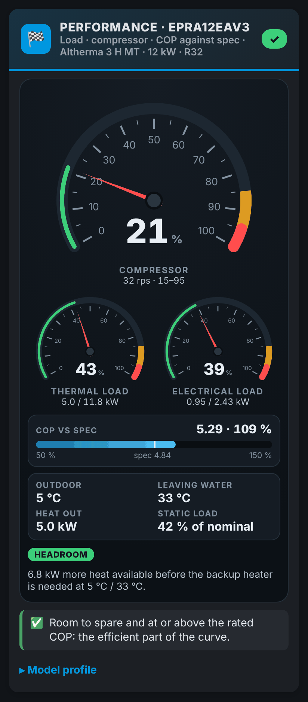

# Performance — native card

A native card of **Daikin Cycle ML**:
`type: custom:daikin-performance-card`. A car-style cluster that shows how
hard your heat pump works **against what its own model can deliver** at
today's outdoor and water temperature: capacity used, compressor speed and
electrical power, the COP against the Daikin rating point, and how much
heat the heat pump still has in reserve. The integration serves the card
itself: nothing to install, no YAML to paste.

**[Installation](#installation)** · **[Options](#options)** · **[What the dials show](#what-the-dials-show)** · **[Model profile](#model-profile)** · **[Where the maximum heat comes from](#where-the-maximum-heat-comes-from)** · **[Troubleshooting](#troubleshooting)**

[CHANGELOG](CHANGELOG.md) · [All cards](../../README.md)

| Phone | Model profile | Dark |
|---|---|---|
|  |  |  |

---

## Why

A single "load" of heat output ÷ nominal kW hides what matters. In mild
weather a 12 kW unit making 5 kW is relaxed; in frost with hot water the
same unit can be at full compressor speed while that number still says
65 %. This card measures the heat against what *your model* can deliver at
*this* outdoor and water temperature.

## Installation

1. Update Daikin Cycle ML (HACS) and restart Home Assistant.
2. Refresh the browser once.
3. **Edit dashboard → + Add card**, search **Daikin Cycle ML · Performance**.

Or in YAML:

    type: custom:daikin-performance-card

## Options

| Option | Default | Meaning |
|---|---|---|
| `primary_load` | `compressor` | The big dial: `compressor`, `thermal` or `electrical` |
| `title` | Performance | Card title |
| `language` | Home Assistant | `en`, `nl` or `fr` |
| `device_id` | first heat pump | When you have several |

The limits are not card options: they belong to the integration, so every
card and alert uses the same values (see [Model profile](#model-profile)).

## What the dials show

| Dial | Formula | Limit comes from |
|---|---|---|
| **Capacity used** | heat output ÷ maximum heat at (outdoor, water) | [maximum heat](#where-the-maximum-heat-comes-from), interpolated between the points |
| **Compressor** | speed ÷ maximum (the dial starts at 0 rps, so a compressor below its minimum still shows; #491) | your values, or learned from your runs ("highest speed seen so far") |
| **Electrical power** | electrical input ÷ maximum input | Daikin's maximum power input (EPRA08/10/12: 1.69 / 2.04 / 2.28 kW), else an estimate (maximum heat ÷ COP) |
| **COP vs rating point** | live COP ÷ COP of the Daikin rating point at (outdoor, water) | datasheet COP points, Carnot-scaled outside them. A heat pump at part load is normally above its rating point |

**Reserve** is the heat the heat pump can still add at this outdoor and
water temperature (an estimate). When the unit delivers more than the
estimate, the maximum is raised to what it does: a heat pump cannot
deliver more than it can.

**At its limit** (red) only when both are true for the current sample:

- the leaving water is more than 2 K below its target (the unit cannot
  keep up), and
- the compressor runs within 10 % of a **confirmed** top speed (your
  value in the model profile); without one, the heat is at the estimated
  maximum.

The backup heater is shown from its own signal, never predicted: the
Daikin controller switches it on by its settings (equilibrium
temperature, delay after a start, defrost, emergency mode). When it runs
while the heat pump still has reserve, the card says so.

Verdicts: running with room to spare, working hard, at its limit (with or
without the backup heater), backup heater on with reserve, defrost,
compressor off.

## Model profile

Open **▸ Model profile** on the card (or **Configure → Model profile** in
Home Assistant). It starts from the datasheet of the model chosen in setup:

- **Compressor minimum / maximum**: learned from your own runs after 20
  steady runs. A learned maximum is the highest speed seen so far (mild
  weather rarely needs full speed); type your unit's top speed to confirm it.
- **Points**: per outdoor and water temperature the **maximum heat**
  (`hmax`) and the **spec COP** at the Daikin rating point.
- **Add point** for a condition the datasheet does not list: on the last
  row of the table type the outdoor and water temperature (for example
  −7 and 35) and the maximum heat in kW and/or the COP from your
  datasheet's capacity table at that condition, then press **Add point**.

Every value shows its source: **Datasheet**, **Estimate**, **Learned** or
**Manual**. **Remove my value** goes back to the other sources. Your
values are saved in the integration and used everywhere: COP against the
datasheet, the normalised COP, alerts and the other cards.

## Where the maximum heat comes from

The same rule for every model. Daikin's EN 14511 capacities in a datasheet
are **rating points**: Daikin chooses the compressor speed per test point
(EPRA08, 10 and 12 all list 6.17 kW at A7/W35, and more at A-7 than at
A7). The unit can deliver *at least* that much there, so they are a lower
bound, not the maximum (reviewed with a Daikin application engineer, #478).

Per outdoor and water temperature:

1. **Manual**: your own value always wins.
2. **Estimate** from the maximum at A7/W35: Daikin's product-table maximum
   (EPRA12: 9.97 kW) or else the nominal kW of the model, 1 % lower per K
   outdoor below 7 °C and 0.5 % lower per K water above 35 °C.
3. **Never below what the unit is known to reach**: a Daikin datasheet
   capacity at that point (source **Datasheet**) or what your own heat
   pump delivered at high speed (**Learned**, per 5 K band, after 30
   samples on 3 days) raises the estimate; they never lower it.

| Model | Maximum at A7/W35 |
|---|---|
| EPRA08 / 10 / 12 EAV3 | 7.95 / 9.25 / 9.97 kW (Daikin product table) |
| EPRA14 / 16 / 18 DAV3 | 10.18 / 10.91 / 12.12 kW (Daikin product table) |
| EPSK12 / 14 AW1 | 11.99 / 13.34 kW (Daikin product table) |
| EVLQ05 / 08 CV3 | 5.12 / 10.02 kW (Daikin product table) |
| all other models | the nominal kW (an estimate; type yours to correct it) |

## Diagnostics for a bug report

At the bottom of the card, **Download** saves the diagnostics file and
**Copy** puts it on the clipboard, ready to paste into a
[GitHub issue](https://github.com/elRadix/daikin_cycle_ml/issues/new/choose).
It is Home Assistant's diagnostics file for the heat pump this card shows,
without the list of every other custom integration Home Assistant adds to
its own download. An administrator account is needed.

## Troubleshooting

- **Compressor dial "—"**: the speed range is learned after 20 steady
  runs; or type it in the model profile.
- **"Maximum = highest speed seen so far"**: type your unit's top speed in
  the model profile to make the compressor dial and "at its limit" exact.
- **"Nearest point …" under the dial**: add a point closer to the current
  outdoor and water temperature.
- **Card not found** in the picker: refresh the browser once after the update.
