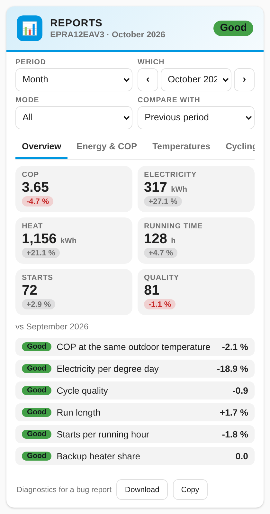
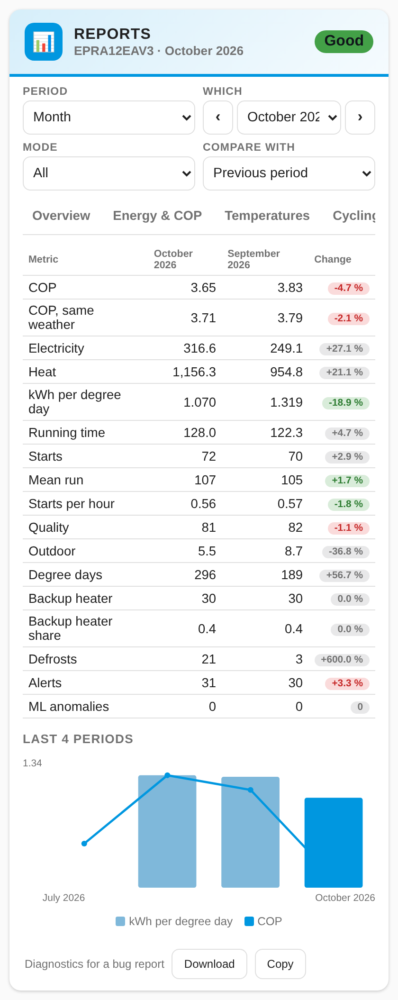
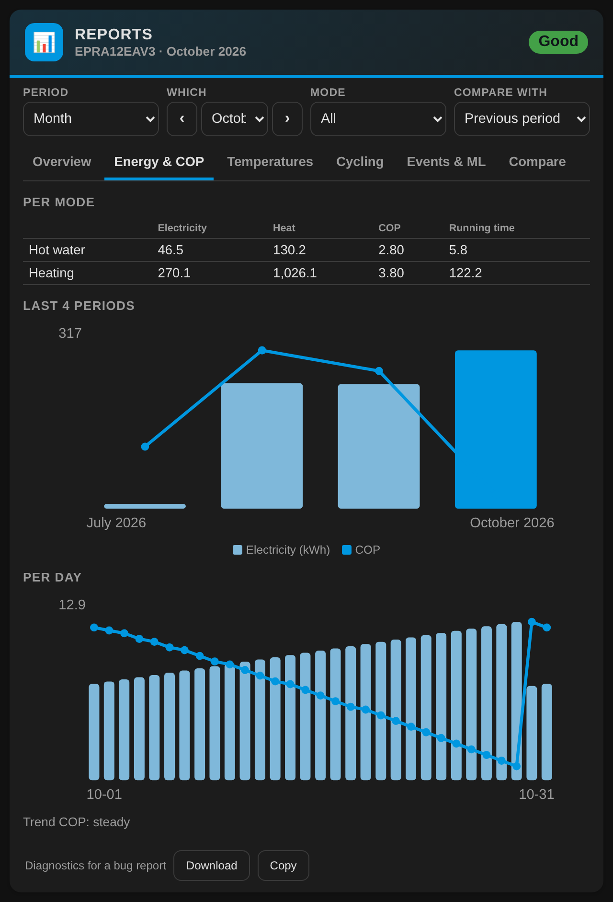

# Reports — native card

A native card of **Daikin Cycle ML**: `type: custom:daikin-reports-card`.
Week, month, year and heating-season reports of your heat pump: COP,
energy, temperatures, flow, cycling, backup heater, defrosts, alerts and ML
anomalies, **compared with the previous period or the same period last
year**, with a verdict per metric. The integration serves the card itself:
nothing to install, no YAML to paste.

**[Installation](#installation)** · **[Options](#options)** · **[The tabs](#the-tabs)** · **[How periods are compared](#how-periods-are-compared)** · **[Troubleshooting](#troubleshooting)**

[CHANGELOG](CHANGELOG.md) · [All cards](../../README.md)

| Overview | Compare | Dark |
|---|---|---|
|  |  |  |

---

## Why

A month with more kWh is not a worse heat pump when it was colder. The
card compares energy **per degree day** and the COP **at the same outdoor
temperature**, so you see whether the heat pump itself did better or worse.

## Installation

1. Update Daikin Cycle ML (HACS) and restart Home Assistant.
2. Refresh the browser once.
3. **Edit dashboard → + Add card**, search **Daikin Cycle ML · Reports**.

Or in YAML:

    type: custom:daikin-reports-card

The first reports are built right after the update, from the history the
integration still keeps (COP samples and energy up to a year back, daily
cycle totals for good). After that, every night after 03:00.

## Options

| Option | Default | Meaning |
|---|---|---|
| `period_type` | `month` | `week` (ISO, Monday to Sunday), `month`, `year` or `season` |
| `mode` | `all` | `all`, `heating`, `dhw` or `cooling` |
| `compare` | `previous` | `previous`, `last_year` or `none` |
| `default_tab` | `overview` | `overview`, `energy`, `temps`, `cycling`, `events` or `compare` |
| `title` | Reports | Card title |
| `language` | Home Assistant | `en`, `nl` or `fr` |
| `device_id` | first heat pump | When you have several |

The heating season starts in the month set in **Configure → Advanced →
Season**; the degree-day method is set there too (*Automatic* follows the
country of Home Assistant).

## The tabs

| Tab | Shows |
|---|---|
| **Overview** | COP, electricity, heat, running time, starts and quality with their change, and a verdict per metric |
| **Energy & COP** | Electricity, heat and COP per mode; the last 12 periods; every day of the period; the days left out of the COP and why |
| **Temperatures** | Outdoor mean / coldest / warmest, leaving and return water, ΔT, flow, degree days; per day |
| **Cycling** | Starts, runs, mean run, starts per running hour, running time, quality, compressor speed; starts per day |
| **Events & ML** | Backup heater minutes and share, defrosts, ML anomalies, alerts per type |
| **Compare** | Every metric side by side with the change; kWh per degree day and COP over the last periods |

## How periods are compared

- **Change**: green when it is better for the heat pump (higher COP,
  longer runs, fewer starts per hour, less backup heater), red when worse,
  grey when it only describes the period (kWh, outdoor temperature).
- **COP, same weather**: the COP of both periods over the outdoor
  temperature bands (2 K) they share.
- **kWh per degree day**: electricity divided by the degree days of the
  period, so a colder period is not "worse".
- **Verdict**: *Good*, *Watch* or *Act* per metric (for example COP at the
  same weather: Watch from 3 % lower, Act from 10 % lower). A period with
  data on fewer than 80 % of its days is shown but not judged
  (*Incomplete*).
- Days that fail the integration's checks (no energy metered, COP outside
  what physics allows, meter and samples disagree, an unusual COP for the
  weather) are stored but left out of the COP; Energy & COP lists them.

The reports are kept for good; `daikin_cycle_ml.rebuild_reports` rebuilds
them, `daikin_cycle_ml.export_reports` exports them as JSON or CSV.

## Troubleshooting

| Symptom | Check |
|---|---|
| *No report yet* | The first build runs on the first start after the update; check the log for `Period reports backfilled` |
| *Daikin Cycle ML not found* | The integration is set up and its sensor `last_month_report` exists |
| A period says *Incomplete* | Home Assistant or ESPAltherma was off for part of it |
| Numbers of the current period change | The current week / month / year is rebuilt every night until it ends |
