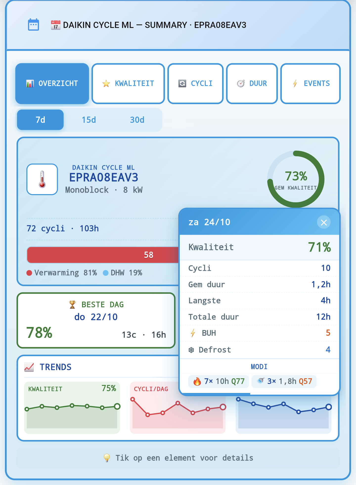
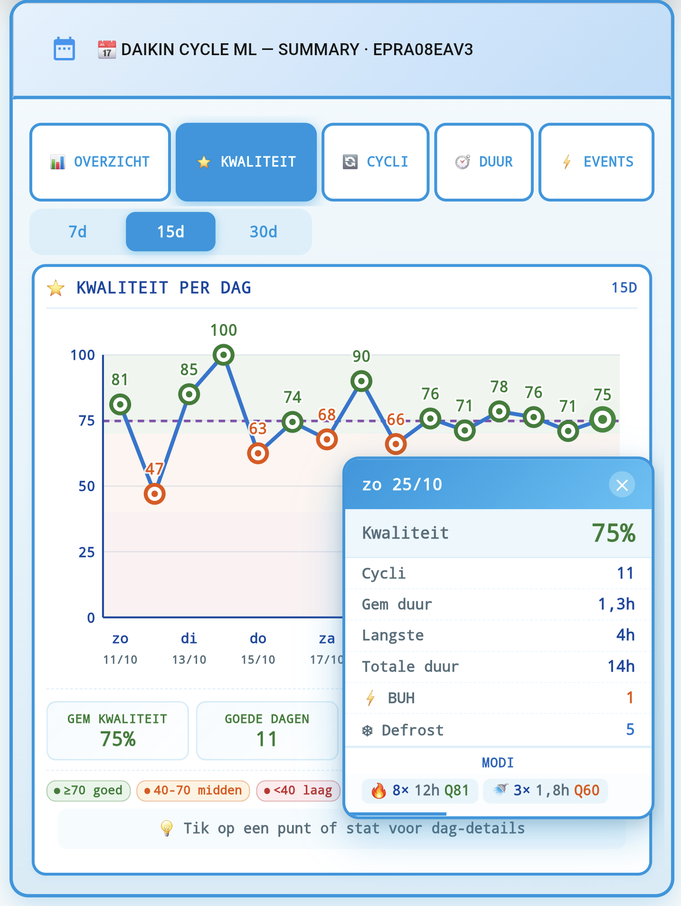
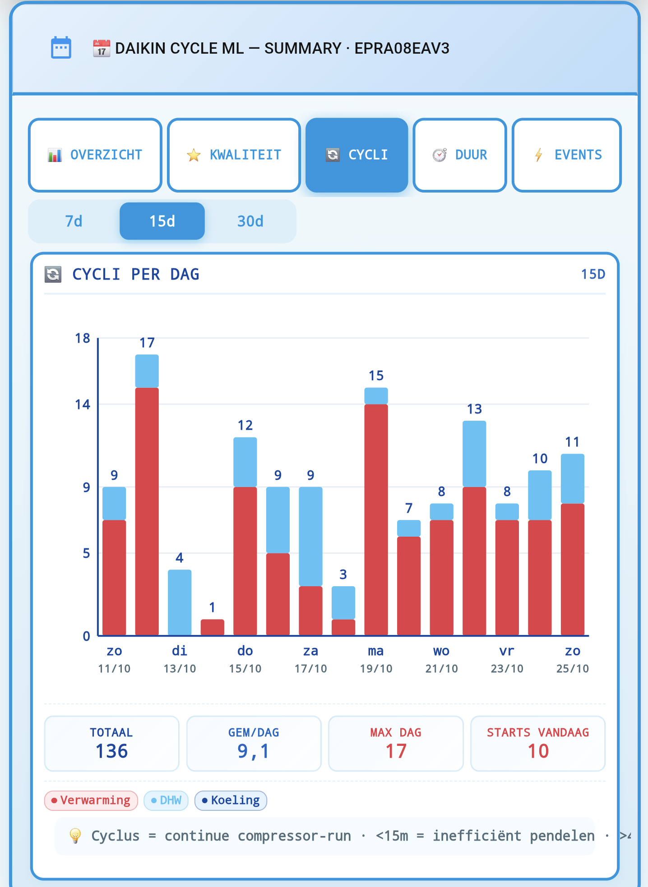
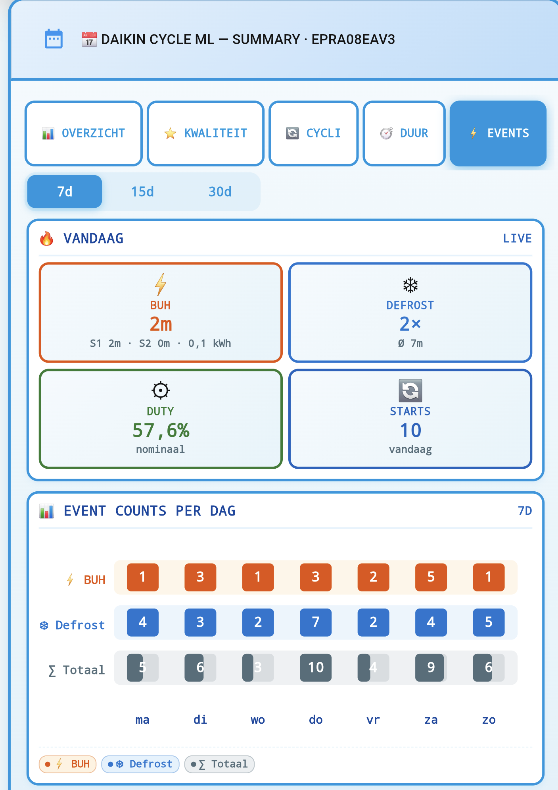

# Daily Summary Tabbed Card

Multi-tab Lovelace dashboard card for **Daikin Cycle ML** with 5 views — Overview, Quality, Cycles, Duration, Events — interactive popups, and EN/NL auto-detection.

**📥 [Copy the YAML](daily-summary-tabbed.yaml)** · **[Installation](#installation)** · **[Variables](#variables)** · **[Troubleshooting](#troubleshooting)**

---

## What it shows

| Tab | Content |
|---|---|
| **Overview** | HP model hero, avg quality ring, mode split bar, best/worst day cards, 3 sparkline trends |
| **Quality** | Adaptive Y-axis, quality-per-day line + dots, avg line, distribution counts |
| **Cycles** | Per-mode stacked bars, day totals, avg/max/starts stats |
| **Duration** | Per-mode stacked runtime bars, adaptive cap, clipped-day markers |
| **Events** | Live today tiles (BUH/Defrost/Duty/Starts), 3-row daily counts (BUH/Defrost/Total), ratio chart |

*vs. the original Daily Summary card:* adds multi-tab navigation, adaptive chart scaling, persistent tab/window state, popup details on every element, and Dutch entity support.

---

## Requirements

### Backend

- **daikin_cycle_ml** `>= v1.12.0`

### Frontend (HACS cards)

| Card | Repo | Purpose |
|---|---|---|
| `stack-in-card` | custom-cards/stack-in-card | Wrapper |
| `mushroom-template-card` | piitaya/lovelace-mushroom | Header |
| `button-card` | custom-cards/button-card | Content renderer |
| `card-mod` | thomasloven/lovelace-card-mod | Border + shadow styling |

Install each via **HACS → Frontend → Explore & Download Repositories**. Restart Home Assistant after installing a new frontend card.

---

## Installation

1. Install the 4 HACS frontend cards (see above).
2. Restart Home Assistant.
3. Hard-refresh browser (Ctrl+Shift+R).
4. Open **Lovelace → Edit dashboard → + Add Card → Manual**.
5. Open [`daily-summary-tabbed.yaml`](daily-summary-tabbed.yaml) (click **Raw** → copy, or right-click → **Save link as**) and copy the entire YAML.
6. Paste it into the manual card editor.
7. (Optional) Add a `variables:` block at the top — see Variables section.
8. **Save.**

The card auto-detects your HP model, HA language, and entity names. No manual entity-ID edits required if your integration uses the default prefix.

---

## Variables

All variables are optional. Add them at the **top** of the YAML, before `type:`:

    type: custom:stack-in-card
    variables:
      lang_override: ''
      default_tab: 'overview'
      default_window: 7
      chart_height: 280
      show_hints: true

| Variable | Type | Default | Description |
|---|---|---|---|
| `lang_override` | string | '' | Force language: empty (auto), `nl`, or `en` |
| `default_tab` | string | 'overview' | Initial tab: `overview`, `quality`, `cycles`, `duration`, `events` |
| `default_window` | int | 7 | Initial window: 7, 15, or 30 days |
| `chart_height` | int | 280 | Chart height in pixels |
| `show_hints` | bool | true | Show "tap for details" hint notes |

---

## Tabs overview

### Overview
HP model hero panel with average-quality ring, mode split bar, and best/worst day cards. 3 sparkline trends below.

### Quality
Daily quality line chart. Y-axis auto-adapts — if all values ≥70, view is 60-100 to remove dead space. Dashed line = 7-day avg.

### Cycles
Per-day stacked bars by mode. Day totals shown above bars. Stats strip: total, avg/day, max/day, starts today.

### Duration
Per-day stacked runtime bars. Y-axis caps at p95 to keep outliers visible. Clipped days get a red marker.

### Events
Live today tiles (BUH, Defrost, Duty, Starts). Daily counts with 3 rows (BUH / Defrost / Total) and mini-bar fill showing relative totals. Ratio chart with 15% and 35% reference lines.

---

## Popups

Every interactive element triggers a detail popup:

- **Day elements** (dots, bars, stats) → daily breakdown with per-mode splits
- **Hero panel** → range summary (total cycles, avg quality, best/worst)
- **Event tiles** → current metrics (BUH steps, defrost age, duty band)
- **Best/worst cards** → that specific day's details

Popup auto-dismisses after 4 seconds. Click to close immediately.

---

## Language detection

Priority order:

1. `variables.lang_override` (if set)
2. `hass.language` (HA UI setting)
3. `configured_language` (integration setting)
4. Default: `en`

**Mixed system?** If HA UI is EN but entities are Dutch, force NL labels with `lang_override: 'nl'`.

---

## Entity compatibility

The card resolves entities via suffix matching. Supported variants:

| Purpose | English | Dutch |
|---|---|---|
| Daily summary | `*_daily_summary_recent` | `*_recent_dagoverzicht` |
| HP specs | `*_hp_specs` | `*_wp_specs` |
| Cycle state | `*_cycle_state` | `*_cyclus_status` |
| Starts | `*_compressor_starts_today` | `*_compressorstarts_vandaag` |
| BUH runtime | `*_runtime_buh_today` | `*_buh_bedrijfstijd_vandaag` |
| Defrost count | `*_defrost_count_today` | `*_ontdooiingen_vandaag` |
| Defrost duration | `*_defrost_duration_today` | `*_ontdooiingsduur_vandaag` |
| Duty cycle | `*_duty_cycle_today` | `*_duty_cycle_vandaag` |

**Custom entry names** work too — e.g. `sensor.warmtepomp_recent_dagoverzicht`. The resolver tries the `daikin_cycle_ml` prefix first, then falls back to any prefix with the correct suffix.

### Verify entities resolve

In **Developer Tools → Template**, paste:

    {{ states.sensor
      | selectattr('entity_id', 'search', '(daily_summary_recent|recent_dagoverzicht|hp_specs|wp_specs|cycle_state|cyclus_status)$')
      | map(attribute='entity_id') | list }}

Expected: 3 entities (summary, specs, state). All 3 present = card will work.

---

## Customization examples

Dutch labels on mixed EN UI + NL entities:

    type: custom:stack-in-card
    variables:
      lang_override: 'nl'
      default_tab: 'quality'
      default_window: 30

Larger charts for tablets or wall-mounted displays:

    variables:
      chart_height: 400
      show_hints: false

---

## Troubleshooting

### "Daikin Cycle ML entities niet gevonden"
Resolver could not find the 3 core entities. Check:
- Integration is running (Settings → Devices & Services → Daikin Cycle ML)
- Entry is not disabled
- Run the template query above to see what entities exist

### "Summary error: card is not defined"
JavaScript exception in `button-card`. Check browser console (F12). Reinstall `button-card` via HACS if persistent.

### Popup does not appear
- `button-card` version too old (needs v3.5+)
- Browser cache — hard-refresh (Ctrl+Shift+R)

### Chart is empty
- Overview/Cycles/Duration need `daily_summary_recent` with `days[]` attribute
- Events need `runtime_buh_today`, `defrost_count_today`, `duty_cycle_today`
- Quality needs `quality_avg` in each `days[]` record

---

## Data & limitations

- **Adaptive Y-axis** — Quality chart may show 60-100 range if all data is high. Intentional, reduces empty space.
- **Duration cap** — Y-axis caps at p95. Days above cap get a red clipping marker.
- **Window persistence** — tab and window state survive 30s tick updates via internal state. Resets to `default_tab` / `default_window` on page refresh.
- **Popup auto-dismiss** — after 4 seconds. No persistence.
