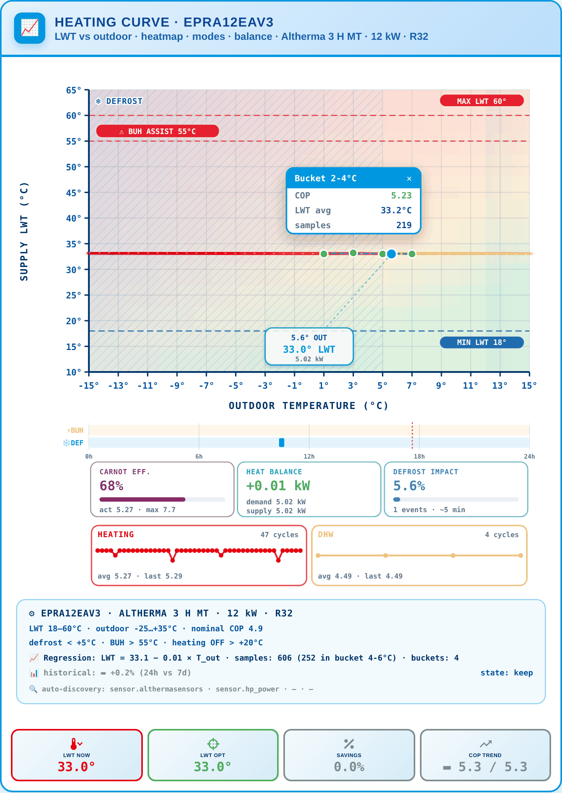

# Heating curve — YAML card

The water temperature your heat pump runs at against the outdoor
temperature, coloured by COP, with your model's limits and the live
point. English, Dutch and French, dark mode.

> **Native alternative:** the [Efficiency card](../daikin-efficiency-card/README.md)
> has the heating curve (*Curve* tab) without YAML. This card still adds
> the COP heatmap behind the curve.

[CHANGELOG](CHANGELOG.md) · [All cards](../../README.md) · [YAML card guide](../README.md)

## Contents

- [What it shows](#what-it-shows)
- [Install](#install)
- [Reading the card](#reading-the-card)
- [Variables](#variables)
- [Troubleshooting](#troubleshooting)

## What it shows

- the **measured curve**: one point per 2 °C outdoor band, at its mean
  water temperature, coloured by COP (green 4 or more, orange 2.5-4, red
  below 2.5), with a running line through the points;
- your **model's limits** from the datasheet: water temperature range,
  defrost, backup-heater and heating-off zones;
- the **live point** with outdoor, water temperature and heat output;
- a 24 h strip of **backup heater** and **defrost**;
- **Carnot efficiency**, **heat balance** and **defrost impact**;
- COP per **mode** (48 h sparklines);
- the **advice tiles**: water temperature now and optimal, expected COP
  gain, COP trend.

## Install

Needs button-card, stack-in-card and card-mod (HACS → Frontend). Copy
[`heating-curve.yaml`](heating-curve.yaml), then **Edit dashboard → + Add
card → Manual**, paste, **Save**. Re-paste after an update when the
release notes list this card. Details: [YAML card guide](../README.md).

## Reading the card

**Zones**

| Zone | Meaning |
|---|---|
| Defrost (blue hatching, left) | Outdoor below +5 °C: defrosts expected |
| Backup heater (red band, top) | Water above 55 °C: the backup heater may help |
| Heating off (grey, right) | Outdoor above +20 °C: no heating demand |

The exact limits come from your model's datasheet
(`sensor.daikin_cycle_ml_hp_specs`).

**Points:** tap a point for its band, mean COP, water temperature and
number of samples. The points come from the heating-curve advice
(`heating_curve_advice`, attribute `buckets`); they stay while hot water or
the backup heater pause the advice.

**Panels**

| Panel | Value |
|---|---|
| Carnot efficiency | Live COP against the Carnot limit at these temperatures |
| Heat balance | Heat delivered against demand |
| Defrost impact | Share of running time spent defrosting |

**Tiles:** water temperature now and the best-COP temperature for this
outdoor band, the expected COP gain of the advice, and the COP of the last
24 h against 7 days.

## Variables

In the header (`variables: &dcm`), shared by all YAML cards:

| Variable | Default | Values |
|---|---|---|
| `lang_override` | `''` | `''` (automatic), `en`, `nl`, `fr` |
| `theme_override` | `auto` | `auto`, `light`, `dark` |
| `show_help` | `true` | Show the explanation notes |

Language, theme and header: [YAML card guide](../README.md).

## Troubleshooting

| Symptom | Check |
|---|---|
| Card shows as text or `Custom element doesn't exist` | Install button-card, stack-in-card and card-mod; restart; refresh the browser |
| `ButtonCardJSTemplateError` | The YAML was changed while pasting: copy the raw file again |
| Values show `—` | The integration is loaded? Copy the latest YAML; check `sensor.daikin_cycle_ml_hp_specs` |
| No points | The advice needs heating samples in at least two outdoor bands; wait a few days of heating |
| No live point | Only while the compressor runs |
| Wrong language | `lang_override`, or the Home Assistant language |

The browser console (F12) usually names the problem.
