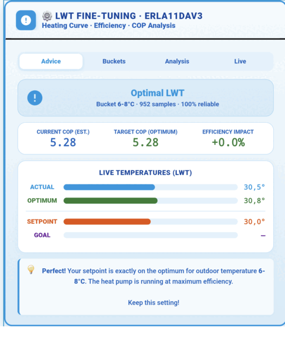

# LWT Fine-Tuning Card

Interactive Lovelace card for **heating curve optimization**, **LWT (Leaving Water Temperature) analysis**, and **COP efficiency insights** — powered by Daikin Cycle ML sensor data.

---

## What this card does

Four-tab hub that turns raw `heating_curve_advice` sensor attributes into actionable guidance:

| Tab | Purpose |
|-----|---------|
| **⚙️ Advice** | Hero banner with current recommendation (Lower LWT / Raise LWT / Optimal), Current vs Target COP, live temperature bars, multi-line explanation note. |
| **📊 Buckets** | Interactive chart of optimal LWT per outdoor temperature bucket. Tap any dot for per-bucket COP details. Current bucket highlighted in green. |
| **🔬 Analysis** | Heating curve parameters (Slope / Tracking Error / Step Size) and offset recommendation. Explains what slope and offset mean. |
| **📡 Live** | Animated real-time LWT marker with optimal zone, setpoint + goal reference lines, auto-scaled. Live 4-stat footer. |

## Tab reference — full breakdown

The card bundles four interactive tabs, each targeting a different question.

### ⚙️ Tab 1: Advice (default)

**Question answered:** "What should I do right now?"

**Visual elements:**
- **Hero banner** — color-coded call to action (green/red/blue)
- **COP grid** — Current COP (est.), Target COP (optimum), Efficiency Impact (%)
- **Live temperature bars** — Actual / Optimum / Setpoint / Goal
- **Explanation note** — plain-language guidance tailored to state

**Decision matrix:**

| `delta_c` | Hero color | Hero label | Recommended action |
|-----------|-----------|------------|-------------------|
| `< -0.5` | 🟢 Green | **Lower LWT** | Decrease heating curve Offset |
| `> +0.5` | 🔴 Red | **Increase LWT** | Increase heating curve Offset |
| `-0.5 .. +0.5` | 🔵 Blue | **Optimal LWT** | Keep current setting |

When to look: every time you open the dashboard.

### 📊 Tab 2: Buckets

**Question answered:** "How does my heat pump perform at different outdoor temperatures?"

**Visual elements:**
- **Interactive LWT curve** — one point per 2°C outdoor bucket
- **Auto-zoom** — y-axis adapts (≥10% padding, min 5° range)
- **Optimal-zone band** — ±1.5°C around current target LWT
- **Current bucket highlight** — green if good, red if over-heating
- **Reference lines** — dashed Setpoint (orange) + Goal (purple)

**Interactions:** Tap any dot → popup with Bucket, Optimal LWT, COP, Sample count, Outdoor temp.

**Empty states:**
- Fewer than 2 buckets: "Insufficient data for chart."
- No bucket data: "Waiting for Daikin data..." (DHW/Defrost variants)

When to look: to understand seasonal behavior or spot bad temperature ranges.

### 🔬 Tab 3: Analysis

**Question answered:** "How well is my heat pump tracking the setpoint?"

**Visual elements:**
- **3-cell grid:** Slope / Tracking Error / Step Size
- **Offset advice box** — colored call-to-action

**Field meanings:**
- **Slope** — rate of setpoint change per °C outdoor temp
- **Tracking Error** — gap between actual LWT and setpoint (≤ 2°C = healthy)
- **Step Size** — recommended per-adjustment change

**Offset advice matrix:**

| `offset_delta_c` | Color | Text shown |
|------------------|-------|------------|
| `0` | 🟢 Green | Keep offset |
| `> 0` | 🔴 Red | Increase +X° |
| `< 0` | 🟢 Green | Decrease X° |

When to look: after making a change, to verify tracking.

### 📡 Tab 4: Live

**Question answered:** "What's happening right now with my LWT?"

**Visual elements:**
- **Horizontal LWT scale** — color-coded track
- **Green optimal zone** — ±1.5°C band
- **Animated LWT marker** — blue pulsing dot with live value
- **Reference lines** — dashed Setpoint + Goal
- **4-stat footer** — Actual / Optimum / Setpoint / Goal values

**Animation:** pulsing ring (2s cycle) marks the live state.

When to look: during active heating, or after defrost to see settling.

---

## Prerequisites

- **Daikin Cycle ML** integration installed and loaded (v1.21+ recommended)
- One of the following sensor entity sets present and not disabled:

| Role | English name | Dutch name |
|------|--------------|------------|
| HP specs | `sensor.*_hp_specs` | `sensor.*_wp_specs` |
| Cycle state | `sensor.*_cycle_state` | `sensor.*_cyclus_status` |
| LWT advice | `sensor.*_heating_curve_advice` | `sensor.*_stooklijn_advies` |

The card auto-resolves via `daikin_cycle_ml`-prefixed entities first, then falls back to any matching suffix.

---

## Installation

1. Open your Lovelace dashboard
2. **Edit dashboard** → **+ Add Card** → **Manual**
3. Paste the full contents of `card.yaml`
4. **Save**

No HACS resource install needed — the card bundles its own CSS/JS via `card_mod` and `button-card` (both must be installed via HACS).

### Required HACS frontend cards

- `stack-in-card`
- `mushroom-template-card`
- `button-card`
- `card-mod`

If any is missing, the card will render empty or with a config error.

---

## Configuration

The card accepts one optional variable:

    variables:
      lang_override: 'nl'   # 'nl', 'en', or '' (auto-detect from hass.language)

Set `lang_override: ''` (default) to auto-follow the Home Assistant UI language.

---

## LWT Advice — how to read it

The `delta_c` attribute from `heating_curve_advice` drives the main recommendation:

| Condition | Meaning | Action |
|-----------|---------|--------|
| `delta_c < -0.5` | Setpoint is **too high** for this outdoor temp | **Lower** heating curve → saves COP (green banner) |
| `delta_c > 0.5` | Setpoint is **too low** | **Raise** curve → comfort risk (red banner) |
| `|delta_c| <= 0.5` | Setpoint is **optimal** | Keep current setting |

> ⚠️ **Why negative means "lower":** Daikin's integration uses a *negative* `delta_c` to signal *over-heating* (which costs COP). The card interprets negative delta as a **COP-saving opportunity**, not as "too cold". Earlier dashboard versions confused this — v1.22.5+ is correct.

---

## Entity attributes consumed

From `heating_curve_advice` (all optional, card degrades gracefully):

| Attribute | Used for |
|-----------|----------|
| `bucket` | Current outdoor temperature bucket (e.g. `2-4°C`) |
| `buckets` | Per-bucket LWT/COP/samples map |
| `huidige_lwt` | Actual LWT |
| `optimale_lwt` | Optimal LWT for current bucket |
| `huidige_setpoint` | Current heating curve setpoint |
| `doel_setpoint` | Target setpoint (optimum) |
| `delta_c` | Recommended setpoint change (see above) |
| `besparing_cop_pct` | COP savings if recommendation applied |
| `betrouwbaarheid` | Confidence 0..1 |
| `samples` | Sample count for current bucket |
| `slope_delta` | Curve slope estimate |
| `tracking_error` | Setpoint tracking error (°C) |
| `offset_delta_c` | Recommended offset adjustment |
| `step_c` | Recommended step size |
| `state_label` | Human label for hero banner |

From `hp_specs`: `model` (shown in the card header).

## Complete message catalog

Every message the card can show, with the trigger condition.

### State-based advices

| Banner | Trigger | Message |
|--------|---------|---------|
| **Lower LWT** | `delta_c < -0.5` | "Your setpoint is X°C too high. Lowering it saves Y% COP. Lower Offset by X°C." |
| **Increase LWT** | `delta_c > +0.5` | "Your setpoint is X°C too low. Increase Offset by X°C for comfort." |
| **Optimal LWT** | \|`delta_c`\| ≤ 0.5 | "Perfect! Setpoint is on the optimum. Keep this setting!" |

### Analysis notes

| Condition | Style | Message |
|-----------|-------|---------|
| Tracking > 2°C | ⚠️ Warning | "Tracking Error X°C is high. Causes: defrost, low water flow, aggressive curve." |
| Tracking ≤ 2°C | 💡 Info | "Tracking Error X°C is very good. Slope sets rise rate; Offset is fixed add-on." |

### Bucket notes

| Samples | Confidence word |
|---------|-----------------|
| > 50 | "very reliable" |
| 11-50 | "reliable" |
| ≤ 10 | "not enough data yet" |

### Waiting messages

| Cycle state | Icon | Message |
|-------------|------|---------|
| Default | Spinning circle | "Waiting for Daikin data..." |
| DHW / SWW | Pulsing droplet | "Waiting for Daikin data (DHW active)..." |
| Defrost | Pulsing triangle | "Waiting for Daikin data (Defrost active)..." |

### Error messages

| Condition | Message |
|-----------|---------|
| No advice sensor | "Daikin Cycle ML entities not found." |
| Integration unavailable | "Daikin integration unavailable." |
| Chart < 2 buckets | "Insufficient data for chart." |
| JS runtime error | "Error: [detail]" |

---

## User actions — step-by-step

What to do based on the advice shown.

### Advice = "Lower LWT" (green banner)

The card reports your setpoint is X°C **too high**. You're paying for heat you're not using.

1. Open Daikin controller → Heating curve settings
2. Find the **Offset** parameter (not Slope)
3. **Decrease** by X°C (from banner)
4. Wait 24-48 hours with stable outdoor temp
5. Re-check Advice tab → should shift toward "Optimal LWT"
6. Verify Current COP climbed closer to Target COP

Savings: Y% per Efficiency Impact. Adds up over a heating season.

### Advice = "Increase LWT" (red banner)

The card reports your setpoint is X°C **too low**. Comfort risk during cold snaps.

1. Open Daikin controller → Heating curve settings
2. Find the **Offset** parameter
3. **Increase** by X°C
4. Wait 24-48 hours
5. Re-check Advice tab

Trade-off: more energy spent. If banner flips to "Lower LWT", you've overshot.

### Advice = "Optimal LWT" (blue banner)

No action needed. Keep current setting. Re-check after significant outdoor swings (> 5°C change).

### Tracking error high (> 2°C)

1. Recent defrost cycle — wait 15-30 minutes
2. Low water flow — increase pump speed 1 step
3. Aggressive heating curve — check slope
4. Sensor lag — normal for small errors

### Bucket looks anomalous (dip in chart)

1. Tap the bucket to see COP and samples
2. Low samples (< 10) — unreliable, ignore
3. High samples + low COP — investigate that week's data

### Live tab shows large gap

Normal during: defrost (5-15 min), DHW heating, cold start. Gap should close within 30 min. If not, check tracking error causes above.

### Configuration changes

Three variables (edit card config):

- `lang_override` — 'en' or 'nl' (default: auto-detect)
- `default_tab` — 'advice' | 'buckets' | 'analysis' | 'live'
- `show_help` — false to hide explanation notes

---

## Troubleshooting

| Symptom | Cause | Fix |
|---------|-------|-----|
| "Daikin Cycle ML entities not found" | Integration not loaded, or all three sensors renamed | Verify entity IDs in Developer Tools → States |
| "Waiting for Daikin data..." | No `bucket` attribute yet | Wait for first full heating cycle |
| "Insufficient data for chart" | Fewer than 2 outdoor temp buckets | Normal on fresh install; accumulates over days |
| Empty card, no error | Missing HACS frontend dep | Install all 4 required cards |
| Hero says "Lower LWT" but note says "raise" | Old card version | Use the version in this folder (v1, 2026-11-13) |

---

## How it works (technical)

- Single `button-card` host with three `.lwt-view` divs, toggled by `data-view` attribute.
- Tab clicks are dispatched by a `tap_action` JS handler that reads `data-ev-action` from the nearest hovered element (no per-tab handlers → less event listener churn).
- Popups use a `window.__lwtShowPop` / `window.__lwtHidePop` pair with a rolling payload registry capped at 2000 entries.
- Auto-locale detection: `hass.language.startsWith('nl')` → NL, else EN.
- No external network calls, no template helpers — pure client-side rendering.

---

## Version history

See `CHANGELOG.md`.

## License

Same as the parent project (see repo root).
