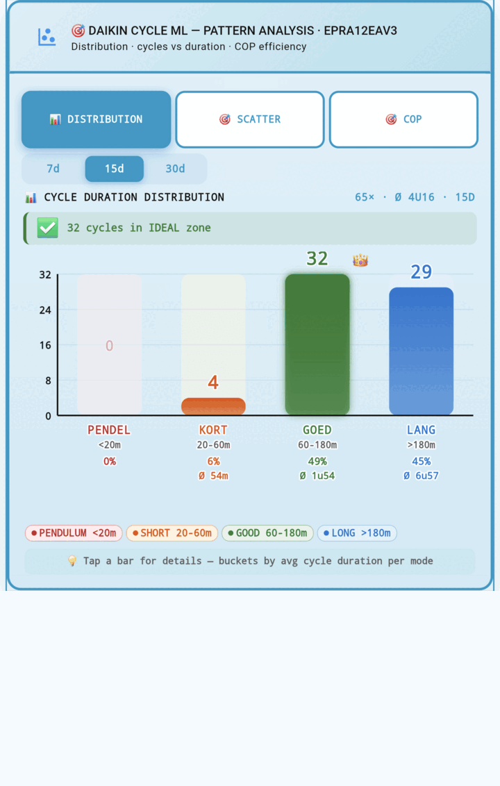

# Pattern Analysis Card

Multi-tab Lovelace dashboard card for **Daikin Cycle ML** with 3 views — Distribution, Scatter, and COP — interactive popups, dual-axis trends, dark-mode support, and EN/NL entity auto-detection.

**[Copy the YAML](pattern-analysis.yaml)** · **[Installation](#installation)** · **[Variables](#variables)** · **[Troubleshooting](#troubleshooting)**

---

## What it shows

| Tab | Content |
|---|---|
| **Distribution** | Cycle-duration buckets (Pendulum / Short / Good / Long), dominant-bucket crown badge, per-bucket day-list popups, share & average duration per bucket |
| **Scatter** | Cycles/day vs avg duration scatter, quality-based colouring, collision-free labels, today-highlight pulse, per-point detail popup |
| **COP** | COP today + 48h sparkline, datasheet comparison (A7/W35), per-mode COP cards, dual-axis duration & cycles trend with crown/warning badges, system health strip, contextual insight banner |

*vs. the Daily Summary Tabbed card:* replaces the fixed 5 tabs with 3 focused analytic views. Adds live COP analysis with datasheet comparison, dual-axis combined duration/cycle trend with per-day crown/warning badges, and full dark-mode support via HA CSS variables.

---

## Requirements

### Backend

- **daikin_cycle_ml** `>= v1.21.0`

### Frontend (HACS cards)

| Card | Repo | Purpose |
|---|---|---|
| stack-in-card | [custom-cards/stack-in-card](https://github.com/custom-cards/stack-in-card) | Wrapper |
| mushroom-template-card | [piitaya/lovelace-mushroom](https://github.com/piitaya/lovelace-mushroom) | Header |
| button-card | [custom-cards/button-card](https://github.com/custom-cards/button-card) | Content renderer |
| card-mod | [thomasloven/lovelace-card-mod](https://github.com/thomasloven/lovelace-card-mod) | Border + shadow styling |

Install each via **HACS → Frontend → Explore & Download Repositories**. Restart Home Assistant after installing a new frontend card.

---

## Installation

1. Install the 4 HACS frontend cards (see above).
2. Restart Home Assistant.
3. Hard-refresh browser (Ctrl+Shift+R).
4. Open **Lovelace → Edit dashboard → + Add Card → Manual**.
5. Open [pattern-analysis.yaml](pattern-analysis.yaml) (click **Raw** → copy, or right-click → **Save link as**).
6. Paste it into the manual card editor.
7. *(Optional)* Add a variables block at the top — see [Variables](#variables).
8. **Save.**

The card auto-detects your HP model, HA language, and entity names. No manual entity-ID edits required if your integration uses the default prefix.

---

## Variables

All variables are optional. Add them at the top of the YAML, before the type field:

    type: custom:stack-in-card
    variables:
      lang_override: ''
      default_tab: 'dist'
      default_window: 7
      chart_height: 280
      show_hints: true

| Variable | Type | Default | Description |
|---|---|---|---|
| lang_override | string | (empty) | Force language: empty (auto from HA), nl, or en |
| default_tab | string | dist | Initial tab on load: dist, scatter, or cop |
| default_window | int | 7 | Initial time window: 7, 15, or 30 days |
| chart_height | int | 280 | Chart height hint (px). SVG auto-scales to full card width |
| show_hints | bool | true | Show the "tap for details" hint notes below each chart |

### Examples

**Force Dutch labels + COP tab on load:**

    type: custom:stack-in-card
    variables:
      lang_override: 'nl'
      default_tab: 'cop'
      default_window: 30

**Compact view without hint notes:**

    type: custom:stack-in-card
    variables:
      show_hints: false
      chart_height: 240

---

## Tabs

### 1. Distribution

Buckets aggregated across all days in the selected window:

| Bucket | Range | Meaning |
|---|---|---|
| **PENDEL** | less than 20 min | Pendulum / short-cycling |
| **KORT** | 20 - 60 min | Short run |
| **GOED** | 60 - 180 min | Good cycle |
| **LANG** | more than 180 min | Long run |

- **Dominant bucket** — marked with a crown badge.
- **Bar colours** — red (Pendulum), orange (Short), green (Good), blue (Long).
- **Tap any bar** → popup with cycles, days, share %, average duration, total runtime, and a per-day breakdown.
- **Axis and labels** — Y-axis auto-scales to the largest bucket count.

### 2. Scatter

- **X-axis** — cycles per day
- **Y-axis** — average duration (minutes)
- **Dot colour** — quality score (green above 70, orange 40-69, red below 40)
- **Dot size** — scales with cycles/day
- **Today-highlight** — pulsing halo on the latest/today point
- **Collision-free labels** — day abbreviation + avg duration, placed in up to 4 candidate rows
- **Background zones** — Pendulum (red), Mixed (orange), Ideal (green), Too-long (red)
- **Tap any dot** → popup with cycles, share %, avg/max/total duration, quality, BUH count, defrost count, and per-mode breakdown.

### 3. COP

Six sub-sections:

**COP Performance**

- Today's COP big number, min/max band, sample count
- 48h sparkline from cop_curve_recent.points[]
- Datasheet comparison card (tilde prefix indicates approximate calculation from hp_specs.points A7/W35)
- D/W/M trend lines per mode (Heating / DHW / Cooling)

**Mode Breakdown**

- 2x2 cards: Heating / DHW / Cooling / Combined
- Each card: current COP, trend arrow, Day/Week/Month sparkline
- Tap → popup with all three period values + sample count + min/max range + p10/p90 range

**Duration and Cycles Trend**

- **Left Y-axis** — duration (bars, coloured by bucket)
- **Right Y-axis** — cycles (line, purple)
- **Target lines** — duration target (green dashed) and cycles target (purple dashed) from learned_thresholds
- **Crown/warning badges** — for good days / bad days
- **Today pulse** — animated pulse on today's bar and cycle dot
- Tap any bar → full daily detail popup

**System Health**

- **SPF SEASON** — seasonal SPF value
- **WEEK TREND** — COP degradation week % (coloured by sign)
- **BUH** — Backup heater runtime today
- **DEFROST** — Defrost count today
- Tap any tile → popup with detail + thresholds

**Insight Banner**

Contextual assessment based on prioritised checks:

1. Heating COP below datasheet times 0.85 → warning
2. Week trend below -8% → warning
3. Any day above 1.5x target cycles → warning
4. SPF at or above 3.5 → success
5. COP above datasheet → success
6. Default: "System performing normally"

---

## Language detection

**Priority order:**

1. lang_override variable (if en or nl)
2. hass.language (starts with nl → Dutch)
3. configured_language attribute on cycle_state
4. Default: en

**Mixed system?** If HA UI is EN but your entities are Dutch, force NL labels with lang_override nl.

---

## Entity compatibility

The card resolves entities via suffix matching. The resolver tries the daikin_cycle_ml prefix first, then falls back to any prefix with the correct suffix.

| Purpose | English suffix | Dutch suffix |
|---|---|---|
| Daily summary | _daily_summary_recent | _recent_dagoverzicht |
| HP specs | _hp_specs | _wp_specs |
| Cycle state | _cycle_state | _cyclus_status |
| Compressor starts | _compressor_starts_today | _compressorstarts_vandaag |
| BUH runtime | _runtime_buh_today | _buh_bedrijfstijd_vandaag |
| Defrost count | _defrost_count_today | _ontdooiingen_vandaag |
| Defrost duration | _defrost_duration_today | _ontdooiingsduur_vandaag |
| Duty cycle | _duty_cycle_today | _duty_cycle_vandaag |
| COP today | _cop_today | _cop_vandaag |
| COP heating (D/W/M) | _cop_heating_{day,week,month} | _cop_verwarming_{dag,week,maand} |
| COP DHW (D/W/M) | _cop_dhw_{day,week,month} | _cop_dhw_{dag,week,maand} |
| COP cooling (D/W/M) | _cop_cooling_{day,week,month} | _cop_koeling_{dag,week,maand} |
| SPF season | _spf_season | _spf_seizoen |
| Degradation week | _cop_degradation_week_pct | _cop_degradatie_week_pct |
| Learned thresholds | _learned_thresholds | _geleerde_drempels |
| COP curve recent | _cop_curve_recent | _cop_curve_recent |
| COP vs datasheet | _cop_vs_datasheet_pct | _cop_vs_datasheet_pct |

Custom entry names work too — e.g. sensor.warmtepomp_recent_dagoverzicht. The resolver tries the daikin_cycle_ml prefix first, then falls back to any prefix with the correct suffix.

---

## Troubleshooting

| Issue | Cause | Fix |
|---|---|---|
| "entities not found" message | Neither _daily_summary_recent nor _recent_dagoverzicht exists | Ensure daikin_cycle_ml integration is running and at least one cycle has completed |
| Tabs revert to first tab on update | Old YAML used setAttribute on viewBox | Update to latest pattern-analysis.yaml — this version persists state in window.__paTab / window.__paWin |
| Charts appear narrow or centered | A height attribute is forced on the SVG | Current version uses width 100 percent and auto height |
| Popups don't appear on tap | button-card or card-mod not installed | Install both and restart HA |
| COP datasheet card shows dash | hp_specs.points[] missing or lacks A7/W35 | Verify sensor.daikin_cycle_ml_hp_specs has an A7/W35 row |
| Dark theme looks broken | card-mod not applied | Ensure card-mod is latest and HA's themes.darkMode is true |

---

## Data and limitations

- **Window cap** — Maximum 30 days. Values above 30 are silently capped.
- **Popups use canvas coordinates** — Positioned via getBoundingClientRect() relative to .pa-chart. Fully compatible with stack-in-card but not with horizontal-stack.
- **Popups auto-dismiss after 5 seconds** — Or tap anywhere inside to close immediately.
- **Distribution buckets are fixed** — Pendulum under 20 min, Short 20-60 min, Good 60-180 min, Long over 180 min.
- **Datasheet comparison** — Uses hp_specs.points[] where label equals "A7/W35". If missing, falls back to cop_vs_datasheet_pct sensor. If both fail, shows a dash with tilde prefix.
- **Combined trend chart** — Uses last N entries of the daily summary. Single day shows a single point (no path).
- **No persistent state across page reloads** — Tab and window persist in window.__paTab / window.__paWin for the session; full page reload resets to defaults.
- **Language fallback** — If configured_language missing and hass.language is not NL, defaults to EN.

---

## Data flow

    daily_summary_recent.days[]                  Dist / Scatter / Combined trend
    hp_specs.points[]                            Datasheet ref (A7/W35)
    cycle_state.configured_language              Language detection
    cop_today.cop / cop_min / cop_max            COP header + band
    cop_curve_recent.points[]                    48h sparkline
    cop_heating/dhw/cooling day, week, month     Mode cards + trend lines
    spf_season                                   Health strip
    cop_degradation_week_pct                     Health strip + insight
    runtime_buh_today                            Health strip
    defrost_count_today                          Health strip
    learned_thresholds.target_cycles_per_day     Target lines

---

*Part of the [daikin_cycle_ml](../../..) integration.*
