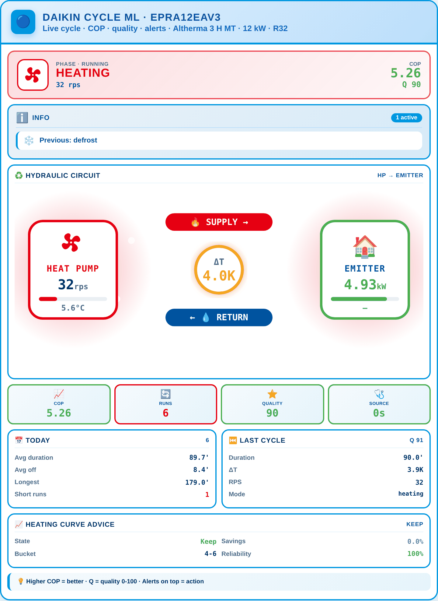

# Simple card — YAML card

Live phase, hydraulic diagram, COP, quality, alerts, today, last cycle and the heating-curve advice on one compact card. English, Dutch and French, dark mode.

[CHANGELOG](CHANGELOG.md) · [All cards](../../README.md) · [YAML card guide](../README.md)



## What it shows

| Section | Content |
|---|---|
| **Header** | Title + live subtitle |
| **Hero** | Current phase (IDLE / HEATING / DHW / DEFROST / BUH / COOLING) + animated fan at live rps + COP + Quality |
| **Alerts** | Only when active - colour-coded by severity (crit / warn / info) |
| **Diagram** | Hydraulic loop: warmtepomp -> afgifte, with live rps / kW / dT |
| **Tiles** | COP - Runs today/target - Quality % - Source age |
| **2-col detail** | "Vandaag" (avg duration, avg off, longest, short runs) next to "Laatste cyclus" (duration, dT, rps, mode) |
| **Stooklijn** | Current advice state + bucket + savings % + reliability |
| **Explain** | One-line legend for non-obvious values |

All **25 entities** from the integration are used. Missing values render
as an em-dash placeholder (no errors, no broken layout).

---

## Dependencies

Install each via **HACS -> Frontend -> Explore & Download Repositories**:

| Card | Purpose | HACS repo |
|---|---|---|
| `stack-in-card` | Outer container that vertically stacks the cards | `custom-cards/stack-in-card` |
| `button-card` | Dynamic HTML render (the entire body) | `custom-cards/button-card` |
| `card-mod` | Inline CSS (border + gradient on the outer frame) | `thomasloven/lovelace-card-mod` |

**Minimum versions**: any recent release (2025 or newer).

---

## Installation

1. **Install the three dependencies** (see above) via HACS.
2. **Restart Home Assistant** - required after installing a new frontend card.
3. Hard-refresh the browser (Ctrl+Shift+R).
4. Open a dashboard in edit mode, click **+ Add Card**.
5. Choose **Manual** (bottom of the card picker).
6. Copy the entire contents of `simple-card.yaml` and paste it.
7. Click **Save**.

If the card looks unstyled or empty:

- Hard-refresh the browser again.
- Open **Developer Tools -> Console** in the browser for JS errors.
- Verify all three frontend cards are listed under
  **Settings -> Dashboards -> Resources**.

---

## Configuration

### Variables, language and theme

The variables are in the header of the card (the first button-card,
`variables: &dcm`); the other parts of the card reuse them with
`variables: *dcm`. Edit them there; a `variables:` block on the outer
`stack-in-card` has no effect.

    - type: custom:button-card
      variables: &dcm
        lang_override: ''
        theme_override: auto
        show_help: true

| Variable | Default | Values | Effect |
|---|---|---|---|
| `lang_override` | `''` | `''`, `en`, `nl`, `fr` | Force the language; empty = HA UI language, then the integration language, then English |
| `theme_override` | `auto` | `auto`, `light`, `dark` | `auto` follows the Home Assistant dark mode |
| `show_help` | `true` | `true`, `false` | Show the hint / explanation notes |

Language: English, Dutch or French; without `lang_override` the HA UI
language, then the integration language (`configured_language`), then
English. Numbers use the decimal separator of your HA number format.
Theme: one palette for all cards, dark backgrounds and light text in dark
mode. The header shows the heat pump model, family and power. Details:
[shared card settings](../README.md).

### Entity IDs

If your integration entities don't match the default prefix
(`sensor.daikin_cycle_ml_*` / `binary_sensor.daikin_cycle_ml_*`), update
the two `var S = {...}` / `var B = {...}` objects near the top of the JS
block. The `UPD` variable points to the HACS update entity.

---

## Entities used

### Sensors (9)

- `sensor.daikin_cycle_ml_cycle_state`
- `sensor.daikin_cycle_ml_current_cycle`
- `sensor.daikin_cycle_ml_last_cycle`
- `sensor.daikin_cycle_ml_cycles_today`
- `sensor.daikin_cycle_ml_quality_today`
- `sensor.daikin_cycle_ml_cop_today`
- `sensor.daikin_cycle_ml_source_health`
- `sensor.daikin_cycle_ml_learned_thresholds`
- `sensor.daikin_cycle_ml_heating_curve_advice`

### Binary sensors (15)

- `binary_sensor.daikin_cycle_ml_compressor_running`
- `binary_sensor.daikin_cycle_ml_heating_active`
- `binary_sensor.daikin_cycle_ml_cooling_active`
- `binary_sensor.daikin_cycle_ml_dhw_active`
- `binary_sensor.daikin_cycle_ml_defrost_active`
- `binary_sensor.daikin_cycle_ml_buh_active`
- `binary_sensor.daikin_cycle_ml_short_run`
- `binary_sensor.daikin_cycle_ml_short_off`
- `binary_sensor.daikin_cycle_ml_pendulum_hourly`
- `binary_sensor.daikin_cycle_ml_pendulum_daily`
- `binary_sensor.daikin_cycle_ml_dhw_pendulum`
- `binary_sensor.daikin_cycle_ml_high_cycle_rate`
- `binary_sensor.daikin_cycle_ml_setpoint_oscillating`
- `binary_sensor.daikin_cycle_ml_source_stale`
- `binary_sensor.daikin_cycle_ml_missing_attributes`

### Update

- `update.daikin_cycle_ml_update`

---

## Customisation tips

### Hide the diagram

Find the block starting with the comment `DIAGRAM` in the JS and remove
the lines that append `s` (the SVG) plus the wrapping `<div class="d-sec">`.

### Disable alerts

Replace the block that starts with:

```js
if(alerts.length>0){
```

...with an empty string `''` if you prefer a pure-information card.

### Change the fan animation speed

The `fanDur()` function maps rps to animation duration:

```js
if(r>=75) return '0.4s';
if(r>=40) return '0.8s';
if(r>=15) return '1.5s';
if(r>0)   return '3s';
```

Adjust thresholds or durations as desired.

### Make it read-only (no blinking alerts)

Remove `animation: efp 1.6s ease-in-out infinite;` from the alert
container style.

---

## Troubleshooting

| Symptom | Fix |
|---|---|
| Card renders as plain YAML text | HACS frontend cards not installed. See **Dependencies**. |
| `Custom element doesn't exist: stack-in-card` | Frontend card not loaded - restart HA, hard-refresh browser. |
| Body shows empty / blank | Re-paste the latest card YAML (cards resolve entity IDs in any language since #390), then check the browser console for JS errors. |
| COP shows a dash placeholder | No COP sample collected yet - check `sensor.daikin_cycle_ml_cop_today` in **Developer Tools -> States**. |
| Language not switching | Verify both `lang_override` (Jinja) and `LANG_OVERRIDE` (JS) are set to the same value. Check for typos - the values are case-sensitive and must be lowercase `'nl'` or `'en'`. |
| Header in NL, body in EN (or vice versa) | `lang_override` and `LANG_OVERRIDE` are out of sync. Set both to identical values. |
| Colours look washed out | Some browsers block CSS gradients in `card_mod` under strict mode. Remove the outer `card_mod.style` block if needed. |
| Preview image missing | Take a fresh screenshot of the card (~800x600) and save it as `showcase.png` in this folder. |

---
