# Getting started

From an ESPAltherma sensor to your first useful numbers: what the
integration needs, the setup wizard screen by screen, and what to look at
in the first hour, day and week.

🇬🇧 English · 🇳🇱 [Nederlands](setup/nl.md) · 🇫🇷 [Français](setup/fr.md)

## Contents

- [1. Before you start](#1-before-you-start)
- [2. The setup wizard](#2-the-setup-wizard)
- [3. Changing settings later](#3-changing-settings-later)
- [4. First hour](#4-first-hour)
- [5. First day](#5-first-day)
- [6. First week](#6-first-week)
- [7. Hybrid and bivalent systems](#7-hybrid-and-bivalent-systems)

## 1. Before you start

You need:

- **Home Assistant** 2026.9 or newer;
- **ESPAltherma** reading your heat pump, either the classic single sensor
  (v1, typically `sensor.althermasensors` with all values as attributes) or
  the separate entities of ESPAltherma v2 (`sensor.espaltherma_*`);
- **or** the [P1/P2 MQTT bridge](https://github.com/Arnold-n/P1P2MQTT) on the
  P1/P2 bus, without ESPAltherma: see [P1/P2 MQTT bridge](P1P2.md) (the
  table below is for ESPAltherma only).

ESPAltherma's definition files are templates: most values are commented
out. Enable at least these, then reboot the ESP board.

| Value | Used for |
|---|---|
| `Operation Mode` | Heating / cooling / hot water |
| `I/U operation mode` | Mode (falls back to `Operation Mode`) |
| `Defrost Operation` | Defrosts |
| `Leaving water temp. after BUH (R2T)` | Leaving water (R1T before the backup heater is read first when present) |
| `Inlet water temp.(R4T)` | Return water, ΔT, heat output |
| `Outdoor air temp.(R1T)` | COP per outdoor band, heating curve |
| `Flow sensor (l/min)` | Heat output |
| `Water pump operation` | Pump state (optional for detection) |
| `BUH Step1`, `BUH Step2` | Backup heater (optional for detection) |
| `LW setpoint (main)` | Setpoint tracking |

Recommended as well: `INV frequency (rps)` (compressor speed, the start
signal), `Leaving water temp. before BUH (R1T)`, `3way valve(On:DHW_Off:Space)`
(not needed when you have no hot-water tank) and `DHW tank temp. (R5T)`.

Names differ per model and firmware (spellings, `I/U` / `O/U` prefixes,
ESPAltherma v2 names); the integration reads all known variants. Check what
your sensor publishes in **Developer tools → States**. Per-model details:
[Model Compatibility](MODEL_COMPATIBILITY.md).

## 2. The setup wizard

**Settings → Devices & services → Add integration → Daikin Cycle ML.**
Tap a screenshot for the full screen.

| 1. Model family | 2. Sensor and model | 3. Attribute check |
|---|---|---|
| [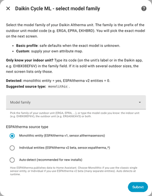](images/setup/01-family.png) | [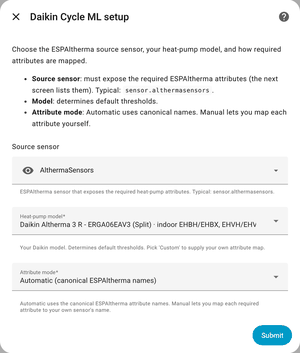](images/setup/02-model.png) | [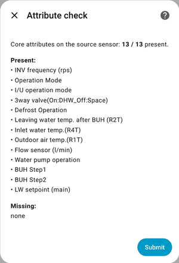](images/setup/03-attributes.png) |

1. **Model family.** Pick the family of your outdoor unit, or **type any
   code you know**: the indoor unit (`EHBX08EF6V`), the outdoor unit
   (`ERGA06EAV3`), both, or just family and size (`ERGA06`). An indoor size
   sold with several outdoor units narrows the next list to those. Leave it
   empty for the basic profile. The source type is detected for you.

   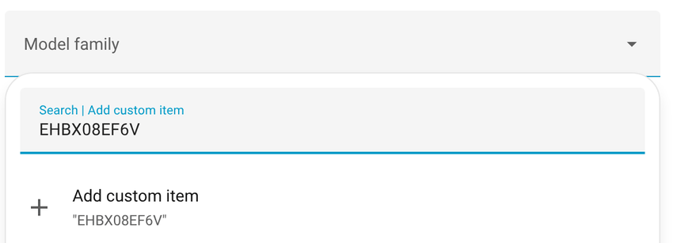

2. **Sensor and model.** The ESPAltherma sensor, your exact model (the list
   names the indoor units sold with each) and the attribute mode. Pick
   *Manual* only when your firmware uses names the integration does not
   know; *Custom* lets you enter your own heat-pump data.
3. **Attribute check.** What was found and what is missing. A missing value
   is listed again later as a repair; only values the cycle detector needs
   stop the setup.

| 4. Cycle detection | 5. Pendulum thresholds | 6. Quality thresholds |
|---|---|---|
| [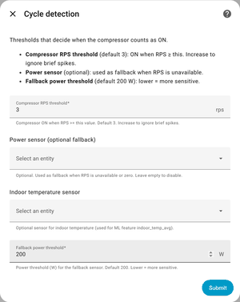](images/setup/04-cycle.png) | [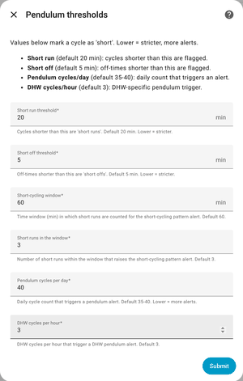](images/setup/05-pendulum.png) | [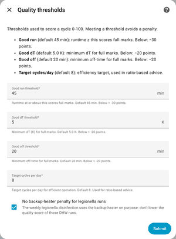](images/setup/06-quality.png) |

4. **Cycle detection.** When the compressor counts as running (default
   3 rps), an optional power sensor as fallback start signal and an
   optional room temperature sensor.
5. **Pendulum thresholds.** What counts as a short run (20 min) or a short
   pause (5 min), and how many cycles per day or hot-water cycles per hour
   raise an alert.
6. **Quality thresholds.** What a good run, ΔT and pause look like for the
   0-100 quality score of each cycle.

| 7. Notifications | 8. Confirm | 9. Done |
|---|---|---|
| [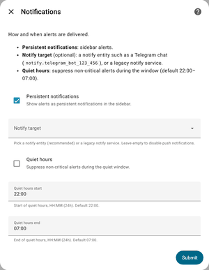](images/setup/07-notifications.png) | [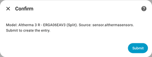](images/setup/08-confirm.png) | [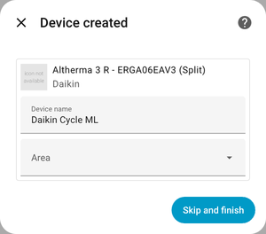](images/setup/09-done.png) |

7. **Notifications.** Sidebar notifications, an optional notify entity
   (for example a Telegram bot or the mobile app) and quiet hours.
8. **Confirm** and **9. Done.** The device shows your model; pick an area
   if you like.

The defaults suit most installations: tune them after a week with data
([§6](#6-first-week)). ESPAltherma v2 users get two extra screens (entity
prefix and a review of what was found). Every screen and option is
described in [Configuration §3](CONFIGURATION.md#3-setup-wizard).

## 3. Changing settings later

**Settings → Devices & services → Daikin Cycle ML → Configure** opens the
options menu: sensors and detection, pendulum, quality and ML,
notifications (including a test button for every alert), maintenance, COP
calculation and your model profile.

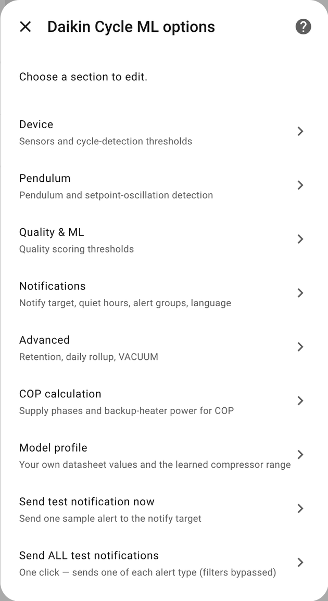

**Reconfigure** (⋮ menu) changes the source sensor or model without
removing the integration. See [Configuration §4](CONFIGURATION.md).

## 4. First hour

**Within a minute:**

- `sensor.daikin_cycle_ml_source_health` below 30 s;
- `binary_sensor.daikin_cycle_ml_source_stale` and
  `binary_sensor.daikin_cycle_ml_missing_attributes` off.

**Within an hour:**

- `sensor.daikin_cycle_ml_cycle_state` switches between `idle` and
  `running` with the compressor;
- `sensor.daikin_cycle_ml_current_cycle` shows the run in progress;
- `sensor.daikin_cycle_ml_cycles_today` counts the first closed cycle.

**Nothing happens?** Check that the compressor really runs
(`sensor.daikin_cycle_ml_thermal_power_live` above 0), that the source is
fresh and complete (above), and that the compressor speed passes the
threshold (Configure → Device). More in
[Troubleshooting §3](TROUBLESHOOTING.md#3-cycle-detection).

**Add the native cards:** Add card → search *Daikin* → Daily summary,
Efficiency or Performance. They are served by the integration itself and
update with it.

## 5. First day

| Look at | Healthy |
|---|---|
| `sensor.daikin_cycle_ml_cycles_today` | 6-20 cycles; above 40 is heavy cycling |
| `sensor.daikin_cycle_ml_quality_today` | above 70; below 50 means something to fix |
| `sensor.daikin_cycle_ml_cop_today` | 2.5-5 for heating, depending on outdoor and water temperature |
| `sensor.daikin_cycle_ml_cop_vs_datasheet_pct` | around 0 % (compared with your datasheet at the same outdoor and water temperature) |
| `binary_sensor.daikin_cycle_ml_short_run`, `..._short_off`, `..._pendulum_hourly` | off most of the day |

`sensor.daikin_cycle_ml_heating_curve_advice` needs some days of heating
in several outdoor bands. Its states are `keep`, `lower_lwt`, `raise_lwt`
and `no_data`; the `reason` attribute says why (for example `buh_active`,
`within_deadband`, `room_warm_enough`). The Efficiency card shows the same
advice with its comfort guard.

## 6. First week

**Too many cycling alerts?** Configure → Pendulum: raise
`pendulum_cycles_per_hour` (default 4) or `short_run_threshold_min`
(default 20). Or switch alert groups off under Notifications. All
defaults are listed in [`cycle-thresholds.json`](cycle-thresholds.json).

**Comfort guard of the curve advice:** Configure → Device:
`comfort_min_c` (default 20 °C) and `comfort_max_c` (24 °C). The advice
never lowers the water temperature while the room is below the minimum.

**Phone notifications:** Configure → Notifications → Delivery: pick a
notify entity; set quiet hours (critical alerts still come through).

**Learned values:** after about 20 cycles per mode the ML baseline starts
scoring; learned thresholds and clusters fill in over the week (k-means
runs on Sunday 04:00). See [Machine Learning](ML.md).

**Something looks off?** The diagnostics file shows what the integration
sees: **Download** or **Copy** at the bottom of a native card
([what is in it](DIAGNOSTICS.md)).

## 7. Hybrid and bivalent systems

**Altherma R Hybrid** (EVLQ05CV3 / EVLQ08CV3 with the EHYHBH / EHYHBX
hydrobox and a gas boiler) uses ESPAltherma's `ALTHERMA(HYBRID).h`. Boiler
periods are kept out of the heat-pump COP, a boiler run does not count as a
short heat-pump cycle, and three sensors and two binary sensors show the
boiler share (unavailable on other installs). The hybrid profile's own
spellings (`Outlet Water Heat Exch. Temp. (R1T)`, ...) are read
automatically.

**Any heat pump with an external boiler:** enable ESPAltherma's
`Bivalent Operation` (plus `Boiler Operation Demand` / `Boiler DHW Demand`).
When the source publishes it, boiler periods get the same handling. See
[Configuration §6.4](CONFIGURATION.md#64-bivalent-and-no-hot-water-tank).
