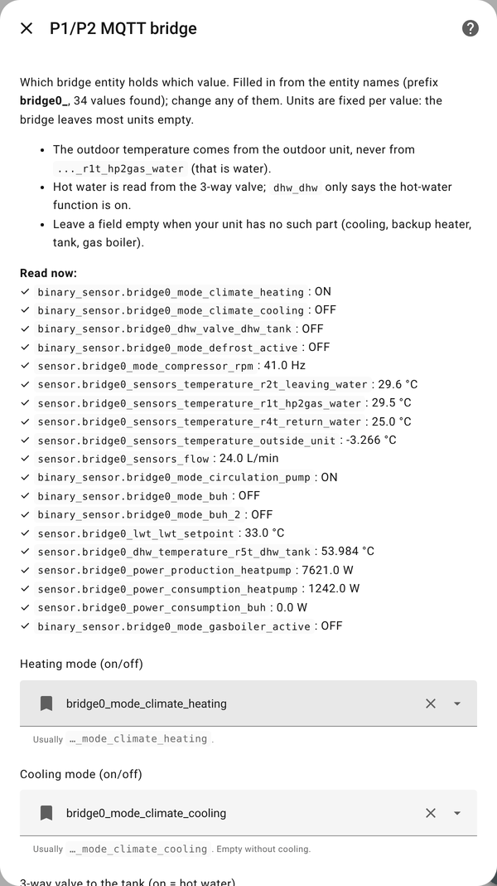

# P1/P2 MQTT bridge

Daikin Cycle ML can read your heat pump through the
[P1/P2 MQTT bridge](https://github.com/Arnold-n/P1P2MQTT) by
[Arnold Niessen](https://github.com/Arnold-n) instead of ESPAltherma. The
bridge sits on the P1/P2 bus (the room-thermostat wires) and publishes every
value as its own Home Assistant entity. Everything works the same:
cycles, COP, alerts, ML, cards and reports.

Setup in [🇳🇱 Nederlands](setup/nl.md#p1p2-mqtt-bridge) ·
[🇫🇷 Français](setup/fr.md#pont-mqtt-p1p2).

## Contents

- [1. What you need](#1-what-you-need)
- [2. Setup](#2-setup)
- [3. Which entity is which value](#3-which-entity-is-which-value)
- [4. Hybrid and bivalent](#4-hybrid-and-bivalent)
- [5. Field settings](#5-field-settings)
- [6. Troubleshooting](#6-troubleshooting)
- [7. Thanks](#7-thanks)

## 1. What you need

- A P1/P2 MQTT bridge connected to the P1/P2 bus of your Daikin indoor
  unit, with Home Assistant MQTT discovery on (the bridge's default).
- The bridge's entities in Home Assistant, with any prefix (`bridge0_`,
  `hc_`, ...). Several prefixes on one bridge are fine.
- Recommended: turn on the bridge's counter requests
  (`switch.<prefix>_bridge_counter_request_function`). The energy and
  running-hour counters and the field settings stay `unavailable` until it
  is on.
- No ESPAltherma. If you have both on one heat pump, choose one of them in
  the setup.

## 2. Setup

**Settings → Devices & services → Add integration → Daikin Cycle ML.**

1. **First screen:** type your model (for example `EPRA12EAV3` or
   `EVLQ08CV3`) and pick **P1/P2 MQTT bridge** as data source. When a bridge
   is found and no ESPAltherma, it is already selected.
2. **P1/P2 MQTT bridge:** the entities are filled in from their names, with
   the value read now. Check them, change any, leave a field empty when your
   unit has no such part (cooling, backup heater, tank, gas boiler), then
   **Submit**.
3. **Model and the other screens** as in [Getting started](GETTING_STARTED.md#2-the-setup-wizard);
   no ESPAltherma sensor is asked for.

To change the map later: **Reconfigure → full wizard**.

## 3. Which entity is which value

Entities are recognised by the end of their name, whatever the prefix.

| Value | Bridge entity (ending) | Notes |
|---|---|---|
| Heating / cooling mode | `mode_climate_heating`, `mode_climate_cooling` | |
| Hot water | `dhw_valve_dhw_tank` (3-way valve) | `dhw_dhw` only says the hot-water function is on: it reads on while heating |
| Defrost | `mode_defrost_active` | Not `15_param_defrost_active_param15` |
| Compressor | `mode_compressor_rpm` | Hz, although the name says rpm |
| Leaving water | `sensors_temperature_r2t_leaving_water` | |
| Leaving water before the backup heater | `sensors_temperature_r1t_hp2gas_water` | Water, never the outdoor temperature |
| Return water | `sensors_temperature_r4t_return_water` | `r9t_return_water` only when R4T is missing, never 0.000 |
| Outdoor temperature | `sensors_temperature_outside_unit` | Then `sensors_temperature_outside` (external sensor) |
| Flow | `sensors_flow` | l/min |
| Pump, backup heater 1 / 2 | `mode_circulation_pump`, `mode_buh`, `mode_buh_2` | Not `mode_buh_on` (a setting) |
| Leaving-water setpoint | `lwt_lwt_setpoint` | |
| Tank | `dhw_temperature_r5t_dhw_tank` | Below −20 °C = no tank |
| Heat and electrical power | `power_production_heatpump`, `power_consumption_heatpump` + `power_consumption_buh` | W, measured by the bridge |
| Gas boiler | `mode_gasboiler_active` | Not `power_production_gasboiler` (not reliable on its own) |

Units are fixed per value: the bridge leaves most units empty, so they are
never read from the entity.

**COP.** Your own power meter wins (Configure → Device → Sensors); else the
bridge's measured power, with its heat output. Diagnostics show the
bridge's own COP (`COP_Realtime`) next to the one the integration computes,
under `coordinator.source_resolution`.

## 4. Hybrid and bivalent

- **Altherma hybrid (EVLQ + gas boiler):** choose the EVLQ model. The
  boiler is read from `mode_gasboiler_active`: heating with the 3-way valve
  off, hot water with it on. Boiler periods stay out of the heat pump's
  COP.
- **No Daikin tank** (tank sensor about −40 °C, or field setting E-06 off,
  as on a hybrid whose gas boiler makes the hot water): the 3-way valve is
  ignored and no hot-water runs are expected.
- **Other units with an external boiler:** field setting C-02 (external
  backup) at 1 or more turns on the bivalent handling (see
  [Configuration](CONFIGURATION.md)).

## 5. Field settings

The bridge reads the installer's settings (heating curve, leaving-water
limits, target ΔT, tank, bivalent temperatures, unit type, ...). Daikin
Cycle ML reads them every 10 minutes and shows them in diagnostics and in
the `hp_specs` sensor attributes (`installer_settings`,
`installer_target_dt_k`). They never change your own settings.

## 6. Troubleshooting

| Symptom | Check |
|---|---|
| *P1/P2 MQTT bridge* not suggested | The bridge entities exist in Home Assistant (MQTT integration, discovery on) |
| A field stays empty | The entity has another name: pick it from the list |
| *R1T on the bridge is water temperature* | Pick the outdoor unit's temperature (`…_temperature_outside_unit`) |
| No cycles, `missing_attributes` on | The bridge is offline (all entities `unavailable`), or a required value is not mapped |
| Energy counters / field settings `unavailable` | Turn on `switch.<prefix>_bridge_counter_request_function` |
| Hot-water runs on a unit without tank | Set Configure → Advanced → *Hot-water tank* to *never* |

Diagnostics (**Download** at the bottom of any native card) show the map,
values left out and why, and the field settings.

## 7. Thanks

To Arnold Niessen for the P1/P2 MQTT bridge and for providing one to
develop and test this support, and to the users who shared the entity lists
of their monobloc and hybrid installations
([#309](https://github.com/elRadix/daikin_cycle_ml/issues/309),
[#512](https://github.com/elRadix/daikin_cycle_ml/issues/512)).
