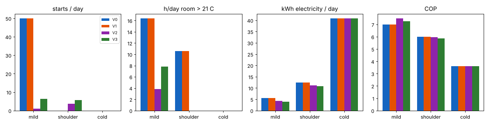
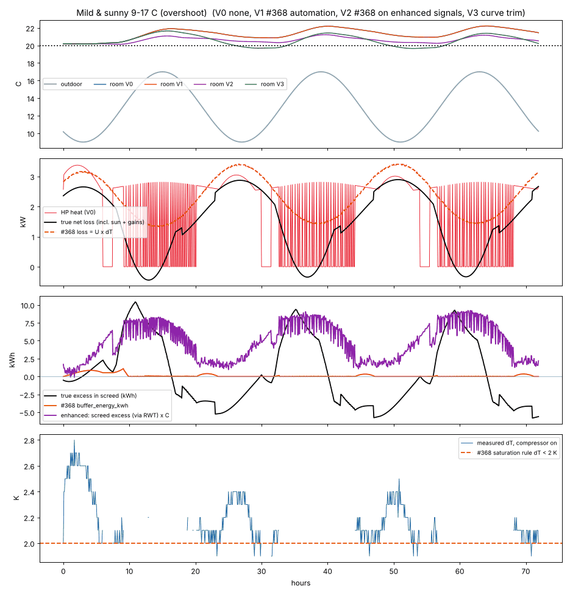
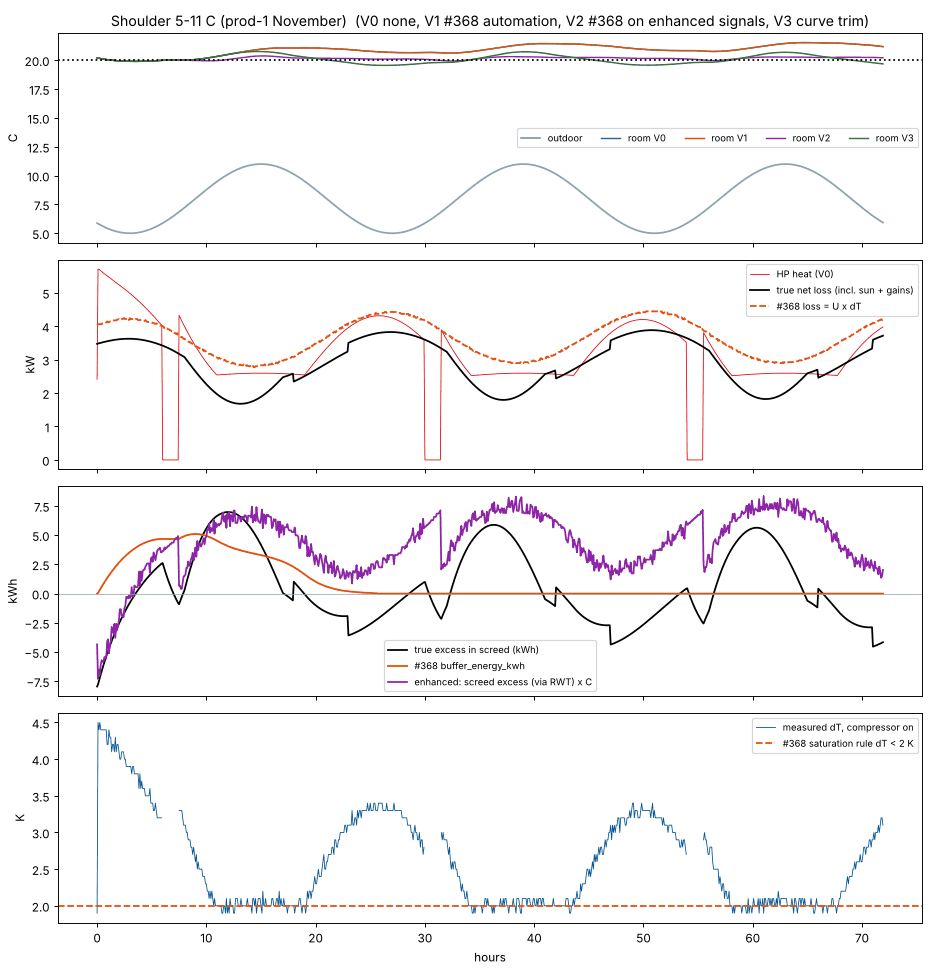
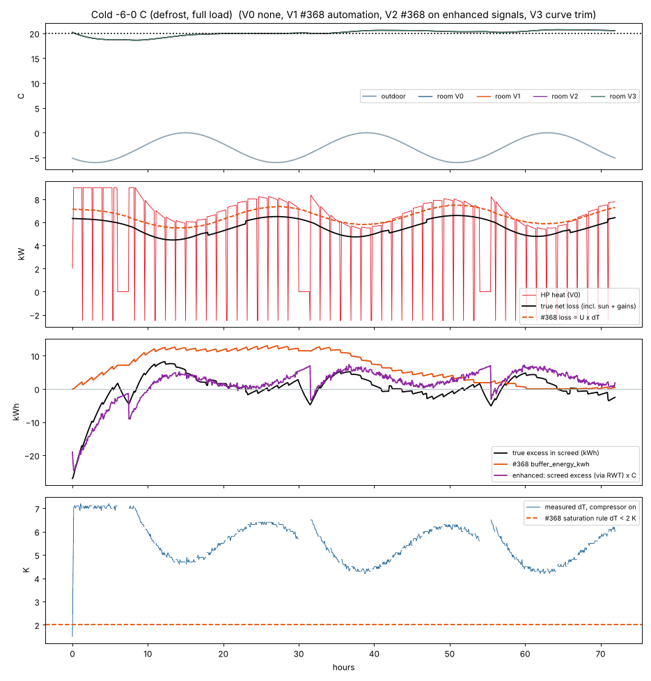

# #368 Energy Balance & Floor Buffer: simulation (Phase 2)

Feasibility study for issue #368 (Universal Energy Balance Engine and
Adaptive Floor Buffer). Tool: `tools/sim_energy_balance.py`; results:
`img/sim368_results.json`.

## Model

Two-node house (floor screed + room) heated by a modulating heat pump on a
weather curve, calibrated to prod-1 (ETVX12S23 12 kW, underfloor heating,
v1.23.3 diagnostics of 2026-11-19):

| Quantity | Value | Source |
|---|---|---|
| Minimum modulation | 2.55 kW at 16 rps, 9.6 °C | prod-1 live point |
| Weather curve | 28.6 °C at 9.6 °C, floor 25 °C | prod-1 LW setpoint |
| Flow / ΔT at minimum | 18.3 l/min / 2.1 K | prod-1 |
| House loss coefficient | 260 W/K + 250 W internal gains | fitted to the live point |
| Emitter (water → room) | 388 W/K (pipe 1100, floor 600 W/K) | fitted to LWT 29.6 / RWT 27.5 |
| Screed | 4 kWh/K, time constant 6.7 h | 120 m², 6 cm |
| COP | 0.612 × Carnot | fitted to prod-1's COP per bucket |
| True turnover point | 9.3 °C | from the above |

Ticks every 30 s like the coordinator. Measurements are rounded like the
sensors (0.1 K, indoor 0.1 °C). DHW 06:00–07:30, defrost below 4 °C.

## Scenarios and variants

Three weather cases, three days each, after 20 days of learning:
**mild** 9–17 °C sunny, **shoulder** 5–11 °C, **cold** −6–0 °C.

| Variant | Control |
|---|---|
| V0 | Weather curve only (#368 scope 2), no automation |
| V1 | #368 automation as specified: −5 K on `floor_buffer_saturated` (dT < 2 K), restore on `floor_buffer_empty` |
| V2 | Same automation on the enhanced signals (screed temperature via RWT) |
| V3 | Advisory curve trim above the learned turnover point (−1 K steps, room-guarded) |

## Results

| Case | Var | Starts/day | Compressor h/day | kWh el/day | COP | Room h > 21 °C |
|---|---|---|---|---|---|---|
| mild | V0 | 50.0 | 14.1 | 5.61 | 7.00 | 16.4 |
| mild | V1 | 50.0 | 14.1 | 5.61 | 7.00 | 16.4 |
| mild | V2 | 1.0 | 10.7 | 4.26 | 7.50 | 3.8 |
| mild | V3 | 6.3 | 10.1 | 3.99 | 7.26 | 7.8 |
| shoulder | V0 | 0.0 | 22.5 | 12.37 | 6.00 | 10.6 |
| shoulder | V1 | 0.0 | 22.5 | 12.37 | 6.00 | 10.6 |
| shoulder | V2 | 3.7 | 17.5 | 11.18 | 5.97 | 0.0 |
| shoulder | V3 | 5.7 | 17.1 | 10.87 | 5.86 | 0.0 |
| cold | V0–V3 | 0.0 | 22.5 | 40.88 | 3.61 | 0.0 |

## Findings

1. **The `dT < 2 K` saturation rule measures flow, not the floor.** At
   minimum modulation ΔT = P_min / (flow · c_p): with prod-1's 18.3 l/min
   that is about 2.0 K. Share of compressor time below 2 K: 0 % at 12 and
   15 l/min, 2 % at 18.3, 80 % at 22, 93 % at 25 l/min. V1 never acts.
2. **The running buffer integral has no anchor.** Clamped at 0 and fed with
   U × ΔT that ignores gains, it stays near 0 (correlation with the true
   stored energy −0.4 … 0.4).
3. **U through the origin ignores gains.** Learned 282 W/K (true 260); the
   balance status agrees with reality 27–30 % of the time (sun reads as
   underproduction).
4. **"Lowest hourly power per bracket" is demand, not P_min, below the
   turnover point** (7.4 kW at −6 °C). The turnover estimate swings between
   −6 °C and 22 °C; learning P_min only from hours at minimum compressor
   speed gives 10.2 °C (true 9.3 °C).
5. **The concept works with better signals.** V2 (screed temperature from
   the return water while the pump runs) on mild days:
   - starts drop from 50 to 1 per day;
   - room above 21 °C drops from 16.4 to 3.8 h/day;
   - electricity drops 24 % (5.61 → 4.26 kWh/day);
   - COP rises from 7.0 to 7.5.

   On shoulder days it removes all overshoot and saves 10 %. The cold case
   stays untouched (OAT < 3 °C lock).
6. **prod-1 runs a room thermostat** (RT setpoint 20 °C). With it the model
   reproduces prod-1's single long pauses on mild days (3.7 starts,
   7.9 compressor h/day). #368 scope 2 excludes this control mode: it
   applies to weather-curve-only installations.

The enhanced screed signal follows the true stored energy (r = 0.6–0.9) but
with an offset of a few kWh. Its threshold therefore has to be learned per
house, from the room-temperature response.
