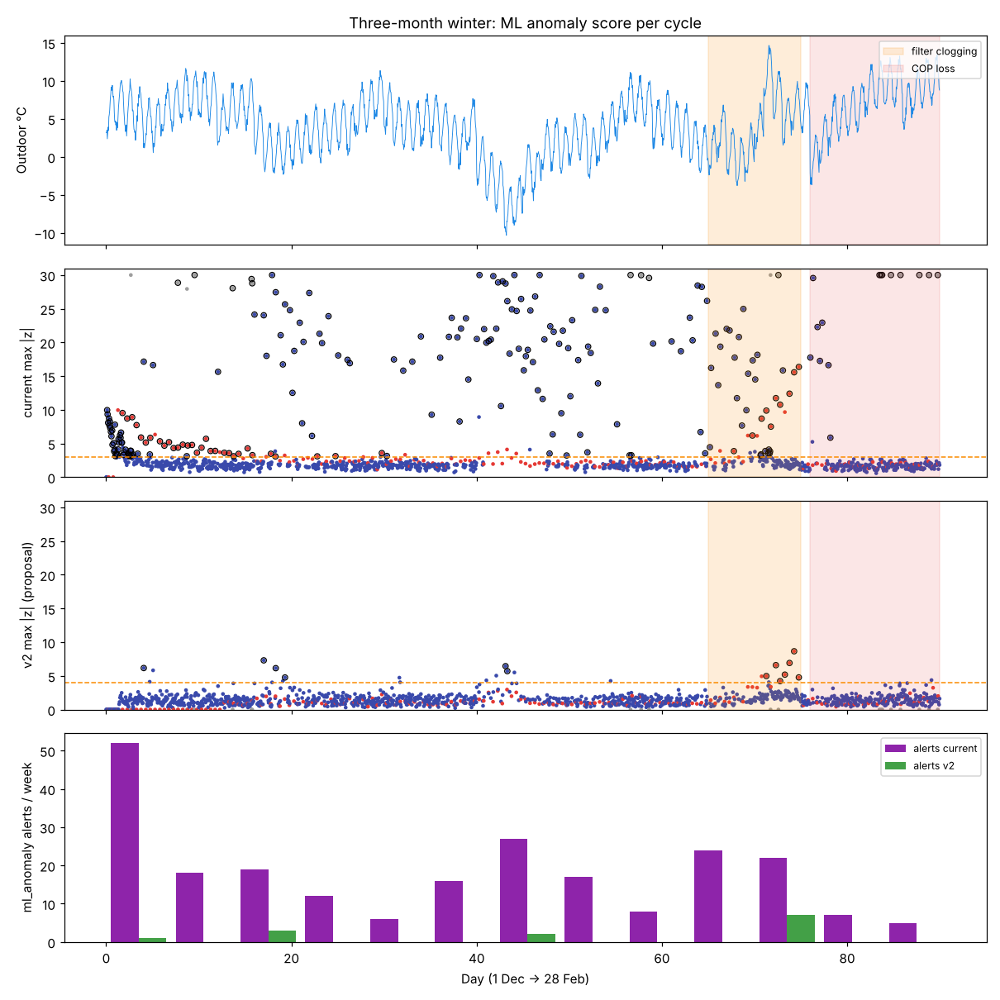
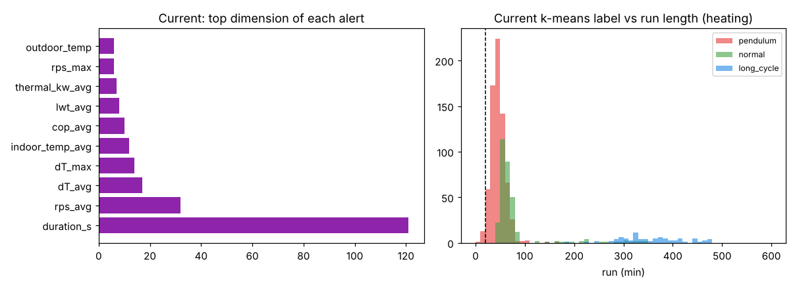

# ML pipeline: three-month winter simulation

Review of the ML layer (`ml/` + `engine/anomaly_engine.py`), checked with a
simulation of 1 December to 28 February. Tool: `tools/sim_ml_winter.py`;
results: `img/sim_ml_winter_results.json`.

## Setup

The tool generates the cycles of an 8 kW split heat pump in a typical
Dutch / Belgian house and feeds them through the integration's **own
code**, in the order of `coordinator._process_new_cycle`:

| Code | Use |
|---|---|
| `coordinator._classify_transient` | False starts are not learned |
| `ml.multi_baseline.MultiBaseline` + `engine.anomaly_engine.evaluate` | `ml_anomaly` alert, 60 min dedup |
| `ml.adaptive_thresholds.AdaptiveThresholds` | Learned short-run / off / cycles-per-day |
| `ml.clustering.kmeans` + `classify_clusters` + `nearest_centroid` | Weekly clusters (last 7 days), label per cycle |
| `engine.quality_scorer.score_cycle` | Quality per cycle |

The simulated house and weather:

| Quantity | Value |
|---|---|
| Heat loss / internal gains | 150 W/K / 400 W |
| Outdoor temperature | mean 4.2 °C, cold snap to −10 °C in week 6 (10–16 Jan), mild spell 10–14 Feb |
| Behaviour | Modulates down to 2.3 kW, then cycles; DHW 06:30 and 18:15 |
| Defrosts | Most frequent around +1 °C |
| False starts | On mild restarts |
| Data volume | 1,403 cycles (15.6 per day), 180 DHW runs, 20 false starts |

Two faults are injected to score the alerts:
- **Filter clogging, 4–13 Feb:** flow falls from 17 to 10 l/min, so ΔT rises by 70 %.
- **Slow COP loss, 15–28 Feb:** the COP falls by 15 %.

## Findings

### 1. `ml_anomaly` fires about 19 times a week on a healthy heat pump

| | Current | v2 (proposal below) |
|---|---|---|
| Alerts in 90 days | 233 | 13 |
| Alerts per week, no fault | **19.3** | **0.6** |
| Alerts in week 1 | 52 | 1 |
| Alerts on false starts | 17 | 0 |
| Filter fault: alerts / first alert after | 36 / day 0 (buried in noise) | 7 / day 6 |
| COP loss: alerts | 15 (indistinguishable from noise) | 0 (a COP-degradation job, see 7) |

The causes, in order of impact:

- **a. Cold start:**
  - The EWMA (`alpha` 0.01) starts with variance 0. After *n* cycles its variance is roughly `alpha·n` times the true variance, so after 10 cycles the std is about a third of the truth.
  - Every z-score is therefore inflated about 3× for the first ~100 cycles of each mode. 17 of the first 20 heating cycles and 16 of the first 20 DHW cycles raise an alert.
  - DHW (2 cycles a day) needs about 7 weeks to settle.
- **b. Outlier lock:**
  - From cycle 20 on, a cycle with |z| > 5 is not learned. Because the std is still too small at that point (see a), long but normal runs are rejected, and 141 updates are skipped.
  - The variance of `duration_s` never grows: its std ends at 14 min, while heating runs normally range from 30 min to 8 h.
  - Every long run on a cold day then raises an alert. `duration_s` is the top dimension in **121 of 233** alerts.
- **c. Raw duration:** run length is skewed (log-normal); a z-score on seconds treats a 6 h run as a fault.
- **d. Context and binary features are scored too:**
  - `outdoor_temp` is the weather, not the heat pump.
  - `indoor_temp_avg` is the room.
  - `buh_used` and `defrost_used` are 0/1 with a tiny variance.
  - A cold snap or the first defrost of the season therefore reads as an anomaly. Within the 12-dimension max, 12 tests per cycle multiply false positives.
- **e. False starts are scored:** they are kept out of the baseline (#105) but still evaluated against it, and a 90 s run is always an outlier, so 17 alerts are about a cycle the integration already classifies as expected.

### 2. "pendulum" cluster label is relative, not absolute

`classify_clusters` names the cluster with the shortest mean duration "pendulum", whatever that duration is.
- In this winter the shortest centroid is 34–47 min, so **852 cycles are labelled pendulum and 838 of them run 20 min or longer**; only 15 real short runs exist.
- The #436 reporter's diagnostics show the same: a 48 min centroid is labelled `pendulum`.
- `sensor.last_cycle.cluster` therefore says "pendulum" for most normal cycles.

### 3. k-means trains on other vectors than it assigns

- **Different inputs:** `async_run_kmeans` builds vectors from DB rows (`extract_many`). The `cycles` table has no `lwt_avg` or `indoor_temp_avg` column, so these two dimensions are 0 in training. `nearest_centroid` then assigns live vectors in which they are 30–50 °C and ~20 °C.
- **Mixed data:** training also mixes heating with DHW (12–14 DHW cycles per week) and includes false starts. The docstring says clustering finds sub-patterns "within a single mode".
- **No scaling:** features are not scaled, so `duration_s` (thousands of seconds) decides the clusters on its own.

### 4. Adaptive short-run threshold flags 20 % of cycles by design

`learn_short_run_min` is the p20 of run lengths: 38–39 min in this winter.
- If adaptive thresholds are enabled, one cycle in five is "short" by definition, however healthy the heat pump is.
- The learned `good_off` (p50) drops to 13 min.
- Adaptive thresholds are off by default (`adaptive_enabled: false`), so this affects only users who turn them on.

### 5. Other details

- **Self-inclusion:** `evaluate_anomaly` runs after `per_mode.update(vector)`, so a cycle is partly compared with itself (small with `alpha` 0.01, but z = 0 for the first cycle of a mode).
- **Unbounded history:** the adaptive history lists grow without bound (persisted in `model_state`), about 5,000 samples a year.

### 6. Quality score

- **Range:** the scores range from 70 to 100 for healthy cycles in this winter.
- **Penalties:** defrost and backup-heater penalties behave as specified (#421).
- **Fault weeks:** the injected faults barely move the score, which is expected because it scores cycle shape, not efficiency.

### 7. The COP loss is not an ML anomaly

- **v2:** a 15 % loss over two weeks is absorbed by any adaptive baseline, and v2 raises nothing for it.
- **Current code:** its 15 alerts cannot be told apart from the noise around them.
- **Where it belongs:** slow drift is the job of `cop_degradation` (weekly, weather-normalised), not of a per-cycle z-score.

## Proposal (v2, simulated above)

| Change | Effect |
|---|---|
| Unbiased warm-up: `alpha_eff = max(alpha, 1/n)`, alerts only after 25 cycles per baseline | No week-1 burst |
| Score behaviour only: `log(duration)`, `dT_avg`, `rps_avg`, `cop_avg`, `lwt_avg`, `thermal_kw_avg`; outdoor temperature as context, not as a dimension | Weather and defrosts no longer alert |
| Baseline per mode × outdoor band (4 K), falling back to the mode baseline until a band has 25 cycles | A cold-snap run is compared with cold-day runs |
| Std floor per dimension, Huber-clipped update instead of skipping outliers | No variance lock; real faults still stand out |
| Do not evaluate false starts | 17 alerts fewer |
| Alert on z ≥ 4 for 2 cycles in a row, or z ≥ 6 once | One odd cycle is not an alert |
| k-means per mode, on scaled behaviour dimensions, without false starts; vectors built the same way for training and assignment; "pendulum" only for runs below the short-run threshold | Labels mean what they say |
| Adaptive short-run: learn from the user's good-run threshold and the run-length distribution (e.g. p5, floored at half the configured value) instead of p20 | No built-in 20 % "short" rate |

Result in this winter: 13 alerts instead of 233, 0.6 per fault-free week, and the filter fault found after 6 days (7 alerts).

Two choices remain to tune on prod-1 data:
- **Detection speed vs noise:** a lower threshold (z ≥ 3.5) or a CUSUM on `dT_avg` finds the filter fault sooner at the cost of some noise.
- **Migration:** existing baselines (with locked variance) should be reset once.

## Reproduce

    python tools/sim_ml_winter.py --out docs/design/img

The tool runs on the integration's code at the checked-out version; the
weather, the house and the faults are in the tool (seed 7).
