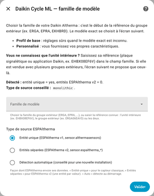
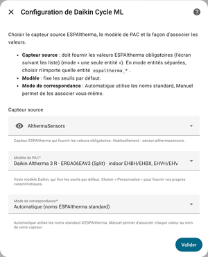
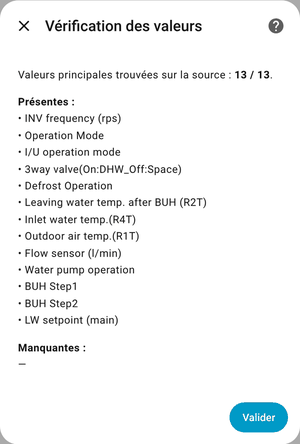
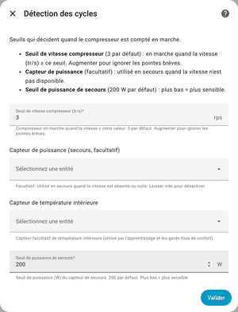
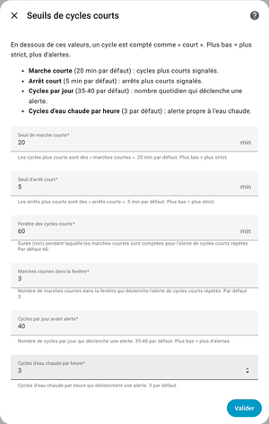
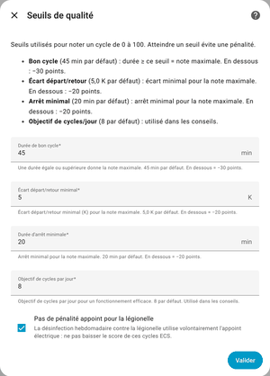
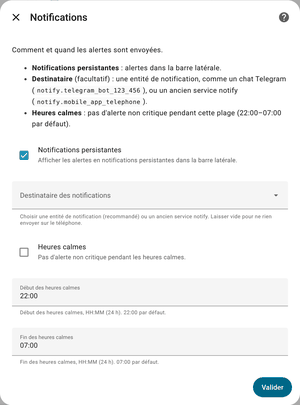
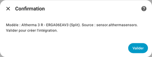
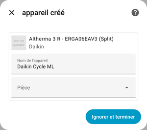
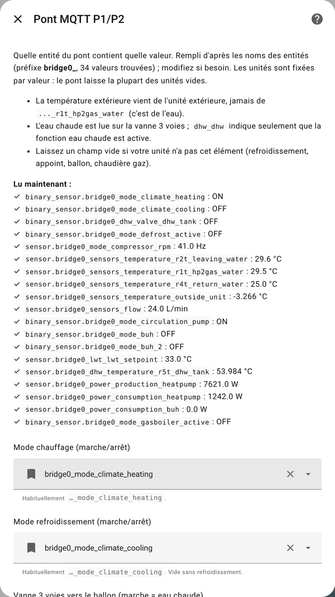

# Installer Daikin Cycle ML

Du capteur ESPAltherma aux premiers chiffres utiles. Le reste de la
documentation est en anglais ; l'intégration, les cartes et les alertes
existent aussi en français.

🇬🇧 [English](../GETTING_STARTED.md) · 🇳🇱 [Nederlands](nl.md) · 🇫🇷 Français

## Sommaire

- [1. Ce qu'il faut](#1-ce-quil-faut)
- [2. Installation](#2-installation)
- [3. L'assistant de configuration](#3-lassistant-de-configuration)
- [4. La première heure](#4-la-première-heure)
- [5. Les cartes](#5-les-cartes)
- [6. Aide](#6-aide)

## 1. Ce qu'il faut

- **Home Assistant** 2026.9 ou plus récent, avec **HACS** ;
- **ESPAltherma** qui lit votre pompe à chaleur : le capteur unique
  classique (v1, en général `sensor.althermasensors` avec toutes les valeurs
  en attributs) ou les entités séparées d'ESPAltherma v2
  (`sensor.espaltherma_*`) ;
- **ou** le [pont MQTT P1/P2](https://github.com/Arnold-n/P1P2MQTT) sur le
  bus P1/P2, sans ESPAltherma : voir [Pont MQTT P1/P2](#pont-mqtt-p1p2)
  (le tableau ci-dessous ne concerne qu'ESPAltherma).

Les fichiers de définition d'ESPAltherma sont des modèles : la plupart des
valeurs sont en commentaire. Activez au moins celles-ci, puis redémarrez la
carte ESP :

| Valeur | Utilisée pour |
|---|---|
| `Operation Mode`, `I/U operation mode` | Chauffage, rafraîchissement, eau chaude |
| `Defrost Operation` | Dégivrages |
| `Leaving water temp. after BUH (R2T)` | Température de départ (R1T avant l'appoint est lue d'abord si elle existe) |
| `Inlet water temp.(R4T)` | Retour, ΔT, chaleur produite |
| `Outdoor air temp.(R1T)` | Température extérieure |
| `Flow sensor (l/min)` | Chaleur produite |
| `Water pump operation`, `BUH Step1`, `BUH Step2`, `LW setpoint (main)` | Pompe, appoint électrique, consigne (pas nécessaires à la détection des cycles) |

Conseillées : `INV frequency (rps)` (vitesse du compresseur),
`Leaving water temp. before BUH (R1T)`, `3way valve(On:DHW_Off:Space)` (inutile
sans ballon) et `DHW tank temp. (R5T)`. Les noms varient selon le modèle et
le firmware ; l'intégration connaît toutes les variantes. Vérifiez ce que
publie votre capteur dans **Outils de développement → États**.

## 2. Installation

1. **HACS → Intégrations →** cherchez **Daikin Cycle ML** → **Télécharger**.
   Introuvable ? Ajoutez d'abord `https://github.com/elRadix/daikin_cycle_ml`
   comme dépôt personnalisé (catégorie *Intégration*).
2. **Redémarrez Home Assistant.**
3. **Paramètres → Appareils et services → Ajouter une intégration →
   Daikin Cycle ML.**

## 3. L'assistant de configuration

Touchez une capture pour l'écran complet.

| 1. Famille de modèle | 2. Capteur et modèle | 3. Vérification |
|---|---|---|
|  |  |  |

1. **Famille de modèle.** Choisissez la famille de votre groupe extérieur,
   ou **saisissez une référence connue** : l'unité intérieure
   (`EHBX08EF6V`), le groupe extérieur (`ERGA06EAV3`), les deux, ou famille
   et puissance (`ERGA06`). Si l'unité intérieure est vendue avec plusieurs
   groupes extérieurs, l'écran suivant ne propose que ceux-là. Vide = profil
   de base. Le type de source est détecté pour vous.
2. **Capteur et modèle.** Le capteur ESPAltherma, votre modèle exact (la
   liste nomme les unités intérieures associées) et le mode de
   correspondance. Choisissez *Manuel* seulement si votre firmware utilise
   des noms que l'intégration ne connaît pas.
3. **Vérification des valeurs.** Ce qui a été trouvé et ce qui manque. Une
   valeur manquante revient plus tard comme réparation ; seules les valeurs
   nécessaires à la détection des cycles bloquent l'installation.

| 4. Détection des cycles | 5. Cycles courts | 6. Seuils de qualité |
|---|---|---|
|  |  |  |

4. **Détection des cycles.** À partir de quelle vitesse le compresseur
   compte comme en marche (3 tr/s par défaut), un capteur de puissance et un
   capteur de température intérieure facultatifs.
5. **Cycles courts.** Ce qu'est une marche courte (20 min) ou un arrêt
   court (5 min), et à partir de combien de cycles par jour ou de cycles
   d'eau chaude par heure une alerte part.
6. **Seuils de qualité.** Ce qu'est une bonne marche, un bon ΔT et un bon
   arrêt pour la note de qualité (0-100) de chaque cycle.

| 7. Notifications | 8. Confirmation | 9. Terminé |
|---|---|---|
|  |  |  |

7. **Notifications.** Notifications dans la barre latérale, une entité de
   notification facultative (par exemple un bot Telegram ou l'application
   mobile) et des heures calmes.
8. **Confirmation** et **9. terminé.** L'appareil affiche votre modèle ;
   choisissez une pièce si vous voulez.

Les valeurs par défaut conviennent à la plupart des installations : ajustez
après une semaine de données. Plus tard : **Paramètres → Appareils et
services → Daikin Cycle ML → Configurer**. Chaque écran et chaque option :
[Configuration](../CONFIGURATION.md) (en anglais).

### Pont MQTT P1/P2

Avec le pont MQTT P1/P2 d'Arnold Niessen (sans ESPAltherma) :

1. Sur le premier écran, choisissez votre modèle et la source **Pont MQTT
   P1/P2**. Si un pont est trouvé et pas d'ESPAltherma, elle est déjà
   sélectionnée.
2. L'écran suivant montre quelle entité du pont contient quelle valeur,
   rempli d'après les noms, avec la valeur actuelle. Vérifiez, modifiez si
   besoin et laissez un champ vide si votre unité n'a pas cet élément
   (refroidissement, appoint, ballon, chaudière gaz).
3. L'assistant continue ensuite comme ci-dessus, sans capteur ESPAltherma.

Activez les compteurs du pont (`switch.<préfixe>_bridge_counter_request_function`)
pour recevoir aussi les compteurs d'énergie et les réglages sur site. Tout
sur le pont : [P1/P2 MQTT bridge](../P1P2.md) (en anglais).

## 4. La première heure

**En une minute :**

- `sensor.daikin_cycle_ml_fraicheur_de_la_source` sous 30 s ;
- `binary_sensor.daikin_cycle_ml_source_muette` et
  `binary_sensor.daikin_cycle_ml_valeurs_manquantes` sur arrêt.

**En une heure :** l'état du cycle passe de `idle` à `running` avec le
compresseur, et le nombre de cycles du jour compte le premier cycle
terminé.

**Rien ne se passe ?** Le compresseur tourne-t-il vraiment (puissance
thermique au-dessus de 0) ? La vitesse dépasse-t-elle le seuil
(Configurer → Appareil) ? La source est-elle fraîche et complète
(ci-dessus) ? Plus : [Troubleshooting](../TROUBLESHOOTING.md) (en anglais).

Les identifiants d'entité suivent la langue de Home Assistant ; cherchez
par la fin de l'identifiant si un exemple ne correspond pas.

## 5. Les cartes

Trois cartes fournies par l'intégration elle-même, sans cartes frontend
HACS : **Ajouter une carte → cherchez *Daikin*** → Daily summary,
Efficiency ou Performance. Elles suivent la langue de Home Assistant
(français compris) et le mode sombre. Après une mise à jour, actualisez le
navigateur une fois (`Ctrl`+`Shift`+`R` ; dans l'application : tirer vers
le bas). [Aperçu des cartes](../../dashboard/README.md) (en anglais).

## 6. Aide

- En bas de chaque carte : **Diagnostic pour un rapport de bug →
  Télécharger** ou **Copier** ; joignez le fichier à une
  [issue](https://github.com/elRadix/daikin_cycle_ml/issues/new/choose).
- Questions : [discussions](https://github.com/elRadix/daikin_cycle_ml/discussions).
- [FAQ](../FAQ.md) (en anglais).
