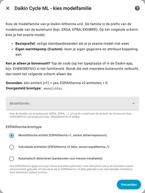
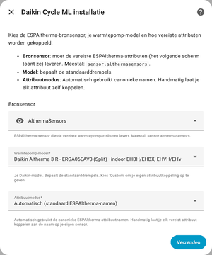
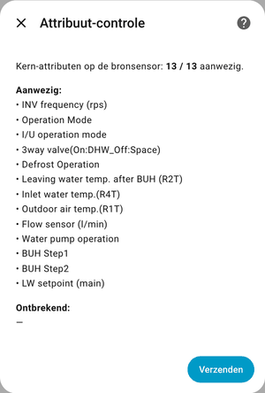
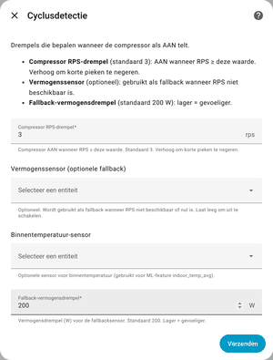
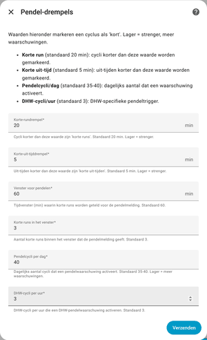
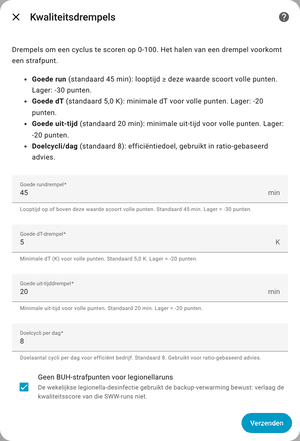
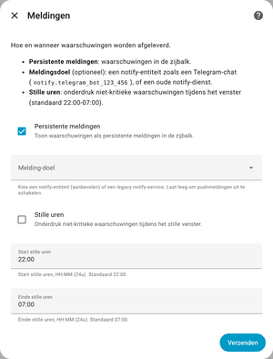
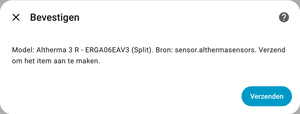
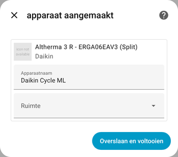
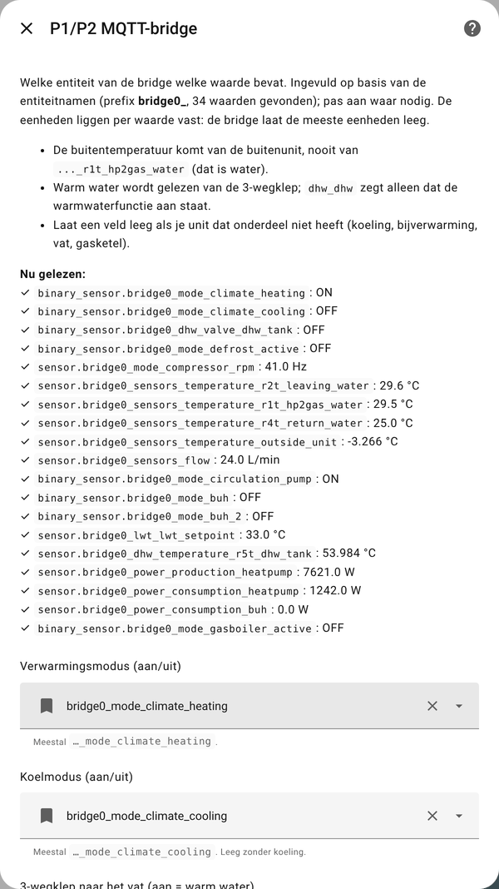

# Daikin Cycle ML installeren

Van ESPAltherma-sensor tot de eerste bruikbare cijfers. De rest van de
documentatie is in het Engels; de integratie, de kaarten en de meldingen
zijn ook in het Nederlands.

🇬🇧 [English](../GETTING_STARTED.md) · 🇳🇱 Nederlands · 🇫🇷 [Français](fr.md)

## Inhoud

- [1. Wat je nodig hebt](#1-wat-je-nodig-hebt)
- [2. Installeren](#2-installeren)
- [3. De installatiewizard](#3-de-installatiewizard)
- [4. Het eerste uur](#4-het-eerste-uur)
- [5. De kaarten](#5-de-kaarten)
- [6. Hulp](#6-hulp)

## 1. Wat je nodig hebt

- **Home Assistant** 2026.9 of nieuwer, met **HACS**;
- **ESPAltherma** die je warmtepomp uitleest: de klassieke ene sensor
  (v1, meestal `sensor.althermasensors` met alle waarden als attributen)
  of de losse entiteiten van ESPAltherma v2 (`sensor.espaltherma_*`);
- **of** de [P1/P2 MQTT-bridge](https://github.com/Arnold-n/P1P2MQTT) op de
  P1/P2-bus, zonder ESPAltherma: zie [P1/P2 MQTT-bridge](#p1p2-mqtt-bridge)
  (de tabel hieronder geldt alleen voor ESPAltherma).

De definitiebestanden van ESPAltherma zijn sjablonen: de meeste waarden
staan uitgecommentarieerd. Zet minstens deze aan en herstart het ESP-bord:

| Waarde | Waarvoor |
|---|---|
| `Operation Mode`, `I/U operation mode` | Verwarmen, koelen, warm water |
| `Defrost Operation` | Ontdooien |
| `Leaving water temp. after BUH (R2T)` | Aanvoertemperatuur (R1T vóór de bijverwarming wordt eerst gelezen als die er is) |
| `Inlet water temp.(R4T)` | Retourtemperatuur, ΔT, warmteafgifte |
| `Outdoor air temp.(R1T)` | Buitentemperatuur |
| `Flow sensor (l/min)` | Warmteafgifte |
| `Water pump operation`, `BUH Step1`, `BUH Step2`, `LW setpoint (main)` | Pomp, bijverwarming, setpoint (niet nodig voor de cyclusdetectie) |

Aanbevolen: `INV frequency (rps)` (compressortoerental),
`Leaving water temp. before BUH (R1T)`, `3way valve(On:DHW_Off:Space)` (niet
nodig zonder boiler) en `DHW tank temp. (R5T)`. Namen verschillen per model
en firmware; de integratie kent alle varianten. Controleer wat je sensor
publiceert in **Ontwikkelhulpmiddelen → Statussen**.

## 2. Installeren

1. **HACS → Integraties →** zoek **Daikin Cycle ML** → **Downloaden**. Niet
   gevonden? Voeg eerst `https://github.com/elRadix/daikin_cycle_ml` toe als
   aangepaste repository (categorie *Integratie*).
2. **Herstart Home Assistant.**
3. **Instellingen → Apparaten & diensten → Integratie toevoegen →
   Daikin Cycle ML.**

## 3. De installatiewizard

Tik op een schermafbeelding voor het volledige scherm.

| 1. Modelfamilie | 2. Sensor en model | 3. Attribuutcontrole |
|---|---|---|
|  |  |  |

1. **Modelfamilie.** Kies de familie van je buitenunit, of **typ een code
   die je kent**: de binnenunit (`EHBX08EF6V`), de buitenunit
   (`ERGA06EAV3`), allebei, of familie en vermogen (`ERGA06`). Wordt een
   binnenunit met meerdere buitenunits verkocht, dan toont het volgende
   scherm alleen die. Leeg laten = basisprofiel. Het brontype wordt voor je
   herkend.
2. **Sensor en model.** De ESPAltherma-sensor, je exacte model (de lijst
   noemt de binnenunits die erbij horen) en de attribuutmodus. Kies
   *Handmatig* alleen als je firmware namen gebruikt die de integratie niet
   kent.
3. **Attribuutcontrole.** Wat er gevonden is en wat ontbreekt. Een
   ontbrekende waarde komt later terug als reparatiemelding; alleen
   waarden die de cyclusdetectie nodig heeft houden de installatie tegen.

| 4. Cyclusdetectie | 5. Pendeldrempels | 6. Kwaliteitsdrempels |
|---|---|---|
|  |  |  |

4. **Cyclusdetectie.** Vanaf welk toerental de compressor als draaiend
   telt (standaard 3 rps), een optionele vermogenssensor en een optionele
   kamertemperatuursensor.
5. **Pendeldrempels.** Wat een korte run (20 min) of korte pauze (5 min) is
   en vanaf hoeveel cycli per dag of warmwatercycli per uur je een melding
   krijgt.
6. **Kwaliteitsdrempels.** Hoe een goede run, ΔT en pauze eruitzien voor
   de kwaliteitsscore (0-100) van elke cyclus.

| 7. Meldingen | 8. Bevestigen | 9. Klaar |
|---|---|---|
|  |  |  |

7. **Meldingen.** Meldingen in de zijbalk, een optionele notify-entiteit
   (bijvoorbeeld een Telegram-bot of de mobiele app) en stille uren.
8. **Bevestigen** en **9. klaar.** Het apparaat toont je model; kies
   eventueel een ruimte.

De standaardwaarden passen bij de meeste installaties: stel ze bij na een
week met gegevens. Later aanpassen: **Instellingen → Apparaten & diensten →
Daikin Cycle ML → Configureren**. Elk scherm en elke optie:
[Configuration](../CONFIGURATION.md) (Engels).

### P1/P2 MQTT-bridge

Met de P1/P2 MQTT-bridge van Arnold Niessen (geen ESPAltherma nodig):

1. Kies op het eerste scherm je model en als gegevensbron **P1/P2
   MQTT-bridge**. Wordt er een bridge gevonden en geen ESPAltherma, dan
   staat die al geselecteerd.
2. Het volgende scherm toont welke entiteit van de bridge welke waarde
   bevat, ingevuld op basis van de namen, met de waarde van nu. Controleer,
   pas aan waar nodig en laat een veld leeg als je unit dat onderdeel niet
   heeft (koeling, bijverwarming, vat, gasketel).
3. Daarna gaat de wizard verder zoals hierboven, zonder ESPAltherma-sensor.

Zet in de bridge de tellers aan (`switch.<prefix>_bridge_counter_request_function`),
dan komen ook de energietellers en de veldinstellingen binnen. Alles over
de bridge: [P1/P2 MQTT bridge](../P1P2.md) (Engels).

## 4. Het eerste uur

**Binnen een minuut:**

- `sensor.daikin_cycle_ml_bron_gezondheid` onder 30 s;
- `binary_sensor.daikin_cycle_ml_bron_verouderd` en
  `binary_sensor.daikin_cycle_ml_ontbrekende_attributen` uit.

**Binnen een uur:** de cyclusstatus wisselt tussen `idle` en `running` met
de compressor, en het aantal cycli van vandaag telt de eerste afgesloten
cyclus.

**Gebeurt er niets?** Draait de compressor echt (thermisch vermogen boven
0)? Komt het toerental boven de drempel (Configureren → Apparaat)? Is de
bron vers en volledig (zie hierboven)? Meer:
[Troubleshooting](../TROUBLESHOOTING.md) (Engels).

Entiteit-id's volgen de taal van Home Assistant; zoek op het einde van de
id als een voorbeeld niet overeenkomt.

## 5. De kaarten

Drie kaarten die de integratie zelf levert, zonder HACS-frontendkaarten:
**Kaart toevoegen → zoek *Daikin*** → Daily summary, Efficiency of
Performance. Ze volgen de taal van Home Assistant (Nederlands inbegrepen)
en de donkere modus. Na een update ververs je de browser één keer
(`Ctrl`+`Shift`+`R`; in de app: naar beneden trekken).
[Overzicht van de kaarten](../../dashboard/README.md) (Engels).

## 6. Hulp

- Onderaan elke kaart: **Diagnose voor een foutmelding → Downloaden** of
  **Kopiëren**; voeg het bestand toe aan een
  [issue](https://github.com/elRadix/daikin_cycle_ml/issues/new/choose).
- Vragen: [discussies](https://github.com/elRadix/daikin_cycle_ml/discussions)
  of het ESPAltherma-topic op Tweakers.
- [FAQ](../FAQ.md) (Engels).
